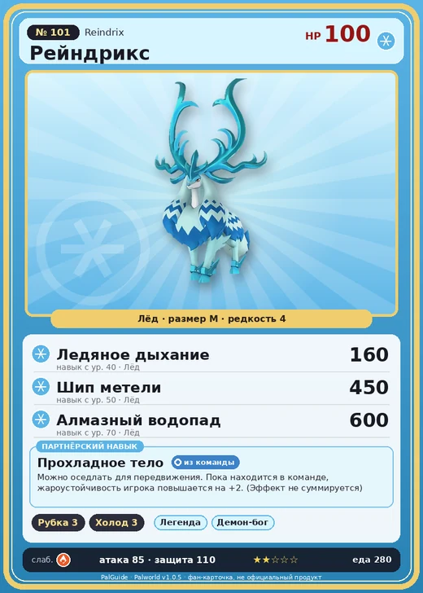

# #101 Рейндрикс (Reindrix)

№ 101

Лёд

Слабость: Огонь

🪓 Рубка деревьев <b>3</b>❄️ Охлаждение <b>3</b>

<b>Прохладное тело</b> 🎒 из команды 🐎 верхом

❤️ 100 · ⚔️ 85 · 🛡 110

| Поле | Значение |
|---|---|
| Стихия | Лёд |
| Слабость (кто бьёт сильнее) | Огонь |
| Редкость | 4 |
| Размер | M |
| HP / Атака / Защита (база вида) | 100 / 85 / 110 |
| Сколько ест | 280 |
| Цена продажи | 1464 |
| Множитель поимки | ×1 |
| Скорость рывка верхом | 1070 |

=== "Обзор"

    #### Работа на базе
    - Рубка деревьев — ур. 3
    - Охлаждение — ур. 3

    #### Партнёрский навык: Прохладное тело
    Можно оседлать для передвижения. Пока находится в команде, жароустойчивость игрока повышается на +2 . (Эффект не суммируется) Технологии 31 level value 1 TemperatureResist_Heat2_PartnerSkill 2 Пробуждение : 2 TemperatureResist_Heat2_PartnerSkill 2 MoveSpeed_up_PartnerSkill_Ride_1 10 Пробуждение : (Скорость передвижения верхом: +10% ) 3 TemperatureResist_Heat2_PartnerSkill 2 MoveSpeed_up_PartnerSkill_Ride_2 12 Пробуждение : (Скорость передвижения верхом: +12% ) 4 TemperatureResist_Heat2_PartnerSkill 2 MoveSpeed_up_PartnerSkill_Ride_3 15 Пробуждение : (Скорость передвижения верхом: +15% ) 5 TemperatureResist_Heat2_PartnerSkill 2 MoveSpeed_up_PartnerSkill_Ride_4 20 Пробуждение : (Скорость передвижения верхом: +20% )

    #### Чем хорош / чем плох
    - ✅ можно оседлать
    - ❌ явных минусов нет

    > Прозрачно-синий рог сияет холодом абсолютного нуля. Стоит только дотронуться до него голой рукой — и всё тело мгновенно покроется льдом, а вы вместе с жизнью рассыплетесь вдребезги.

    См. также: [Стихии](../../guide/06_stihii.md) · [Разведение](../../guide/07_razvedenie.md) · [Все палы](README.md)

=== "Атаки"

    #### Атаки по уровням
    - ур. 1: Воздушная пушка (Нейтральный, сила 40)
    - ур. 7: Ледяная ракета (Лёд, сила 40)
    - ур. 15: Ледяной резак (Лёд, сила 80)
    - ур. 22: Натиск ледяных рогов (Лёд, сила 120)
    - ур. 30: Айсберг (Лёд, сила 120)
    - ур. 40: Ледяное дыхание (Лёд, сила 160)
    - ур. 50: Шип метели (Лёд, сила 450)
    - ур. 70: Алмазный водопад (Лёд, сила 600)

=== "Где живёт"

    #### Где водится
    - В дикой природе: да; точек появления днём: 64, ночью: 64; уровни в первых точках: 32–36
    - Подземелья: Пещера Священной Горы
    - Яйцо: Яйцо льда

=== "Дроп"

    #### Дроп
    - Мясо Рейндрикса — 2 шт., 100%
    - Кожа — 1 шт., 100%
    - Рог — 2 шт., 100%
    - Ледяной орган — 2–3 шт., 100%

    **Дроп альфы:**
    - Деталь древней цивилизации — 6–8 шт., 100%
    - Ценный мех — 6–8 шт., 100%

=== "Разведение"

    #### Разведение
    - Ранг разведения (CombiRank): 1930
    - Участвует в особых парах: Кингпака → Кингпака Крист

=== "Пассивки"

    #### Лучшие пассивки по роли
    - боец: Легенда, Демон-бог, Хладнокровный, Бессмертие, Император льда (вместо Бессмертия, если нет мутации)
    - рабочий: Дьявольские руки, Виртуоз, Мастеровитый, Небожитель/Трудоголик
    - ездовой: Божественная скорость, Легенда, Вечный двигатель, Небесное скольжение

<a class="card-link" href="../needoll_noct/">← Нидолл Нокт</a><a class="card-link" href="../mossanda/">Моссанда →</a>

