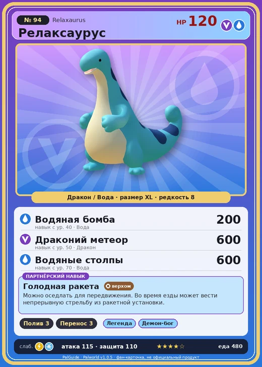

# Релаксаурус

<canvas id="fx"></canvas>

№ 94

ДраконВода

Слабость: Молния <b class="mx">×1,5</b>Лёд <b class="mx">×1,5</b> <button class="hlp" data-tip="Множители перемножаются по обеим стихиям: ×1,5 за стихию, которую атака бьёт, ×0,65 за ту, что её держит. Молния: 1 × 1,5 = ×1,5; Лёд: 1,5 × 1 = ×1,5.">?</button>

Устойчив: Огонь <b class="mx">×0,65</b>Тьма <b class="mx">×0,65</b>

💧 Полив <b>3</b>📦 Транспортировка <b>3</b>

<b>Голодная ракета</b> 🐎 Верхом

❤️ 120 · ⚔️ 115 · 🛡 110

Основное

💎Редкость <button class="hlp" data-tip="Чем выше число, тем реже встречается пал. 1–4 — обычные, 5–7 — редкие, 8+ — легендарные.">?</button><b>8</b>

📏Размер<b>XL</b>

💰Цена продажи <button class="hlp" data-tip="Сколько золота даст торговец за пала.">?</button><b>2365</b>

Бой

🎯Множитель поимки <button class="hlp" data-tip="Насколько легче или труднее поймать: ×1 — обычно, меньше — сложнее.">?</button><b>×1</b>

🐎Скорость рывка верхом <button class="hlp" data-tip="Скорость, если сесть на пала и бежать рывком.">?</button><b>1000</b>

Ферма и еда

🍖Сколько ест <button class="hlp" data-tip="Сколько сытости пал тратит — чем больше, тем больше еды нужно на базе.">?</button><b>480</b>

Разведение

🧬Сила разведения <button class="hlp" data-tip="Скрытое число игры: у детёныша оно примерно среднее от родителей. Чем меньше — тем «сильнее» пал.">?</button><b>1090</b>

=== "Обзор"

    #### Работа на базе

    
💧 Полив<i style="--v:30%"></i><b>3</b>📦 Транспортировка<i style="--v:30%"></i><b>3</b>

    #### Партнёрский навык: Голодная ракета
    Можно оседлать для передвижения. Во время езды может вести непрерывную стрельбу из ракетной установки. Технологии 45.

    #### Чем хорош / чем плох
    - ✅ Высокий урон драконом в средней игре; хорошая атака (115); много здоровья (120); можно оседлать
    - ❌ Ленивый, много ест

    > Вопреки расслабленному виду, на удивление свиреп. Всё, что попадает в поле зрения, воспринимает как еду — и пытается съесть добычу любой ценой.

    См. также: [Стихии](../../guide/06_stihii.md) · [Разведение](../../guide/07_razvedenie.md) · [Все палы](README.md)

=== "Атаки"

    #### Атаки по уровням
    - ур. 1: Драконья пушка (Дракон, сила 40)
    - ур. 7: Водяной выстрел (Вода, сила 50)
    - ур. 15: Драконий взрыв (Дракон, сила 80)
    - ур. 22: Пузырьковый выстрел (Вода, сила 80)
    - ур. 30: Дыхание дракона (Дракон, сила 160)
    - ур. 40: Водяная бомба (Вода, сила 200)
    - ур. 50: Драконий метеор (Дракон, сила 600)
    - ур. 70: Водяные столпы (Вода, сила 600)

=== "Где живёт"

    #### Где водится

    

<button data-k="d" class="on">☀️ День</button><button data-k="n">🌙 Ночь</button>

<button data-w=p class=on>Палпагос</button><button data-w=t>Мировое древо</button>

ур. 30–80<a class="btn hm-full" href="../../../map/?pal=LazyDragon">Показать на большой карте</a>

Бамбуковые рощиВыжженный холмЗелёный ручейИссохшие дюны

🥚 Яйцо<b>Огромное яйцо дракона</b>

🛒 Торговец<b>Продаётся у торговца палами</b>

=== "Дроп"

    #### Дроп
    - Качественное масло Пала — 1–4 шт., 100%
    - Рубин — 1 шт., 5%

    **Дроп альфы:**

    - Деталь древней цивилизации — 2–4 шт., 100%
    - Ценный драконий самоцвет — 2–4 шт., 100%

=== "Разведение"

    #### Разведение
    - Ранг разведения: 1090
    - Участвует в особых парах: [Спаркит](sparkit.md) → [Релаксаурус Лакс](relaxaurus_lux.md)

=== "Пассивки"

    #### Лучшие пассивки по роли

    

⚔️ Боец

максимум урона и живучести в бою

<a class="psv r-4" data-psv="Легенда" href="../../../passivki/legend/">Легенда</a><a class="psv r-4" data-psv="Демон-бог" href="../../../passivki/demon_god/">Демон-бог</a><a class="psv r-3" data-psv="Божественный дракон" href="../../../passivki/divine_dragon/">Божественный дракон</a><a class="psv r-3" data-psv="Хладнокровный" href="../../../passivki/serenity/">Хладнокровный</a>

🛠 Рабочий

работает быстрее и меньше устаёт на базе

<a class="psv r-5" data-psv="Дьявольские руки" href="../../../passivki/demons_hand/">Дьявольские руки</a><a class="psv r-4" data-psv="Виртуоз" href="../../../passivki/remarkable_craftsmanship/">Виртуоз</a><a class="psv r-3" data-psv="Мастеровитый" href="../../../passivki/artisan/">Мастеровитый</a><a class="psv r-3" data-psv="Трудоголик" href="../../../passivki/workaholic/">Трудоголик</a>

🐎 Ездовой

быстрее бегает или летает с тобой верхом

<a class="psv r-4" data-psv="Божественная скорость" href="../../../passivki/swift/">Божественная скорость</a><a class="psv r-4" data-psv="Легенда" href="../../../passivki/legend/">Легенда</a><a class="psv r-4" data-psv="Вечный двигатель" href="../../../passivki/eternal_engine/">Вечный двигатель</a><a class="psv r-4" data-psv="Небесное скольжение" href="../../../passivki/sky_strider/">Небесное скольжение</a>

    <small>Нажми на пассивку, чтобы узнать, что она даёт и где её взять.</small>

<a class="card-link" href="../pyrin_noct/">← Пирин Нокт</a><a class="card-link" href="../relaxaurus_lux/">Релаксаурус Лакс →</a>

