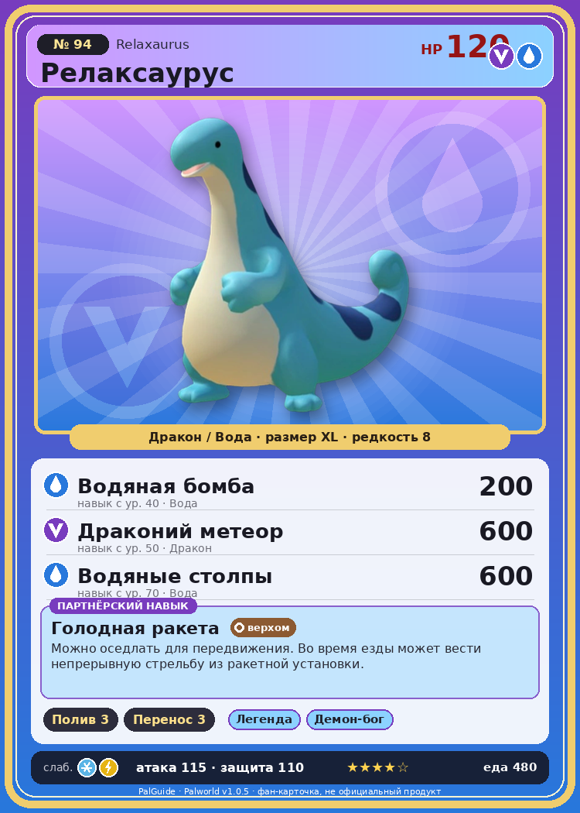

# #94 Релаксаурус (Relaxaurus)

{ width=360 }

| Поле | Значение |
|---|---|
| Стихия | Дракон, Вода |
| Слабость (кто бьёт сильнее) | Лёд, Молния |
| Редкость | 8 |
| Размер | XL |
| HP / Атака / Защита (база вида) | 120 / 115 / 110 |
| Сколько ест | 480 |
| Цена продажи | 2365 |
| Множитель поимки | ×1 |
| Скорость рывка верхом | 1000 |

## Работа на базе
- Полив — ур. 3
- Транспортировка — ур. 3

## Партнёрский навык: Голодная ракета
Можно оседлать для передвижения. Во время езды может вести непрерывную стрельбу из ракетной установки. Технологии 45 level value 1 MainValue 16 Пробуждение : 2 MainValue 17 Пробуждение : (Увеличение урона: Небольшое ) 3 MainValue 20 Пробуждение : (Увеличение урона: Среднее ) 4 MainValue 25 Пробуждение : (Увеличение урона: Большое ) 5 MainValue 31 Пробуждение : (Увеличение урона: Очень большое )

## Атаки по уровням
- ур. 1: Драконья пушка (Дракон, сила 40)
- ур. 7: Водяной выстрел (Вода, сила 50)
- ур. 15: Драконий взрыв (Дракон, сила 80)
- ур. 22: Пузырьковый выстрел (Вода, сила 80)
- ур. 30: Дыхание дракона (Дракон, сила 160)
- ур. 40: Водяная бомба (Вода, сила 200)
- ур. 50: Драконий метеор (Дракон, сила 600)
- ур. 70: Водяные столпы (Вода, сила 600)

## Где водится
- В дикой природе: да; точек появления днём: 38, ночью: 38; уровни в первых точках: 30–35
- Может продаваться у торговца/рекрутера
- Яйцо: Огромное яйцо дракона

## Дроп
- Качественное масло Пала — 1–4 шт., 100%
- Рубин — 1 шт., 5%

**Дроп альфы:**
- Деталь древней цивилизации — 2–4 шт., 100%
- Ценный драконий самоцвет — 2–4 шт., 100%

## Разведение
- Ранг разведения (CombiRank): 1090
- Участвует в особых парах: Спаркит → Релаксаурус Лакс

## Лучшие пассивки по роли
- по обзору: Легенда, Демон-бог, Хладнокровный, Божественный дракон
- боец: Легенда, Демон-бог, Хладнокровный, Бессмертие, Божественный дракон (вместо Бессмертия, если нет мутации)
- рабочий: Дьявольские руки, Виртуоз, Мастеровитый, Небожитель/Трудоголик
- ездовой: Божественная скорость, Легенда, Вечный двигатель, Небесное скольжение

## Чем хорош / чем плох
- ✅ Высокий урон драконом в средней игре; хорошая атака (115); много здоровья (120); можно оседлать
- ❌ Ленивый, много ест

> Вопреки расслабленному виду, на удивление свиреп. Всё, что попадает в поле зрения, воспринимает как еду — и пытается съесть добычу любой ценой.

См. также: [Стихии](../../2_mehaniki/stihii.md) · [Разведение](../../2_mehaniki/razvedenie.md) · [Все палы](README.md)
_Источник: paldb.cc v1.0.5_
