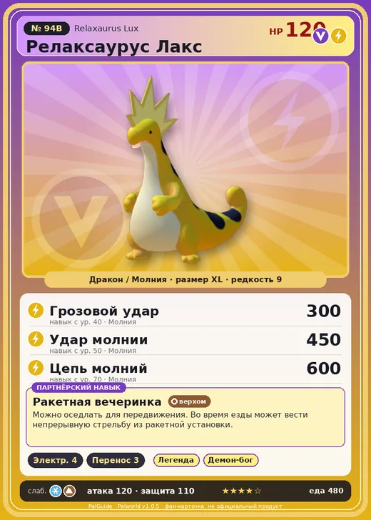

# #94B Релаксаурус Лакс (Relaxaurus Lux)

№ 94B

ДраконМолния

Слабость: ЗемляЛёд

⚡ Генерация энергии <b>4</b>📦 Транспортировка <b>3</b>

<b>Ракетная вечеринка</b> 🐎 верхом

❤️ 120 · ⚔️ 120 · 🛡 110

| Поле | Значение |
|---|---|
| Стихия | Дракон, Молния |
| Слабость (кто бьёт сильнее) | Земля, Лёд |
| Редкость | 9 |
| Размер | XL |
| HP / Атака / Защита (база вида) | 120 / 120 / 110 |
| Сколько ест | 480 |
| Цена продажи | 2685 |
| Множитель поимки | ×1 |
| Скорость рывка верхом | 1000 |

=== "Обзор"

    #### Работа на базе
    - Генерация энергии — ур. 4
    - Транспортировка — ур. 3

    #### Партнёрский навык: Ракетная вечеринка
    Можно оседлать для передвижения. Во время езды может вести непрерывную стрельбу из ракетной установки. Технологии 48.

    #### Чем хорош / чем плох
    - ✅ Молния+дракон; очень высокая атака (120); много здоровья (120); можно оседлать
    - ❌ Особая пара; разводится только особой парой

    > Релаксаурус однажды задумался: а не пора ли мне измениться? И в тот же миг его пронзил электрический разряд!

    См. также: [Стихии](../../guide/06_stihii.md) · [Разведение](../../guide/07_razvedenie.md) · [Все палы](README.md)

=== "Атаки"

    #### Атаки по уровням
    - ур. 1: Искровой выстрел (Молния, сила 50)
    - ур. 7: Драконья пушка (Дракон, сила 40)
    - ур. 15: Шоковая волна (Молния, сила 80)
    - ур. 22: Грозовая линия (Молния, сила 160)
    - ур. 30: Дыхание дракона (Дракон, сила 160)
    - ур. 40: Грозовой удар (Молния, сила 300)
    - ур. 50: Удар молнии (Молния, сила 450)
    - ур. 70: Цепь молний (Молния, сила 600)

=== "Где живёт"

    #### Где водится
    - В дикой природе: да; точек появления днём: 18, ночью: 18; уровни в первых точках: 48–49
    - Может продаваться у торговца/рекрутера
    - Яйцо: Огромное яйцо дракона

=== "Дроп"

    #### Дроп
    - Качественное масло Пала — 1–4 шт., 100%
    - Электрический орган — 2–3 шт., 100%
    - Сапфир — 1 шт., 5%

    **Дроп альфы:**
    - Деталь древней цивилизации — 3–5 шт., 100%
    - Ценный драконий самоцвет — 3–5 шт., 100%

=== "Разведение"

    #### Разведение
    - Ранг разведения (CombiRank): 770
    - **Особая пара:** [Релаксаурус](../../4_spravochniki/paly/relaxaurus.md) + [Спаркит](../../4_spravochniki/paly/sparkit.md)

=== "Пассивки"

    #### Лучшие пассивки по роли

    

⚔️ Боец

максимум урона и живучести в бою

<a class="psv r-4" data-psv="Легенда" href="../../../passivki/legend/">Легенда</a><a class="psv r-4" data-psv="Демон-бог" href="../../../passivki/demon_god/">Демон-бог</a><a class="psv r-3" data-psv="Божественный дракон" href="../../../passivki/divine_dragon/">Божественный дракон</a><a class="psv r-3" data-psv="Хладнокровный" href="../../../passivki/serenity/">Хладнокровный</a>

🛠 Рабочий

работает быстрее и меньше устаёт на базе

<a class="psv r-5" data-psv="Дьявольские руки" href="../../../passivki/demons_hand/">Дьявольские руки</a><a class="psv r-4" data-psv="Виртуоз" href="../../../passivki/remarkable_craftsmanship/">Виртуоз</a><a class="psv r-3" data-psv="Мастеровитый" href="../../../passivki/artisan/">Мастеровитый</a><a class="psv r-3" data-psv="Трудоголик" href="../../../passivki/workaholic/">Трудоголик</a>

🐎 Ездовой

быстрее бегает или летает с тобой верхом

<a class="psv r-4" data-psv="Божественная скорость" href="../../../passivki/swift/">Божественная скорость</a><a class="psv r-4" data-psv="Легенда" href="../../../passivki/legend/">Легенда</a><a class="psv r-4" data-psv="Вечный двигатель" href="../../../passivki/eternal_engine/">Вечный двигатель</a><a class="psv r-4" data-psv="Небесное скольжение" href="../../../passivki/sky_strider/">Небесное скольжение</a>

    <small>Нажми на пассивку, чтобы узнать, что она даёт и где её взять.</small>

<a class="card-link" href="../relaxaurus/">← Релаксаурус</a><a class="card-link" href="../foxcicle/">Фоксайкл →</a>

