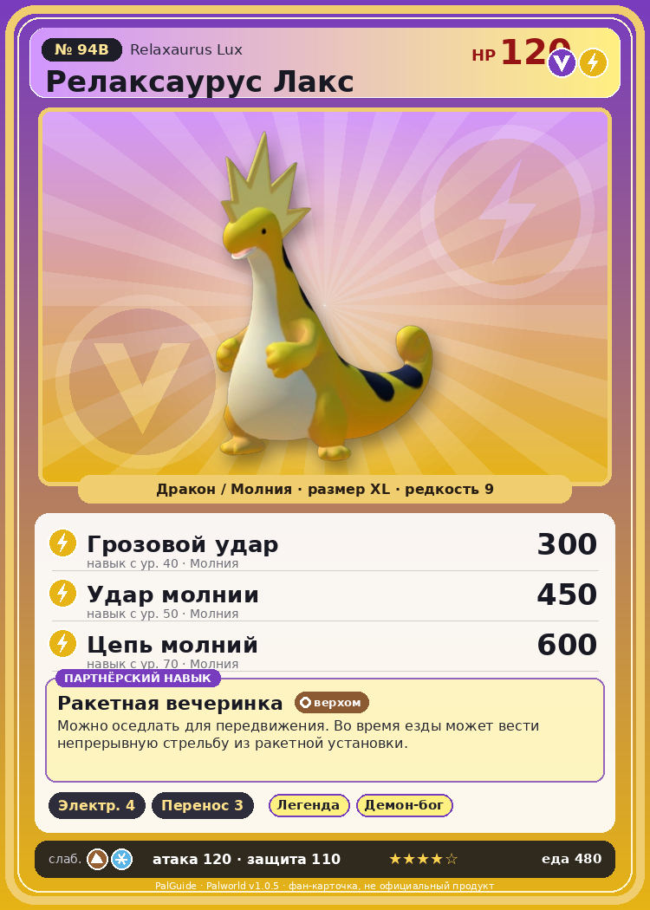

# #94B Релаксаурус Лакс (Relaxaurus Lux)

{ width=360 }

| Поле | Значение |
|---|---|
| Стихия | Дракон, Молния |
| Слабость (кто бьёт сильнее) | Земля, Лёд |
| Редкость | 9 |
| Размер | XL |
| HP / Атака / Защита (база вида) | 120 / 120 / 110 |
| Сколько ест | 480 |
| Цена продажи | 2685 |
| Множитель поимки | ×1 |
| Скорость рывка верхом | 1000 |

## Работа на базе
- Генерация энергии — ур. 4
- Транспортировка — ур. 3

## Партнёрский навык: Ракетная вечеринка
Можно оседлать для передвижения. Во время езды может вести непрерывную стрельбу из ракетной установки. Технологии 48 level value 1 MainValue 16 Пробуждение : 2 MainValue 17 Пробуждение : (Увеличение урона: Небольшое ) 3 MainValue 20 Пробуждение : (Увеличение урона: Среднее ) 4 MainValue 25 Пробуждение : (Увеличение урона: Большое ) 5 MainValue 31 Пробуждение : (Увеличение урона: Очень большое )

## Атаки по уровням
- ур. 1: Искровой выстрел (Молния, сила 50)
- ур. 7: Драконья пушка (Дракон, сила 40)
- ур. 15: Шоковая волна (Молния, сила 80)
- ур. 22: Грозовая линия (Молния, сила 160)
- ур. 30: Дыхание дракона (Дракон, сила 160)
- ур. 40: Грозовой удар (Молния, сила 300)
- ур. 50: Удар молнии (Молния, сила 450)
- ур. 70: Цепь молний (Молния, сила 600)

## Где водится
- В дикой природе: да; точек появления днём: 18, ночью: 18; уровни в первых точках: 48–49
- Может продаваться у торговца/рекрутера
- Яйцо: Огромное яйцо дракона

## Дроп
- Качественное масло Пала — 1–4 шт., 100%
- Электрический орган — 2–3 шт., 100%
- Сапфир — 1 шт., 5%

**Дроп альфы:**
- Деталь древней цивилизации — 3–5 шт., 100%
- Ценный драконий самоцвет — 3–5 шт., 100%

## Разведение
- Ранг разведения (CombiRank): 770
- **Особая пара:** [Релаксаурус](../../4_spravochniki/paly/relaxaurus.md) + [Спаркит](../../4_spravochniki/paly/sparkit.md)

## Лучшие пассивки по роли
- по обзору: Легенда, Демон-бог, Хладнокровный, Император молнии
- боец: Легенда, Демон-бог, Хладнокровный, Бессмертие, Божественный дракон (вместо Бессмертия, если нет мутации)
- рабочий: Дьявольские руки, Виртуоз, Мастеровитый, Небожитель/Трудоголик
- ездовой: Божественная скорость, Легенда, Вечный двигатель, Небесное скольжение

## Чем хорош / чем плох
- ✅ Молния+дракон; очень высокая атака (120); много здоровья (120); можно оседлать
- ❌ Особая пара; разводится только особой парой

> Релаксаурус однажды задумался: а не пора ли мне измениться? И в тот же миг его пронзил электрический разряд!

См. также: [Стихии](../../2_mehaniki/stihii.md) · [Разведение](../../2_mehaniki/razvedenie.md) · [Все палы](README.md)
_Источник: paldb.cc v1.0.5_
