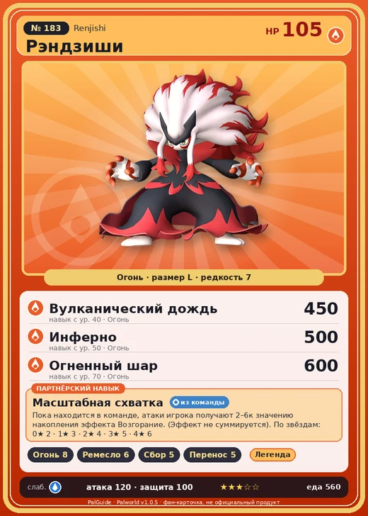

# #183 Рэндзиши (Renjishi)

#183 · Renjishi

Огонь

Слабость: Вода

🔥 Разжигание огня <b>8</b>🖐️ Ручная работа <b>6</b>🌾 Сбор <b>5</b>📦 Транспортировка <b>5</b>

<b>Масштабная схватка</b> 🎒 из команды

❤️ 105 · ⚔️ 120 · 🛡 100

| Поле | Значение |
|---|---|
| Стихия | Огонь |
| Слабость (кто бьёт сильнее) | Вода |
| Редкость | 7 |
| Размер | L |
| HP / Атака / Защита (база вида) | 105 / 120 / 100 |
| Сколько ест | 560 |
| Цена продажи | 4028 |
| Множитель поимки | ×1 |
| Скорость рывка верхом | 500 |

## Работа на базе
- Разжигание огня — ур. 8
- Ручная работа — ур. 6
- Сбор — ур. 5
- Транспортировка — ур. 5

## Партнёрский навык: Масштабная схватка
Пока находится в команде, атаки игрока получают (2~6) к значению накопления эффекта Возгорание . (Эффект не суммируется) level value 1 AdditionalEffect_Burn_PartnerSkill_KabukiMan 2 2 AdditionalEffect_Burn_PartnerSkill_KabukiMan 3 3 AdditionalEffect_Burn_PartnerSkill_KabukiMan 4 4 AdditionalEffect_Burn_PartnerSkill_KabukiMan 5 5 AdditionalEffect_Burn_PartnerSkill_KabukiMan 6

## Атаки по уровням
- ур. 1: Огненный выстрел (Огонь, сила 40)
- ур. 7: Расщеплённый огонь (Огонь, сила 80)
- ур. 15: Огненное дыхание (Огонь, сила 160)
- ур. 22: Огненная стена (Огонь, сила 250)
- ур. 30: Огненная воронка (Огонь, сила 300)
- ур. 40: Вулканический дождь (Огонь, сила 450)
- ур. 50: Инферно (Огонь, сила 500)
- ур. 70: Огненный шар (Огонь, сила 600)

## Где водится
- В дикой природе: нет/особый способ; точек появления днём: 0, ночью: 0
- Яйцо: Большое раскалённое яйцо

## Дроп
- Кожа — 2–3 шт., 100%
- Огненный орган — 2–3 шт., 100%

**Дроп альфы:**
- Деталь древней цивилизации — 7–9 шт., 100%
- Ценный мех — 2–3 шт., 100%

## Разведение
- Ранг разведения (CombiRank): 290

## Лучшие пассивки по роли
- по обзору: Мастеровитый, Виртуоз, Трудоголик, Аскет
- боец: Легенда, Демон-бог, Хладнокровный, Бессмертие, Император огня (вместо Бессмертия, если нет мутации)
- рабочий: Дьявольские руки, Виртуоз, Мастеровитый, Небожитель/Трудоголик
- ездовой: Божественная скорость, Легенда, Вечный двигатель, Небесное скольжение

## Чем хорош / чем плох
- ✅ Разжигание огня 8; очень высокая атака (120); отличный рабочий (пригодность 8); можно оседлать
- ❌ Поздний; много ест (560)

> Когда сталкивается с врагом, на первый взгляд движения кажутся чрезмерно театральными и полными уязвимостей. Однако, удивительно, противник оказывается подавленным и невольно залипает взглядом.

См. также: [Стихии](../../2_mehaniki/stihii.md) · [Разведение](../../2_mehaniki/razvedenie.md) · [Все палы](README.md)
