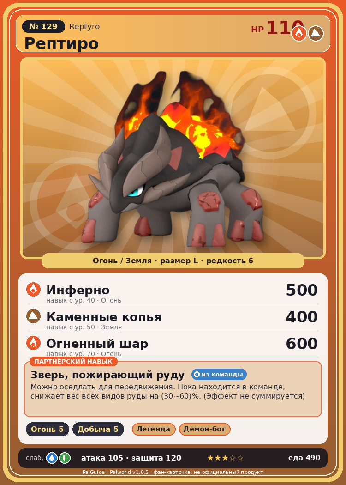

# #129 Рептиро (Reptyro)

{ width=360 }

| Поле | Значение |
|---|---|
| Стихия | Огонь, Земля |
| Слабость (кто бьёт сильнее) | Вода, Трава |
| Редкость | 6 |
| Размер | L |
| HP / Атака / Защита (база вида) | 110 / 105 / 120 |
| Сколько ест | 490 |
| Цена продажи | 2576 |
| Множитель поимки | ×1 |
| Скорость рывка верхом | 1000 |

## Работа на базе
- Разжигание огня — ур. 5
- Добыча — ур. 5

## Партнёрский навык: Зверь, пожирающий руду
Можно оседлать для передвижения. Пока находится в команде, снижает вес всех видов руды на (30~60)% . (Эффект не суммируется) Технологии 42 level value 1 ItemWeightReduction_PartnerSkill_VolcanicMonster 30 2 ItemWeightReduction_PartnerSkill_VolcanicMonster 35 3 ItemWeightReduction_PartnerSkill_VolcanicMonster 40 4 ItemWeightReduction_PartnerSkill_VolcanicMonster 50 5 ItemWeightReduction_PartnerSkill_VolcanicMonster 60

## Атаки по уровням
- ур. 1: Огненный выстрел (Огонь, сила 40)
- ур. 7: Каменный залп (Земля, сила 80)
- ур. 15: Камнемёт (Земля, сила 120)
- ур. 22: Огненное дыхание (Огонь, сила 160)
- ур. 30: Вулканический взрыв (Огонь, сила 300)
- ур. 40: Инферно (Огонь, сила 500)
- ур. 50: Каменные копья (Земля, сила 400)
- ур. 70: Огненный шар (Огонь, сила 600)

## Где водится
- В дикой природе: да; точек появления днём: 23, ночью: 23; уровни в первых точках: 46–48
- Подземелья: Пещера Вулкана
- Яйцо: Большое раскалённое яйцо

## Дроп
- Огненный орган — 5–7 шт., 100%

**Дроп альфы:**
- Деталь древней цивилизации — 3–5 шт., 100%
- Ценные внутренности — 3–5 шт., 100%

## Разведение
- Ранг разведения (CombiRank): 1060
- Участвует в особых парах: Фоксайкл → Рептиро Крист

## Лучшие пассивки по роли
- по обзору: Легенда, Божественная скорость
- боец: Легенда, Демон-бог, Хладнокровный, Бессмертие, Император огня (вместо Бессмертия, если нет мутации)
- рабочий: Дьявольские руки, Виртуоз, Мастеровитый, Небожитель/Трудоголик
- ездовой: Божественная скорость, Легенда, Вечный двигатель, Небесное скольжение

## Чем хорош / чем плох
- ✅ Снижает вес руды 30–60%; хорошая атака (105); крепкая защита (120); отличный рабочий (пригодность 5); можно оседлать
- ❌ явных минусов нет

> По всему телу этого Пала струится подобная магме кровь. Если вылить на него большое количество воды, она мигом нагреется, и произойдет чудовищный фреатический взрыв.

См. также: [Стихии](../../2_mehaniki/stihii.md) · [Разведение](../../2_mehaniki/razvedenie.md) · [Все палы](README.md)
_Источник: paldb.cc v1.0.5_
