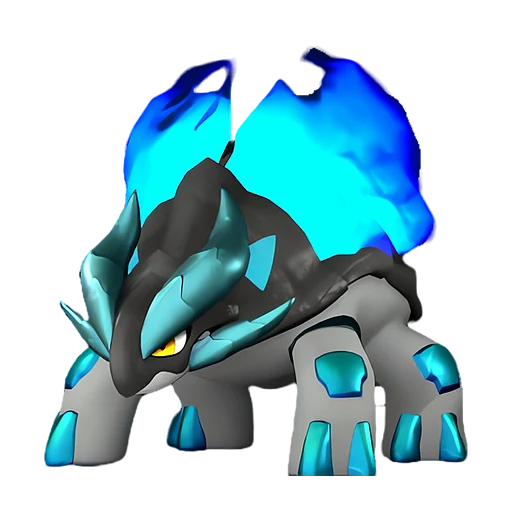

# Рептиро Крист

<canvas id="fx"></canvas>

№ 129B

ЛёдЗемля

Слабость: Огонь <b class="mx">×1,5</b>Трава <b class="mx">×1,5</b> <button class="hlp" data-tip="Множители перемножаются по обеим стихиям: ×1,5 за стихию, которую атака бьёт, ×0,65 за ту, что её держит. Огонь: 1,5 × 1 = ×1,5; Трава: 1 × 1,5 = ×1,5.">?</button>

Устойчив: Молния <b class="mx">×0,65</b>Дракон <b class="mx">×0,65</b>

⛏️ Добыча <b>5</b>❄️ Охлаждение <b>5</b>

<b>Зверь, пожирающий лёд</b> 🎒 Работает из команды🐎 Верхом

❤️ 110 · ⚔️ 105 · 🛡 130

Основное

💎Редкость <button class="hlp" data-tip="Чем выше число, тем реже встречается пал. 1–4 — обычные, 5–7 — редкие, 8+ — легендарные.">?</button><b>7</b>

📏Размер<b>L</b>

💰Цена продажи <button class="hlp" data-tip="Сколько золота даст торговец за пала.">?</button><b>2797</b>

Бой

🎯Множитель поимки <button class="hlp" data-tip="Насколько легче или труднее поймать: ×1 — обычно, меньше — сложнее.">?</button><b>×1</b>

🐎Скорость рывка верхом <button class="hlp" data-tip="Скорость, если сесть на пала и бежать рывком.">?</button><b>1000</b>

Ферма и еда

🍖Сколько ест <button class="hlp" data-tip="Сколько сытости пал тратит — чем больше, тем больше еды нужно на базе.">?</button><b>490</b>

Разведение

🧬Сила разведения <button class="hlp" data-tip="Скрытое число игры: у детёныша оно примерно среднее от родителей. Чем меньше — тем «сильнее» пал.">?</button><b>600</b>

💞Особая пара <button class="hlp" data-tip="Этого пала можно вывести только от этой пары.">?</button><b>Рептиро + Фоксайкл</b>

=== "Обзор"

    #### Работа на базе

    
<a class="wbar" href="../../../2_mehaniki/rabota/?w=mining&lv=5">⛏️ Добыча<i style="--v:50%"></i><b>5</b></a><a class="wbar" href="../../../2_mehaniki/rabota/?w=cooling&lv=5">❄️ Охлаждение<i style="--v:50%"></i><b>5</b></a><a class="wb-more" href="../../../2_mehaniki/rabota/">Что значат уровни работы →</a>

    #### Партнёрский навык: Зверь, пожирающий лёд
    Можно оседлать для передвижения. Пока находится в команде, снижает вес всех видов руды на 35–65%. (Эффект не суммируется) Технологии 43. По звёздам: 0★ 35 · 1★ 40 · 2★ 45 · 3★ 55 · 4★ 65

    #### Чем хорош / чем плох
    - ✅ Снижает вес руды 35–65%; хорошая атака (105); крепкая защита (130); отличный рабочий (пригодность 5); можно оседлать
    - ❌ разводится только особой парой

    > По всему телу этого Пала струится ледяная кровь. При моментальном нагревании кровь превращается в пар, вызывая чудовищный фреатический взрыв.

    См. также: [Стихии](../../guide/06_stihii.md) · [Разведение](../../guide/07_razvedenie.md) · [Все палы](README.md)

=== "Атаки"

    #### Атаки по уровням
    - ур. 1: Ледяная ракета (Лёд, сила 40)
    - ур. 7: Каменный залп (Земля, сила 80)
    - ур. 15: Айсберг (Лёд, сила 120)
    - ур. 22: Ледяное дыхание (Лёд, сила 160)
    - ур. 30: Морозный взрыв (Лёд, сила 400)
    - ур. 40: Шип метели (Лёд, сила 450)
    - ур. 50: Каменные копья (Земля, сила 400)
    - ур. 70: Алмазный водопад (Лёд, сила 600)

=== "Где живёт"

    #### Где водится

    

<button data-k="d" class="on">☀️ День</button><button data-k="n">🌙 Ночь</button>

ур. 48–66<a class="btn hm-full" href="../../../map/?pal=">Показать на большой карте</a>

Ледяной коралловый холмАстральные горыРазбившийся корабль ТэнракуМировое древо

🕳 Подземелье<b>Пещера Священной Горы</b>

🥚 Яйцо<b>Большое яйцо льда</b>

=== "Дроп"

    #### Дроп
    - Ледяной орган — 3–4 шт., 100%

    **Дроп альфы:**
    - Деталь древней цивилизации — 3–5 шт., 100%
    - Ценные внутренности — 3–5 шт., 100%

=== "Разведение"

    #### Разведение
    - Ранг разведения: 600
    - **Особая пара:** [Рептиро](../../4_spravochniki/paly/reptyro.md) + [Фоксайкл](../../4_spravochniki/paly/foxcicle.md)
    - Участвует в особых парах: Молдрон → Молдрон Крист

=== "Пассивки"

    #### Лучшие пассивки по роли

    

⚔️ Боец

максимум урона и живучести в бою

<a class="psv r-4" data-psv="Легенда" href="../../../passivki/legend/">Легенда</a><a class="psv r-4" data-psv="Демон-бог" href="../../../passivki/demon_god/">Демон-бог</a><a class="psv r-3" data-psv="Император льда" href="../../../passivki/ice_emperor/">Император льда</a><a class="psv r-3" data-psv="Хладнокровный" href="../../../passivki/serenity/">Хладнокровный</a>

🛠 Рабочий

работает быстрее и меньше устаёт на базе

<a class="psv r-5" data-psv="Дьявольские руки" href="../../../passivki/demons_hand/">Дьявольские руки</a><a class="psv r-4" data-psv="Виртуоз" href="../../../passivki/remarkable_craftsmanship/">Виртуоз</a><a class="psv r-3" data-psv="Мастеровитый" href="../../../passivki/artisan/">Мастеровитый</a><a class="psv r-3" data-psv="Трудоголик" href="../../../passivki/workaholic/">Трудоголик</a>

🐎 Ездовой

быстрее бегает или летает с тобой верхом

<a class="psv r-4" data-psv="Божественная скорость" href="../../../passivki/swift/">Божественная скорость</a><a class="psv r-4" data-psv="Легенда" href="../../../passivki/legend/">Легенда</a><a class="psv r-4" data-psv="Вечный двигатель" href="../../../passivki/eternal_engine/">Вечный двигатель</a><a class="psv r-4" data-psv="Небесное скольжение" href="../../../passivki/sky_strider/">Небесное скольжение</a>

    <small>Нажми на пассивку, чтобы узнать, что она даёт и где её взять.</small>

<a class="card-link" href="../reptyro/">← Рептиро</a><a class="card-link" href="../starryon/">Старрион →</a>

