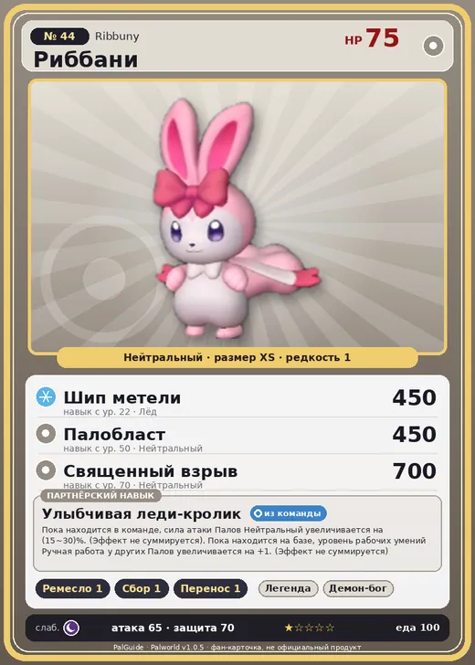

# #44 Риббани (Ribbuny)

#44 · Ribbuny

Нейтральный

Слабость: Тьма

🖐️ Ручная работа <b>1</b>🌾 Сбор <b>1</b>📦 Транспортировка <b>1</b>

<b>Улыбчивая леди-кролик</b> 🎒 из команды 🏠 на базе

❤️ 75 · ⚔️ 65 · 🛡 70

| Поле | Значение |
|---|---|
| Стихия | Нейтральный |
| Слабость (кто бьёт сильнее) | Тьма |
| Редкость | 1 |
| Размер | XS |
| HP / Атака / Защита (база вида) | 75 / 65 / 70 |
| Сколько ест | 100 |
| Цена продажи | 421 |
| Множитель поимки | ×1 |
| Скорость рывка верхом | 350 |

## Работа на базе
- Ручная работа — ур. 1
- Сбор — ур. 1
- Транспортировка — ур. 1

## Партнёрский навык: Улыбчивая леди-кролик
Пока находится в команде, сила атаки Палов Нейтральный увеличивается на (15~30)% . (Эффект не суммируется). Пока находится на базе, уровень рабочих умений Ручная работа у других Палов увеличивается на +1 . (Эффект не суммируется) level value 1 AttackUp_Normal_PartnerSkill 15 WorkSuitabilityAddRank_Handcraft 1 2 AttackUp_Normal_PartnerSkill 17 WorkSuitabilityAddRank_Handcraft 1 3 AttackUp_Normal_PartnerSkill 20 WorkSuitabilityAddRank_Handcraft 1 4 AttackUp_Normal_PartnerSkill 24 WorkSuitabilityAddRank_Handcraft 1 5 AttackUp_Normal_PartnerSkill 30 WorkSuitabilityAddRank_Handcraft 1

## Атаки по уровням
- ур. 1: Воздушная пушка (Нейтральный, сила 40)
- ур. 7: Силовой выстрел (Нейтральный, сила 80)
- ур. 15: Ледяная ракета (Лёд, сила 40)
- ур. 22: Шип метели (Лёд, сила 450)
- ур. 30: Силовая бомба (Нейтральный, сила 120)
- ур. 40: Айсберг (Лёд, сила 120)
- ур. 50: Палобласт (Нейтральный, сила 450)
- ур. 70: Священный взрыв (Нейтральный, сила 700)

## Где водится
- В дикой природе: да; точек появления днём: 400, ночью: 400; уровни в первых точках: 1–3
- Подземелья: Пещера Ущелья
- Яйцо: Обычное яйцо

## Дроп
- Кожа — 1 шт., 100%
- Красивый цветок — 1 шт., 5%
- Бант Риббани — 1 шт., 100%
- Семена ягод — 1 шт., 100%

**Дроп альфы:**
- Деталь древней цивилизации — 1–2 шт., 100%
- Ценный мех — 1–2 шт., 100%

## Разведение
- Ранг разведения (CombiRank): 2860
- Участвует в особых парах: Килламари → Килламари Примо; Бристла → Риббани Ботан

## Лучшие пассивки по роли
- по обзору: Легенда, Хладнокровный
- боец: Легенда, Демон-бог, Хладнокровный, Бессмертие, Святое небо (вместо Бессмертия, если нет мутации)
- ездовой: Божественная скорость, Легенда, Вечный двигатель, Небесное скольжение

## Чем хорош / чем плох
- ✅ +15–30% атаки нейтральных; +1 ручная работа на базе; можно оседлать
- ❌ Слабая; слабая атака (65)

> С лица этого Пала никогда не сходит лучезарная улыбка. Иногда Каттива ради шутки завязывает ему щупальца в тугой узел. Только в такие моменты его лицо искажается грозной, почти демонической гримасой.

См. также: [Стихии](../../2_mehaniki/stihii.md) · [Разведение](../../2_mehaniki/razvedenie.md) · [Все палы](README.md)
