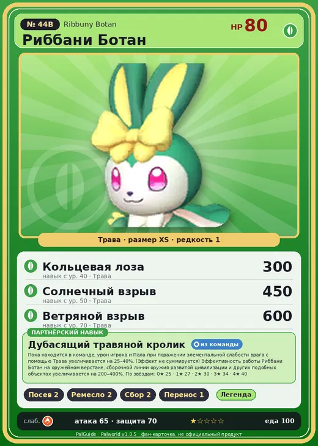

# Риббани Ботан

<canvas id="fx"></canvas>

№ 44B

Трава

Слабость: Огонь <b class="mx">×1,5</b> <button class="hlp" data-tip="Множители перемножаются по обеим стихиям: ×1,5 за стихию, которую атака бьёт, ×0,65 за ту, что её держит.">?</button>

Устойчив: Земля <b class="mx">×0,65</b>

🌱 Посев семян <b>2</b>🖐️ Ручная работа <b>2</b>🌾 Сбор <b>2</b>📦 Транспортировка <b>1</b>

<b>Дубасящий травяной кролик</b> 🎒 Работает из команды

❤️ 80 · ⚔️ 65 · 🛡 70

Основное

💎Редкость <button class="hlp" data-tip="Чем выше число, тем реже встречается пал. 1–4 — обычные, 5–7 — редкие, 8+ — легендарные.">?</button><b>1</b>

📏Размер<b>XS</b>

💰Цена продажи <button class="hlp" data-tip="Сколько золота даст торговец за пала.">?</button><b>526</b>

Бой

🎯Множитель поимки <button class="hlp" data-tip="Насколько легче или труднее поймать: ×1 — обычно, меньше — сложнее.">?</button><b>×1</b>

🐎Скорость рывка верхом <button class="hlp" data-tip="Скорость, если сесть на пала и бежать рывком.">?</button><b>350</b>

Ферма и еда

🍖Сколько ест <button class="hlp" data-tip="Сколько сытости пал тратит — чем больше, тем больше еды нужно на базе.">?</button><b>100</b>

Разведение

🧬Сила разведения <button class="hlp" data-tip="Скрытое число игры: у детёныша оно примерно среднее от родителей. Чем меньше — тем «сильнее» пал.">?</button><b>2460</b>

💞Особая пара <button class="hlp" data-tip="Этого пала можно вывести только от этой пары.">?</button><b>Риббани + Бристла</b>

=== "Обзор"

    #### Работа на базе

    
<a class="wbar" href="../../../2_mehaniki/rabota/?w=planting&lv=2">🌱 Посев семян<i style="--v:20%"></i><b>2</b></a><a class="wbar" href="../../../2_mehaniki/rabota/?w=handiwork&lv=2">✋ Ручная работа<i style="--v:20%"></i><b>2</b></a><a class="wbar" href="../../../2_mehaniki/rabota/?w=gathering&lv=2">🧺 Сбор<i style="--v:20%"></i><b>2</b></a><a class="wbar" href="../../../2_mehaniki/rabota/?w=transporting&lv=1">📦 Транспортировка<i style="--v:10%"></i><b>1</b></a><a class="wb-more" href="../../../2_mehaniki/rabota/">Что значат уровни работы →</a>

    #### Партнёрский навык: Дубасящий травяной кролик
    Пока находится в команде, урон игрока и Пала при поражении элементальной слабости врага с помощью Трава увеличивается на 25–40%. (Эффект не суммируется) Эффективность работы Риббани Ботан на оружейном верстаке, сборочной линии оружия развитой цивилизации и других подобных объектах увеличивается на 200–400%. По звёздам: 0★ 25 · 1★ 27 · 2★ 30 · 3★ 34 · 4★ 40

    #### Чем хорош / чем плох
    - ✅ много здоровья (80)
    - ❌ слабая атака (65); разводится только особой парой

    > С лица этого Пала никогда не сходит лучезарная улыбка. Иногда Каттива ради шутки завязывает ему щупальца в тугой узел. В такие моменты он избивает обидчика — всё с той же улыбкой на лице.

    См. также: [Стихии](../../guide/06_stihii.md) · [Разведение](../../guide/07_razvedenie.md) · [Все палы](README.md)

=== "Атаки"

    #### Атаки по уровням
    - ур. 1: Ветряной клинок (Трава, сила 40)
    - ур. 7: Грязевой выстрел (Земля, сила 40)
    - ур. 15: Семенной пулемёт (Трава, сила 80)
    - ур. 22: Семенная мина (Трава, сила 120)
    - ур. 30: Веер клинков (Трава, сила 200)
    - ур. 40: Кольцевая лоза (Трава, сила 300)
    - ур. 50: Солнечный взрыв (Трава, сила 450)
    - ур. 70: Ветряной взрыв (Трава, сила 600)

=== "Где живёт"

    #### Где водится

    

<button data-k="d" class="on">☀️ День</button><button data-k="n">🌙 Ночь</button>

ур. 18–50<a class="btn hm-full" href="../../../map/?pal=">Показать на большой карте</a>

Берег ПолумесяцаБамбуковые рощиГлубины бамбуковой рощиПодножье вулкана

🕳 Подземелье<b>Пещера Тэнраку</b>

🥚 Яйцо<b>Яйцо свежей листвы</b>

=== "Дроп"

    #### Дроп
    - Кожа — 1 шт., 100%
    - Бант Риббани — 1 шт., 50%
    - Семена моркови — 1 шт., 100%
    - Морковь — 1 шт., 100%

    **Дроп альфы:**
    - Деталь древней цивилизации — 4–6 шт., 100%
    - Ценный мех — 2–3 шт., 100%

=== "Разведение"

    #### Разведение
    - Ранг разведения: 2460
    - **Особая пара:** [Риббани](../../4_spravochniki/paly/ribbuny.md) + [Бристла](../../4_spravochniki/paly/bristla.md)

=== "Пассивки"

    #### Лучшие пассивки по роли

    

⚔️ Боец

максимум урона и живучести в бою

<a class="psv r-4" data-psv="Легенда" href="../../../passivki/legend/">Легенда</a><a class="psv r-4" data-psv="Демон-бог" href="../../../passivki/demon_god/">Демон-бог</a><a class="psv r-3" data-psv="Король духов" href="../../../passivki/spirit_emperor/">Король духов</a><a class="psv r-3" data-psv="Хладнокровный" href="../../../passivki/serenity/">Хладнокровный</a>

    <small>Нажми на пассивку, чтобы узнать, что она даёт и где её взять.</small>

<a class="card-link" href="../ribbuny/">← Риббани</a><a class="card-link" href="../jelliette/">Джелиэтта →</a>

