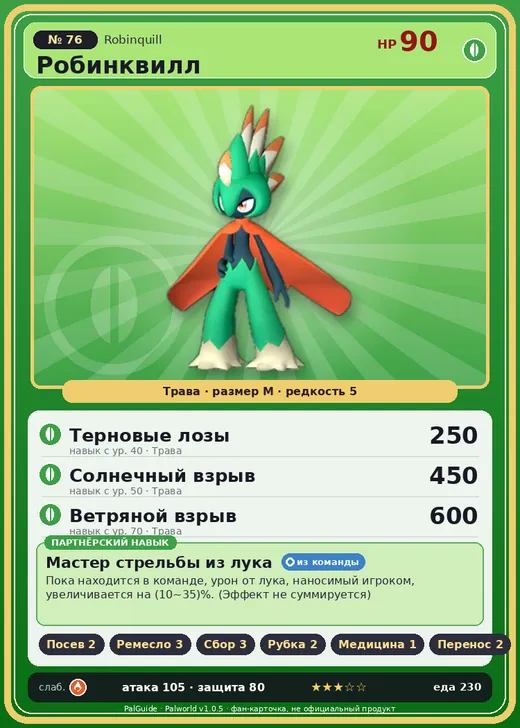

# #76 Робинквилл (Robinquill)

№ 76

Трава

Слабость: Огонь

🌱 Посев семян <b>2</b>🖐️ Ручная работа <b>3</b>🌾 Сбор <b>3</b>🪓 Рубка деревьев <b>2</b>💊 Фармацевтика <b>1</b>📦 Транспортировка <b>2</b>

<b>Мастер стрельбы из лука</b> 🎒 из команды

❤️ 90 · ⚔️ 105 · 🛡 80

| Поле | Значение |
|---|---|
| Стихия | Трава |
| Слабость (кто бьёт сильнее) | Огонь |
| Редкость | 5 |
| Размер | M |
| HP / Атака / Защита (база вида) | 90 / 105 / 80 |
| Сколько ест | 230 |
| Цена продажи | 1335 |
| Множитель поимки | ×1 |
| Скорость рывка верхом | 750 |

=== "Обзор"

    #### Работа на базе
    - Посев семян — ур. 2
    - Ручная работа — ур. 3
    - Сбор — ур. 3
    - Рубка деревьев — ур. 2
    - Фармацевтика — ур. 1
    - Транспортировка — ур. 2

    #### Партнёрский навык: Мастер стрельбы из лука
    Пока находится в команде, урон от лука , наносимый игроком, увеличивается на (10~35)% . (Эффект не суммируется) level value 1 DamageUpWeapon_Otomo 10 2 DamageUpWeapon_Otomo 15 3 DamageUpWeapon_Otomo 20 4 DamageUpWeapon_Otomo 25 5 DamageUpWeapon_Otomo 35

    #### Чем хорош / чем плох
    - ✅ хорошая атака (105); можно оседлать
    - ❌ явных минусов нет

    > Этот лесной охотник по своей натуре очень близок к человеку. Считается, что в древности он отделился от людей как отдельный вид. Возможно, именно он — ключ к пониманию природы Палов.

    См. также: [Стихии](../../guide/06_stihii.md) · [Разведение](../../guide/07_razvedenie.md) · [Все палы](README.md)

=== "Атаки"

    #### Атаки по уровням
    - ур. 1: Ветряной клинок (Трава, сила 40)
    - ур. 7: Силовой выстрел (Нейтральный, сила 80)
    - ур. 15: Снайперский выстрел (Трава, сила 120)
    - ур. 22: Семенная мина (Трава, сила 120)
    - ур. 30: Травяной торнадо (Трава, сила 200)
    - ур. 40: Терновые лозы (Трава, сила 250)
    - ур. 50: Солнечный взрыв (Трава, сила 450)
    - ур. 70: Ветряной взрыв (Трава, сила 600)

=== "Где живёт"

    #### Где водится
    - В дикой природе: да; точек появления днём: 52, ночью: 52; уровни в первых точках: 30–34
    - Подземелья: Пещера Горного Потока
    - Может продаваться у торговца/рекрутера
    - Яйцо: Большое яйцо свежей листвы

=== "Дроп"

    #### Дроп
    - Семенной картофель — 1–2 шт., 100%
    - Стрела — 2–4 шт., 100%

    **Дроп альфы:**
    - Деталь древней цивилизации — 2–4 шт., 100%
    - Ценные внутренности — 2–4 шт., 100%

=== "Разведение"

    #### Разведение
    - Ранг разведения (CombiRank): 2260
    - Участвует в особых парах: Фуддлер → Робинквилл Терра

=== "Пассивки"

    #### Лучшие пассивки по роли
    - боец: Легенда, Демон-бог, Хладнокровный, Бессмертие, Король духов (вместо Бессмертия, если нет мутации)
    - рабочий: Дьявольские руки, Виртуоз, Мастеровитый, Небожитель/Трудоголик
    - ездовой: Божественная скорость, Легенда, Вечный двигатель, Небесное скольжение

<a class="card-link" href="../surfent_terra/">← Серфент Терра</a><a class="card-link" href="../robinquill_terra/">Робинквилл Терра →</a>

