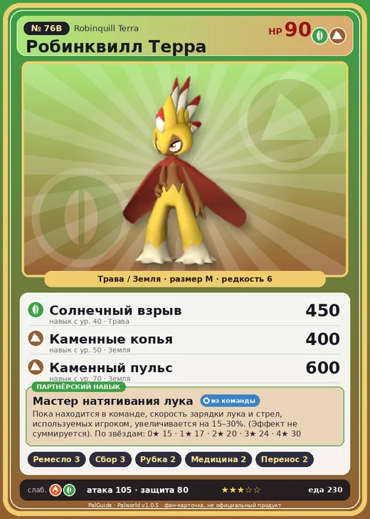

# #76B Робинквилл Терра (Robinquill Terra)

#76B · Robinquill Terra

ТраваЗемля

Слабость: ОгоньТрава

🖐️ Ручная работа <b>3</b>🌾 Сбор <b>3</b>🪓 Рубка деревьев <b>2</b>💊 Фармацевтика <b>2</b>📦 Транспортировка <b>2</b>

<b>Мастер натягивания лука</b> 🎒 из команды

❤️ 90 · ⚔️ 105 · 🛡 80

| Поле | Значение |
|---|---|
| Стихия | Трава, Земля |
| Слабость (кто бьёт сильнее) | Огонь, Трава |
| Редкость | 6 |
| Размер | M |
| HP / Атака / Защита (база вида) | 90 / 105 / 80 |
| Сколько ест | 230 |
| Цена продажи | 1294 |
| Множитель поимки | ×1 |
| Скорость рывка верхом | 750 |

## Работа на базе
- Ручная работа — ур. 3
- Сбор — ур. 3
- Рубка деревьев — ур. 2
- Фармацевтика — ур. 2
- Транспортировка — ур. 2

## Партнёрский навык: Мастер натягивания лука
Пока находится в команде, скорость зарядки лука и стрел , используемых игроком, увеличивается на (15~30)% . (Эффект не суммируется) level value 1 AttackSpeedUp_PartnerSkill_RobinHood_Ground 15 2 AttackSpeedUp_PartnerSkill_RobinHood_Ground 17 3 AttackSpeedUp_PartnerSkill_RobinHood_Ground 20 4 AttackSpeedUp_PartnerSkill_RobinHood_Ground 24 5 AttackSpeedUp_PartnerSkill_RobinHood_Ground 30

## Атаки по уровням
- ур. 1: Грязевой выстрел (Земля, сила 40)
- ур. 7: Ветряной клинок (Трава, сила 40)
- ур. 15: Снайперский выстрел (Трава, сила 120)
- ур. 22: Каменный залп (Земля, сила 80)
- ур. 30: Песчаный вихрь (Земля, сила 200)
- ур. 40: Солнечный взрыв (Трава, сила 450)
- ур. 50: Каменные копья (Земля, сила 400)
- ур. 70: Каменный пульс (Земля, сила 600)

## Где водится
- В дикой природе: да; точек появления днём: 549, ночью: 549; уровни в первых точках: 32–36
- Подземелья: Пещера Песчаных Дюн
- Яйцо: Большое яйцо свежей листвы

## Дроп
- Семенной картофель — 1–2 шт., 100%
- Стрела — 2–4 шт., 100%

**Дроп альфы:**
- Деталь древней цивилизации — 2–4 шт., 100%
- Ценные внутренности — 2–4 шт., 100%

## Разведение
- Ранг разведения (CombiRank): 2050
- **Особая пара:** [Робинквилл](../../4_spravochniki/paly/robinquill.md) + [Фуддлер](../../4_spravochniki/paly/fuddler.md)

## Лучшие пассивки по роли
- боец: Легенда, Демон-бог, Хладнокровный, Бессмертие, Король духов (вместо Бессмертия, если нет мутации)
- рабочий: Дьявольские руки, Виртуоз, Мастеровитый, Небожитель/Трудоголик
- ездовой: Божественная скорость, Легенда, Вечный двигатель, Небесное скольжение

## Чем хорош / чем плох
- ✅ хорошая атака (105); можно оседлать
- ❌ разводится только особой парой

> Эти охотники, обитающие в скалистой местности, поразительно близки к человеку по своей натуре. Когда в руинах находят кости Робинквилл Терра , рядом неизменно лежат и человеческие останки.

См. также: [Стихии](../../2_mehaniki/stihii.md) · [Разведение](../../2_mehaniki/razvedenie.md) · [Все палы](README.md)
