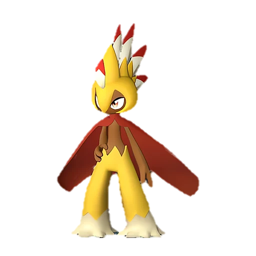

# Робинквилл Терра

<canvas id="fx"></canvas>

№ 76B

ТраваЗемля

Слабость: Огонь <b class="mx">×1,5</b>Трава <b class="mx">×1,5</b> <button class="hlp" data-tip="Множители перемножаются по обеим стихиям: ×1,5 за стихию, которую атака бьёт, ×0,65 за ту, что её держит. Огонь: 1,5 × 1 = ×1,5; Трава: 1 × 1,5 = ×1,5.">?</button>

Устойчив: Молния <b class="mx">×0,65</b>Земля <b class="mx">×0,65</b>

🖐️ Ручная работа <b>3</b>🌾 Сбор <b>3</b>🪓 Рубка деревьев <b>2</b>💊 Фармацевтика <b>2</b>📦 Транспортировка <b>2</b>

<b>Мастер натягивания лука</b> 🎒 Работает из команды

❤️ 90 · ⚔️ 105 · 🛡 80

Основное

💎Редкость <button class="hlp" data-tip="Чем выше число, тем реже встречается пал. 1–4 — обычные, 5–7 — редкие, 8+ — легендарные.">?</button><b>6</b>

📏Размер<b>M</b>

💰Цена продажи <button class="hlp" data-tip="Сколько золота даст торговец за пала.">?</button><b>1294</b>

Бой

🎯Множитель поимки <button class="hlp" data-tip="Насколько легче или труднее поймать: ×1 — обычно, меньше — сложнее.">?</button><b>×1</b>

🐎Скорость рывка верхом <button class="hlp" data-tip="Скорость, если сесть на пала и бежать рывком.">?</button><b>750</b>

Ферма и еда

🍖Сколько ест <button class="hlp" data-tip="Сколько сытости пал тратит — чем больше, тем больше еды нужно на базе.">?</button><b>230</b>

Разведение

🧬Сила разведения <button class="hlp" data-tip="Скрытое число игры: у детёныша оно примерно среднее от родителей. Чем меньше — тем «сильнее» пал.">?</button><b>2050</b>

💞Особая пара <button class="hlp" data-tip="Этого пала можно вывести только от этой пары.">?</button><b>Робинквилл + Фуддлер</b>

=== "Обзор"

    #### Работа на базе

    
<a class="wbar" href="../../../2_mehaniki/rabota/?w=handiwork&lv=3">✋ Ручная работа<i style="--v:30%"></i><b>3</b></a><a class="wbar" href="../../../2_mehaniki/rabota/?w=gathering&lv=3">🧺 Сбор<i style="--v:30%"></i><b>3</b></a><a class="wbar" href="../../../2_mehaniki/rabota/?w=lumbering&lv=2">🪓 Рубка деревьев<i style="--v:20%"></i><b>2</b></a><a class="wbar" href="../../../2_mehaniki/rabota/?w=medicine&lv=2">💊 Фармацевтика<i style="--v:20%"></i><b>2</b></a><a class="wbar" href="../../../2_mehaniki/rabota/?w=transporting&lv=2">📦 Транспортировка<i style="--v:20%"></i><b>2</b></a><a class="wb-more" href="../../../2_mehaniki/rabota/">Что значат уровни работы →</a>

    #### Партнёрский навык: Мастер натягивания лука
    Пока находится в команде, скорость зарядки лука и стрел, используемых игроком, увеличивается на 15–30%. (Эффект не суммируется). По звёздам: 0★ 15 · 1★ 17 · 2★ 20 · 3★ 24 · 4★ 30

    #### Чем хорош / чем плох
    - ✅ хорошая атака (105)
    - ❌ разводится только особой парой

    > Эти охотники, обитающие в скалистой местности, поразительно близки к человеку по своей натуре. Когда в руинах находят кости Робинквилл Терра, рядом неизменно лежат и человеческие останки.

    См. также: [Стихии](../../guide/06_stihii.md) · [Разведение](../../guide/07_razvedenie.md) · [Все палы](README.md)

=== "Атаки"

    #### Атаки по уровням
    - ур. 1: Грязевой выстрел (Земля, сила 40)
    - ур. 7: Ветряной клинок (Трава, сила 40)
    - ур. 15: Снайперский выстрел (Трава, сила 120)
    - ур. 22: Каменный залп (Земля, сила 80)
    - ур. 30: Песчаный вихрь (Земля, сила 200)
    - ур. 40: Солнечный взрыв (Трава, сила 450)
    - ур. 50: Каменные копья (Земля, сила 400)
    - ур. 70: Каменный пульс (Земля, сила 600)

=== "Где живёт"

    #### Где водится

    

<button data-k="d" class="on">☀️ День</button><button data-k="n">🌙 Ночь</button>

ур. 31–55<a class="btn hm-full" href="../../../map/?pal=">Показать на большой карте</a>

Иссохшие дюныШрамы войныАстральные горыБолотный остров

🕳 Подземелье<b>Пещера Песчаных Дюн</b>

🥚 Яйцо<b>Большое яйцо свежей листвы</b>

=== "Дроп"

    #### Дроп
    - Семенной картофель — 1–2 шт., 100%
    - Стрела — 2–4 шт., 100%

    **Дроп альфы:**
    - Деталь древней цивилизации — 2–4 шт., 100%
    - Ценные внутренности — 2–4 шт., 100%

=== "Разведение"

    #### Разведение
    - Ранг разведения: 2050
    - **Особая пара:** [Робинквилл](../../4_spravochniki/paly/robinquill.md) + [Фуддлер](../../4_spravochniki/paly/fuddler.md)

=== "Пассивки"

    #### Лучшие пассивки по роли

    

⚔️ Боец

максимум урона и живучести в бою

<a class="psv r-4" data-psv="Легенда" href="../../../passivki/legend/">Легенда</a><a class="psv r-4" data-psv="Демон-бог" href="../../../passivki/demon_god/">Демон-бог</a><a class="psv r-3" data-psv="Король духов" href="../../../passivki/spirit_emperor/">Король духов</a><a class="psv r-3" data-psv="Хладнокровный" href="../../../passivki/serenity/">Хладнокровный</a>

🛠 Рабочий

работает быстрее и меньше устаёт на базе

<a class="psv r-5" data-psv="Дьявольские руки" href="../../../passivki/demons_hand/">Дьявольские руки</a><a class="psv r-4" data-psv="Виртуоз" href="../../../passivki/remarkable_craftsmanship/">Виртуоз</a><a class="psv r-3" data-psv="Мастеровитый" href="../../../passivki/artisan/">Мастеровитый</a><a class="psv r-3" data-psv="Трудоголик" href="../../../passivki/workaholic/">Трудоголик</a>

    <small>Нажми на пассивку, чтобы узнать, что она даёт и где её взять.</small>

<a class="card-link" href="../robinquill/">← Робинквилл</a><a class="card-link" href="../flopie/">Флопи →</a>

