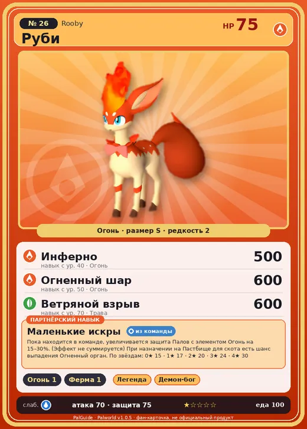

# #26 Руби (Rooby)

#26 · Rooby

Огонь

Слабость: Вода

🔥 Разжигание огня <b>1</b>🐑 Фермерство <b>1</b>

<b>Маленькие искры</b> 🎒 из команды 🏠 на базе

❤️ 75 · ⚔️ 70 · 🛡 75

| Поле | Значение |
|---|---|
| Стихия | Огонь |
| Слабость (кто бьёт сильнее) | Вода |
| Редкость | 2 |
| Размер | S |
| HP / Атака / Защита (база вида) | 75 / 70 / 75 |
| Сколько ест | 100 |
| Цена продажи | 459 |
| Множитель поимки | ×1.1 |
| Скорость рывка верхом | 550 |

## Работа на базе
- Разжигание огня — ур. 1
- Фермерство — ур. 1

## Партнёрский навык: Маленькие искры
Пока находится в команде, увеличивается защита Палов с элементом Огонь на (15~30)% . (Эффект не суммируется) При назначении на Пастбище для скота есть шанс выпадения Огненный орган . level value 1 DefenseUp_Fire_PartnerSkill 15 2 DefenseUp_Fire_PartnerSkill 17 3 DefenseUp_Fire_PartnerSkill 20 4 DefenseUp_Fire_PartnerSkill 24 5 DefenseUp_Fire_PartnerSkill 30

## Атаки по уровням
- ур. 1: Огненный выстрел (Огонь, сила 40)
- ур. 7: Силовой выстрел (Нейтральный, сила 80)
- ур. 15: Расщеплённый огонь (Огонь, сила 80)
- ур. 22: Огненная стрела (Огонь, сила 120)
- ур. 30: Огненный шторм (Огонь, сила 200)
- ур. 40: Инферно (Огонь, сила 500)
- ур. 50: Огненный шар (Огонь, сила 600)
- ур. 70: Ветряной взрыв (Трава, сила 600)

## Где водится
- В дикой природе: да; точек появления днём: 135, ночью: 135; уровни в первых точках: 4–6
- Подземелья: Пещера Отдалённого Острова, Пещера Холмов
- Яйцо: Раскалённое яйцо

## Дроп
- Огненный орган — 2–3 шт., 100%
- Кожа — 1 шт., 100%

**Дроп альфы:**
- Деталь древней цивилизации — 1–3 шт., 100%
- Ценный мех — 1–3 шт., 100%

## Разведение
- Ранг разведения (CombiRank): 2870
- Участвует в особых парах: Гобфин → Гобфин Игнис

## Лучшие пассивки по роли
- боец: Легенда, Демон-бог, Хладнокровный, Бессмертие, Император огня (вместо Бессмертия, если нет мутации)
- ездовой: Божественная скорость, Легенда, Вечный двигатель, Небесное скольжение

## Чем хорош / чем плох
- ✅ можно оседлать
- ❌ слабая атака (70)

> Дикие Руби на удивление редко болеют. Секрет их крепкого здоровья — каждый день съедать кусочек угля, сделанного из сожжённой веточки.

См. также: [Стихии](../../2_mehaniki/stihii.md) · [Разведение](../../2_mehaniki/razvedenie.md) · [Все палы](README.md)
_Источник: paldb.cc v1.0.5_
