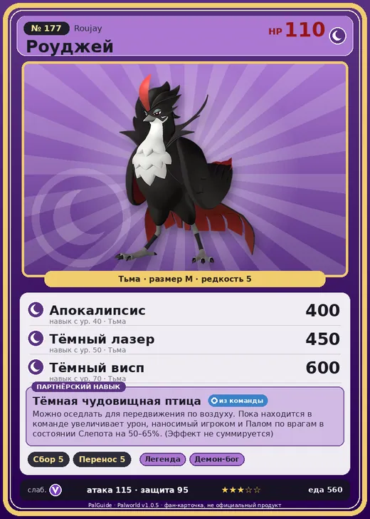

# #177 Роуджей (Roujay)

#177 · Roujay

Тьма

Слабость: Дракон

🌾 Сбор <b>5</b>📦 Транспортировка <b>5</b>

<b>Тёмная чудовищная птица</b> 🎒 из команды 🐎 верхом

❤️ 110 · ⚔️ 115 · 🛡 95

| Поле | Значение |
|---|---|
| Стихия | Тьма |
| Слабость (кто бьёт сильнее) | Дракон |
| Редкость | 5 |
| Размер | M |
| HP / Атака / Защита (база вида) | 110 / 115 / 95 |
| Сколько ест | 560 |
| Цена продажи | 2263 |
| Множитель поимки | ×1 |
| Скорость рывка верхом | 1350 |

## Работа на базе
- Сбор — ур. 5
- Транспортировка — ур. 5

## Партнёрский навык: Тёмная чудовищная птица
Можно оседлать для передвижения по воздуху. Пока находится в команде увеличивает урон, наносимый игроком и Палом по врагам в состоянии Слепота на (50~65)% . (Эффект не суммируется) Технологии 72 level value 1 DamageUpTrainerAndOtomo_ToDarkness_PartnerSkill_ThiefBird 50 2 DamageUpTrainerAndOtomo_ToDarkness_PartnerSkill_ThiefBird 53 3 DamageUpTrainerAndOtomo_ToDarkness_PartnerSkill_ThiefBird 56 4 DamageUpTrainerAndOtomo_ToDarkness_PartnerSkill_ThiefBird 60 5 DamageUpTrainerAndOtomo_ToDarkness_PartnerSkill_ThiefBird 65

## Атаки по уровням
- ур. 1: Распространение тьмы (Тьма, сила 60)
- ур. 7: Тёмная пушка (Тьма, сила 70)
- ур. 15: Стрелы тьмы (Тьма, сила 120)
- ур. 22: Воздушные клинки (Нейтральный, сила 160)
- ур. 30: Кошмарная сфера (Тьма, сила 300)
- ур. 40: Апокалипсис (Тьма, сила 400)
- ур. 50: Тёмный лазер (Тьма, сила 450)
- ур. 70: Тёмный висп (Тьма, сила 600)

## Где водится
- В дикой природе: нет/особый способ; точек появления днём: 0, ночью: 0
- Яйцо: Большое яйцо тьмы

## Дроп
- Кожа — 3–4 шт., 100%
- Рубин — 1–2 шт., 100%

**Дроп альфы:**
- Деталь древней цивилизации — 4–6 шт., 100%
- Ценное перо — 2–3 шт., 100%

## Разведение
- Ранг разведения (CombiRank): 530

## Лучшие пассивки по роли
- боец: Легенда, Демон-бог, Хладнокровный, Бессмертие, Король тьмы (вместо Бессмертия, если нет мутации)
- рабочий: Дьявольские руки, Виртуоз, Мастеровитый, Небожитель/Трудоголик
- ездовой: Божественная скорость, Легенда, Вечный двигатель, Небесное скольжение

## Чем хорош / чем плох
- ✅ хорошая атака (115); отличный рабочий (пригодность 5); можно оседлать; летает (ездовой)
- ❌ много ест (560)

> Руки нечисты, и при удобном случае что-нибудь да стянет. Даже если почти поймали, это не беда. Достаточно быстро украсть «глаза», и видеть будет уже нечем.

См. также: [Стихии](../../guide/06_stihii.md) · [Разведение](../../guide/07_razvedenie.md) · [Все палы](README.md)
