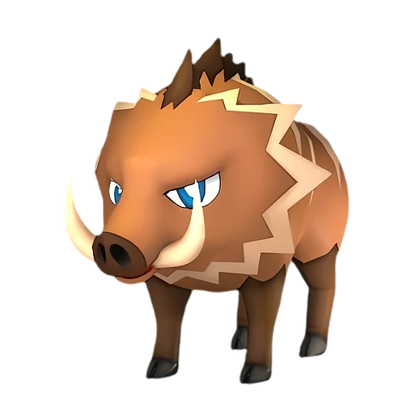

# Рашоа

<canvas id="fx"></canvas>

№ 28

Земля

Слабость: Трава <b class="mx">×1,5</b> <button class="hlp" data-tip="Множители перемножаются по обеим стихиям: ×1,5 за стихию, которую атака бьёт, ×0,65 за ту, что её держит.">?</button>

Устойчив: Молния <b class="mx">×0,65</b>

⛏️ Добыча <b>1</b>

<b>Твердоголовый</b> 🐎 Верхом

❤️ 80 · ⚔️ 70 · 🛡 70

Основное

💎Редкость <button class="hlp" data-tip="Чем выше число, тем реже встречается пал. 1–4 — обычные, 5–7 — редкие, 8+ — легендарные.">?</button><b>1</b>

📏Размер<b>S</b>

💰Цена продажи <button class="hlp" data-tip="Сколько золота даст торговец за пала.">?</button><b>443</b>

Бой

🎯Множитель поимки <button class="hlp" data-tip="Насколько легче или труднее поймать: ×1 — обычно, меньше — сложнее.">?</button><b>×1</b>

🐎Скорость рывка верхом <button class="hlp" data-tip="Скорость, если сесть на пала и бежать рывком.">?</button><b>800</b>

Ферма и еда

🍖Сколько ест <button class="hlp" data-tip="Сколько сытости пал тратит — чем больше, тем больше еды нужно на базе.">?</button><b>100</b>

Разведение

🧬Сила разведения <button class="hlp" data-tip="Скрытое число игры: у детёныша оно примерно среднее от родителей. Чем меньше — тем «сильнее» пал.">?</button><b>2880</b>

=== "Обзор"

    #### Работа на базе

    
<a class="wbar" href="../../../2_mehaniki/rabota/?w=mining&lv=1">⛏️ Добыча<i style="--v:10%"></i><b>1</b></a><a class="wb-more" href="../../../2_mehaniki/rabota/">Что значат уровни работы →</a>

    #### Партнёрский навык: Твердоголовый
    Можно оседлать для передвижения. Во время езды эффективность разрушения камней увеличивается на 500–2000%. Технологии 6. По звёздам: 0★ 500 · 1★ 750 · 2★ 1100 · 3★ 1500 · 4★ 2000

    #### Чем хорош / чем плох
    - ✅ можно оседлать
    - ❌ слабая атака (70)

    > Крайне задирист, лезет в драку, не подумав, кто перед ним. Несмотря на крошечный рост, его натиск способен снести даже валун.

    См. также: [Стихии](../../guide/06_stihii.md) · [Разведение](../../guide/07_razvedenie.md) · [Все палы](README.md)

=== "Атаки"

    #### Атаки по уровням
    - ур. 1: Бешеный таран (Земля, сила 60)
    - ур. 7: Грязевой выстрел (Земля, сила 40)
    - ур. 15: Силовой выстрел (Нейтральный, сила 80)
    - ур. 22: Каменный залп (Земля, сила 80)
    - ур. 30: Силовая бомба (Нейтральный, сила 120)
    - ур. 40: Каменные копья (Земля, сила 400)
    - ур. 50: Палобласт (Нейтральный, сила 450)
    - ур. 70: Каменный пульс (Земля, сила 600)

=== "Где живёт"

    #### Где водится

    

<button data-k="d" class="on">☀️ День</button><button data-k="n">🌙 Ночь</button>

ур. 5–10<a class="btn hm-full" href="../../../map/?pal=Boar">Показать на большой карте</a>

Архипелаг Морских ВетровСкалы красной листвыЗолотые холмыОстров восходящих ветров

🕳 Подземелье<b>Пещера Отдалённого Острова</b>

🕳 Подземелье<b>Пещера Холмов</b>

🥚 Яйцо<b>Яйцо земли</b>

=== "Дроп"

    #### Дроп
    - Мясо Рашоа — 1–2 шт., 100%
    - Кожа — 1 шт., 100%
    - Кость — 1 шт., 100%

    **Дроп альфы:**
    - Деталь древней цивилизации — 1–2 шт., 100%
    - Ценный коготь — 1–2 шт., 100%

=== "Разведение"

    #### Разведение
    - Ранг разведения: 2880

=== "Пассивки"

    #### Лучшие пассивки по роли

    

⚔️ Боец

максимум урона и живучести в бою

<a class="psv r-4" data-psv="Легенда" href="../../../passivki/legend/">Легенда</a><a class="psv r-4" data-psv="Демон-бог" href="../../../passivki/demon_god/">Демон-бог</a><a class="psv r-3" data-psv="Император земли" href="../../../passivki/earth_emperor/">Император земли</a><a class="psv r-3" data-psv="Хладнокровный" href="../../../passivki/serenity/">Хладнокровный</a>

🐎 Ездовой

быстрее бегает или летает с тобой верхом

<a class="psv r-4" data-psv="Божественная скорость" href="../../../passivki/swift/">Божественная скорость</a><a class="psv r-4" data-psv="Легенда" href="../../../passivki/legend/">Легенда</a><a class="psv r-4" data-psv="Вечный двигатель" href="../../../passivki/eternal_engine/">Вечный двигатель</a><a class="psv r-4" data-psv="Небесное скольжение" href="../../../passivki/sky_strider/">Небесное скольжение</a>

    <small>Нажми на пассивку, чтобы узнать, что она даёт и где её взять.</small>

<a class="card-link" href="../mau_cryst/">← Мау Крист</a><a class="card-link" href="../foxparks/">Фокспаркс →</a>

