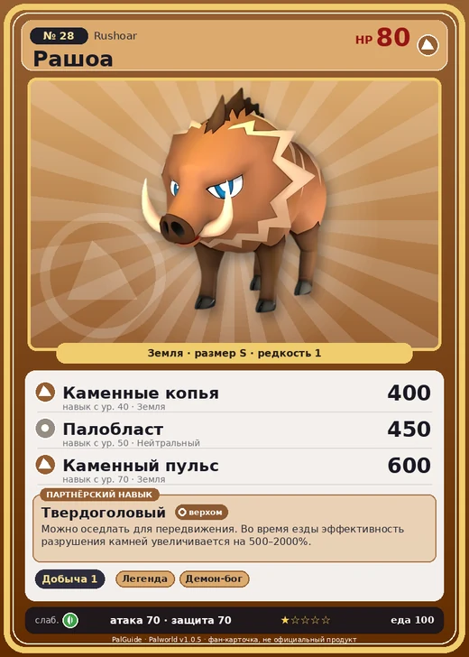

# Рашоа

<canvas id="fx"></canvas>

№ 28 · Rushoar

Земля

Слабость: Трава

⛏️ Добыча <b>1</b>

<b>Твердоголовый</b> 🐎 верхом

❤️ 80 · ⚔️ 70 · 🛡 70

| Поле | Значение |
|---|---|
| Стихия | Земля |
| Слабость (кто бьёт сильнее) | Трава |
| Редкость | 1 |
| Размер | S |
| HP / Атака / Защита (база вида) | 80 / 70 / 70 |
| Сколько ест | 100 |
| Цена продажи | 443 |
| Множитель поимки | ×1 |
| Скорость рывка верхом | 800 |

=== "Обзор"

    #### Работа на базе
    - Добыча — ур. 1

    #### Партнёрский навык: Твердоголовый
    Можно оседлать для передвижения. Во время езды эффективность разрушения камней увеличивается на 500–2000%. Технологии 6. По звёздам: 0★ 500 · 1★ 750 · 2★ 1100 · 3★ 1500 · 4★ 2000

    #### Чем хорош / чем плох
    - ✅ можно оседлать
    - ❌ слабая атака (70)

    > Крайне задирист, лезет в драку, не подумав, кто перед ним. Несмотря на крошечный рост, его натиск способен снести даже валун.

    См. также: [Стихии](../../guide/06_stihii.md) · [Разведение](../../guide/07_razvedenie.md) · [Все палы](README.md)

=== "Атаки"

    #### Атаки по уровням
    - ур. 1: Бешеный таран (Земля, сила 60)
    - ур. 7: Грязевой выстрел (Земля, сила 40)
    - ур. 15: Силовой выстрел (Нейтральный, сила 80)
    - ур. 22: Каменный залп (Земля, сила 80)
    - ур. 30: Силовая бомба (Нейтральный, сила 120)
    - ур. 40: Каменные копья (Земля, сила 400)
    - ур. 50: Палобласт (Нейтральный, сила 450)
    - ур. 70: Каменный пульс (Земля, сила 600)

=== "Где живёт"

    #### Где водится
    - В дикой природе: да; точек появления днём: 148, ночью: 148; уровни в первых точках: 5–7
    - Подземелья: Пещера Отдалённого Острова, Пещера Холмов
    - Яйцо: Яйцо земли

=== "Дроп"

    #### Дроп
    - Мясо Рашоа — 1–2 шт., 100%
    - Кожа — 1 шт., 100%
    - Кость — 1 шт., 100%

    **Дроп альфы:**
    - Деталь древней цивилизации — 1–2 шт., 100%
    - Ценный коготь — 1–2 шт., 100%

=== "Разведение"

    #### Разведение
    - Ранг разведения (CombiRank): 2880

=== "Пассивки"

    #### Лучшие пассивки по роли

    

⚔️ Боец

максимум урона и живучести в бою

<a class="psv r-4" data-psv="Легенда" href="../../../passivki/legend/">Легенда</a><a class="psv r-4" data-psv="Демон-бог" href="../../../passivki/demon_god/">Демон-бог</a><a class="psv r-3" data-psv="Император земли" href="../../../passivki/earth_emperor/">Император земли</a><a class="psv r-3" data-psv="Хладнокровный" href="../../../passivki/serenity/">Хладнокровный</a>

🐎 Ездовой

быстрее бегает или летает с тобой верхом

<a class="psv r-4" data-psv="Божественная скорость" href="../../../passivki/swift/">Божественная скорость</a><a class="psv r-4" data-psv="Легенда" href="../../../passivki/legend/">Легенда</a><a class="psv r-4" data-psv="Вечный двигатель" href="../../../passivki/eternal_engine/">Вечный двигатель</a><a class="psv r-4" data-psv="Небесное скольжение" href="../../../passivki/sky_strider/">Небесное скольжение</a>

    <small>Нажми на пассивку, чтобы узнать, что она даёт и где её взять.</small>

<a class="card-link" href="../mau_cryst/">← Мау Крист</a><a class="card-link" href="../foxparks/">Фокспаркс →</a>

