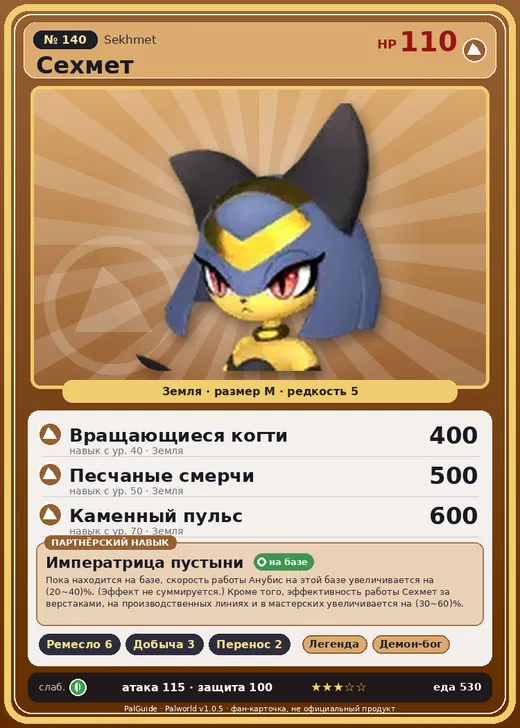

# #140 Сехмет (Sekhmet)

#140 · Sekhmet

Земля

Слабость: Трава

🖐️ Ручная работа <b>6</b>⛏️ Добыча <b>3</b>📦 Транспортировка <b>2</b>

<b>Императрица пустыни</b> 🏠 на базе

❤️ 110 · ⚔️ 115 · 🛡 100

| Поле | Значение |
|---|---|
| Стихия | Земля |
| Слабость (кто бьёт сильнее) | Трава |
| Редкость | 5 |
| Размер | M |
| HP / Атака / Защита (база вида) | 110 / 115 / 100 |
| Сколько ест | 530 |
| Цена продажи | 2638 |
| Множитель поимки | ×1 |
| Скорость рывка верхом | 900 |

## Работа на базе
- Ручная работа — ур. 6
- Добыча — ур. 3
- Транспортировка — ур. 2

## Партнёрский навык: Императрица пустыни
Пока находится на базе, скорость работы Анубис на этой базе увеличивается на (20~40)% . (Эффект не суммируется.) Кроме того, эффективность работы Сехмет за верстаками, на производственных линиях и в мастерских увеличивается на (30~60)% . level value 1 WorkSpeedUp_Sekhmet_PartnerSkill 20 CraftSpeed_PartnerSkill_Sekhmet 30 2 WorkSpeedUp_Sekhmet_PartnerSkill 24 CraftSpeed_PartnerSkill_Sekhmet 36 3 WorkSpeedUp_Sekhmet_PartnerSkill 28 CraftSpeed_PartnerSkill_Sekhmet 42 4 WorkSpeedUp_Sekhmet_PartnerSkill 32 CraftSpeed_PartnerSkill_Sekhmet 48 5 WorkSpeedUp_Sekhmet_PartnerSkill 40 CraftSpeed_PartnerSkill_Sekhmet 60

## Атаки по уровням
- ур. 1: Грязевой выстрел (Земля, сила 40)
- ур. 7: Силовой выстрел (Нейтральный, сила 80)
- ур. 15: Каменный залп (Земля, сила 80)
- ур. 22: Воздушные клинки (Нейтральный, сила 160)
- ур. 30: Когтистое сальто (Земля, сила 300)
- ур. 40: Вращающиеся когти (Земля, сила 400)
- ур. 50: Песчаные смерчи (Земля, сила 500)
- ур. 70: Каменный пульс (Земля, сила 600)

## Где водится
- В дикой природе: да; точек появления днём: 360, ночью: 360; уровни в первых точках: 37–42
- Может продаваться у торговца/рекрутера
- Яйцо: Большое яйцо земли

## Дроп
- Кожа — 2–3 шт., 100%
- Большая душа Пала — 1–2 шт., 100%

**Дроп альфы:**
- Деталь древней цивилизации — 3–5 шт., 100%
- Ценный коготь — 2–3 шт., 100%

## Разведение
- Ранг разведения (CombiRank): 870

## Лучшие пассивки по роли
- боец: Легенда, Демон-бог, Хладнокровный, Бессмертие, Император земли (вместо Бессмертия, если нет мутации)
- рабочий: Дьявольские руки, Виртуоз, Мастеровитый, Небожитель/Трудоголик
- ездовой: Божественная скорость, Легенда, Вечный двигатель, Небесное скольжение

## Чем хорош / чем плох
- ✅ хорошая атака (115); отличный рабочий (пригодность 6); можно оседлать
- ❌ много ест (530)

> Раньше отличался свирепым нравом и считался символом смерти. После того как Анубис трансформировался в символ смерти, богатые, искавшие новый знак отличия, опаивали Сехмет алкоголем и расположили к себе. Со временем Сехмет стал символом знати.

См. также: [Стихии](../../2_mehaniki/stihii.md) · [Разведение](../../2_mehaniki/razvedenie.md) · [Все палы](README.md)
