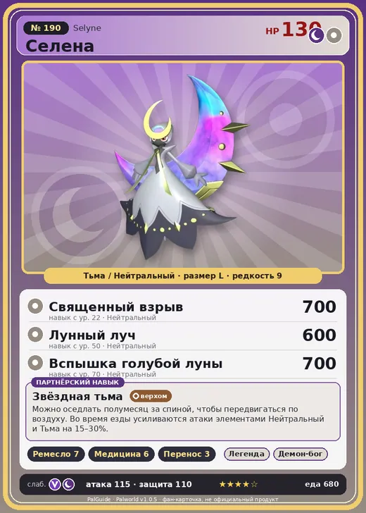

# Селена

<canvas id="fx"></canvas>

№ 190

ТьмаНейтральный

Слабость: Тьма <b class="mx">×1,5</b>Дракон <b class="mx">×1,5</b> <button class="hlp" data-tip="Множители перемножаются по обеим стихиям: ×1,5 за стихию, которую атака бьёт, ×0,65 за ту, что её держит. Тьма: 1 × 1,5 = ×1,5; Дракон: 1,5 × 1 = ×1,5.">?</button>

Устойчив: Нейтральный <b class="mx">×0,65</b>

🖐️ Ручная работа <b>7</b>💊 Фармацевтика <b>6</b>📦 Транспортировка <b>3</b>

<b>Звёздная тьма</b> 🐎 Верхом

❤️ 130 · ⚔️ 115 · 🛡 110

Основное

💎Редкость <button class="hlp" data-tip="Чем выше число, тем реже встречается пал. 1–4 — обычные, 5–7 — редкие, 8+ — легендарные.">?</button><b>9</b>

📏Размер<b>L</b>

💰Цена продажи <button class="hlp" data-tip="Сколько золота даст торговец за пала.">?</button><b>4095</b>

Бой

🎯Множитель поимки <button class="hlp" data-tip="Насколько легче или труднее поймать: ×1 — обычно, меньше — сложнее.">?</button><b>×1</b>

🐎Скорость рывка верхом <button class="hlp" data-tip="Скорость, если сесть на пала и бежать рывком.">?</button><b>1600</b>

Ферма и еда

🍖Сколько ест <button class="hlp" data-tip="Сколько сытости пал тратит — чем больше, тем больше еды нужно на базе.">?</button><b>680</b>

Разведение

🧬Сила разведения <button class="hlp" data-tip="Скрытое число игры: у детёныша оно примерно среднее от родителей. Чем меньше — тем «сильнее» пал.">?</button><b>360</b>

💞Особая пара <button class="hlp" data-tip="Этого пала можно вывести только от этой пары.">?</button><b>Селена + Селена</b>

=== "Обзор"

    #### Работа на базе

    
✋ Ручная работа<i style="--v:70%"></i><b>7</b>💊 Фармацевтика<i style="--v:60%"></i><b>6</b>📦 Транспортировка<i style="--v:30%"></i><b>3</b>

    #### Партнёрский навык: Звёздная тьма
    Можно оседлать полумесяц за спиной, чтобы передвигаться по воздуху. Во время езды усиливаются атаки элементами Нейтральный и Тьма на 15–30%. Технологии 53. По звёздам: 0★ 15 · 1★ 17 · 2★ 20 · 3★ 24 · 4★ 30

    #### Чем хорош / чем плох
    - ✅ Ручная работа 7; босс башни; хорошая атака (115); много здоровья (130); отличный рабочий (пригодность 7); можно оседлать; летает (ездовой)
    - ❌ Поздний; много ест (680); разводится только особой парой

    > Объект, похожий на луну, витающий за спиной этого Пала, с каждым новым поколением понемногу приближается к идеальному кругу. Что произойдёт, когда луна станет полной — никто не знает.

    См. также: [Стихии](../../guide/06_stihii.md) · [Разведение](../../guide/07_razvedenie.md) · [Все палы](README.md)

=== "Атаки"

    #### Атаки по уровням
    - ур. 1: Тёмная пушка (Тьма, сила 70)
    - ур. 7: Стрелы тьмы (Тьма, сила 120)
    - ур. 15: Воздушные клинки (Нейтральный, сила 160)
    - ур. 18: Комета (Дракон, сила 180)
    - ур. 22: Священный взрыв (Нейтральный, сила 700)
    - ур. 30: Клинок бледной луны (Нейтральный, сила 350)
    - ур. 40: Звездные мины (Нейтральный, сила 400)
    - ур. 50: Лунный луч (Нейтральный, сила 600)
    - ур. 70: Вспышка голубой луны (Нейтральный, сила 700)

=== "Где живёт"

    #### Где водится

    

<button data-k="d" class="on">☀️ День</button><button data-k="n">🌙 Ночь</button>

ур. 76–80<a class="btn hm-full" href="../../../map/?pal=MoonQueen">Показать на большой карте</a>

🥚 Яйцо<b>Огромное яйцо тьмы</b>

=== "Дроп"

    #### Дроп
    - Качественная ткань — 1–2 шт., 100%
    - Сапфир — 2–3 шт., 100%

    **Дроп альфы:**

    - Деталь древней цивилизации — 2–3 шт., 100%
    - Ценный коготь — 6–8 шт., 100%

=== "Разведение"

    #### Разведение
    - Ранг разведения: 360
    - **Особая пара:** [Селена](../../4_spravochniki/paly/selyne.md) + [Селена](../../4_spravochniki/paly/selyne.md)
    - Участвует в особых парах: Селена → Селена; Селена → Селена

=== "Пассивки"

    #### Лучшие пассивки по роли

    

⚔️ Боец

максимум урона и живучести в бою

<a class="psv r-4" data-psv="Легенда" href="../../../passivki/legend/">Легенда</a><a class="psv r-4" data-psv="Демон-бог" href="../../../passivki/demon_god/">Демон-бог</a><a class="psv r-3" data-psv="Король тьмы" href="../../../passivki/lord_of_the_underworld/">Король тьмы</a><a class="psv r-3" data-psv="Хладнокровный" href="../../../passivki/serenity/">Хладнокровный</a>

🛠 Рабочий

работает быстрее и меньше устаёт на базе

<a class="psv r-5" data-psv="Дьявольские руки" href="../../../passivki/demons_hand/">Дьявольские руки</a><a class="psv r-4" data-psv="Виртуоз" href="../../../passivki/remarkable_craftsmanship/">Виртуоз</a><a class="psv r-3" data-psv="Мастеровитый" href="../../../passivki/artisan/">Мастеровитый</a><a class="psv r-3" data-psv="Трудоголик" href="../../../passivki/workaholic/">Трудоголик</a>

🐎 Ездовой

быстрее бегает или летает с тобой верхом

<a class="psv r-4" data-psv="Божественная скорость" href="../../../passivki/swift/">Божественная скорость</a><a class="psv r-4" data-psv="Легенда" href="../../../passivki/legend/">Легенда</a><a class="psv r-4" data-psv="Вечный двигатель" href="../../../passivki/eternal_engine/">Вечный двигатель</a><a class="psv r-3" data-psv="Умелый бегун" href="../../../passivki/runner/">Умелый бегун</a>

    <small>Нажми на пассивку, чтобы узнать, что она даёт и где её взять.</small>

<a class="card-link" href="../shadowbeak/">← Шэдоубик</a><a class="card-link" href="../bastigor/">Бастигор →</a>

