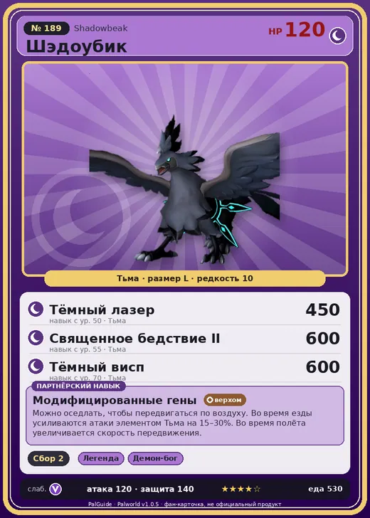

# Шэдоубик

<canvas id="fx"></canvas>

№ 189 · Shadowbeak

Тьма

Слабость: Дракон

🌾 Сбор <b>2</b>

<b>Модифицированные гены</b> 🐎 верхом

❤️ 120 · ⚔️ 120 · 🛡 140

Основное

💎Редкость <button class="hlp" data-tip="Чем выше число, тем реже встречается пал. 1–4 — обычные, 5–7 — редкие, 8+ — легендарные.">?</button><b>10</b>

📏Размер<b>L</b>

💰Цена продажи <button class="hlp" data-tip="Сколько золота даст торговец за пала.">?</button><b>3245</b>

Бой

🎯Множитель поимки <button class="hlp" data-tip="Насколько легче или труднее поймать: ×1 — обычно, меньше — сложнее.">?</button><b>×1</b>

🐎Скорость рывка верхом <button class="hlp" data-tip="Скорость, если сесть на пала и бежать рывком.">?</button><b>1600</b>

Ферма и еда

🍖Сколько ест <button class="hlp" data-tip="Сколько сытости пал тратит — чем больше, тем больше еды нужно на базе.">?</button><b>530</b>

Разведение

🧬Сила разведения <button class="hlp" data-tip="Скрытое число игры: у детёныша оно примерно среднее от родителей. Чем меньше — тем «сильнее» пал.">?</button><b>550</b>

💞Особая пара <button class="hlp" data-tip="Этого пала можно вывести только от этой пары.">?</button><b>Шэдоубик + Шэдоубик</b>

=== "Обзор"

    #### Работа на базе
    - Сбор — ур. 2

    #### Партнёрский навык: Модифицированные гены
    Можно оседлать, чтобы передвигаться по воздуху. Во время езды усиливаются атаки элементом Тьма на 15–30%. Во время полёта увеличивается скорость передвижения. Технологии 47. По звёздам: 0★ 15 · 1★ 17 · 2★ 20 · 3★ 24 · 4★ 30

    #### Чем хорош / чем плох
    - ✅ Летающий тёмный боец; очень высокая атака (120); много здоровья (120); крепкая защита (140); можно оседлать; летает (ездовой)
    - ❌ Слаб к драконам; много ест (530); разводится только особой парой

    > Запретное существо, рождённое из безумия. Его генетическая связь с другими Палами исчезла — возможно, он уже вышел за пределы самого понятия Пал.

    См. также: [Стихии](../../guide/06_stihii.md) · [Разведение](../../guide/07_razvedenie.md) · [Все палы](README.md)

=== "Атаки"

    #### Атаки по уровням
    - ур. 1: Воздушная пушка (Нейтральный, сила 40)
    - ур. 7: Тёмный шар (Тьма, сила 50)
    - ур. 15: Теневой взрыв (Тьма, сила 80)
    - ур. 22: Духовное пламя (Тьма, сила 200)
    - ур. 30: Кошмарная сфера (Тьма, сила 300)
    - ур. 40: Священное бедствие (Тьма, сила 400)
    - ур. 50: Тёмный лазер (Тьма, сила 450)
    - ур. 55: Священное бедствие II (Тьма, сила 600)
    - ур. 70: Тёмный висп (Тьма, сила 600)

=== "Где живёт"

    #### Где водится
    - В дикой природе: да; точек появления днём: 11, ночью: 11
    - Яйцо: Огромное яйцо тьмы

=== "Дроп"

    #### Дроп
    - Сталепластик — 2–3 шт., 100%
    - Углеродное волокно — 2–3 шт., 100%
    - Книга революционных технологий — 1 шт., 10%
    - Большая душа Пала — 1 шт., 100%

    **Дроп альфы:**
    - Деталь древней цивилизации — 6–8 шт., 100%
    - Ценное перо — 6–8 шт., 100%

=== "Разведение"

    #### Разведение
    - Ранг разведения (CombiRank): 550
    - **Особая пара:** [Шэдоубик](../../4_spravochniki/paly/shadowbeak.md) + [Шэдоубик](../../4_spravochniki/paly/shadowbeak.md)
    - Участвует в особых парах: Шэдоубик → Шэдоубик; Шэдоубик → Шэдоубик

=== "Пассивки"

    #### Лучшие пассивки по роли

    

⚔️ Боец

максимум урона и живучести в бою

<a class="psv r-4" data-psv="Легенда" href="../../../passivki/legend/">Легенда</a><a class="psv r-4" data-psv="Демон-бог" href="../../../passivki/demon_god/">Демон-бог</a><a class="psv r-3" data-psv="Король тьмы" href="../../../passivki/lord_of_the_underworld/">Король тьмы</a><a class="psv r-3" data-psv="Хладнокровный" href="../../../passivki/serenity/">Хладнокровный</a>

🐎 Ездовой

быстрее бегает или летает с тобой верхом

<a class="psv r-4" data-psv="Божественная скорость" href="../../../passivki/swift/">Божественная скорость</a><a class="psv r-4" data-psv="Легенда" href="../../../passivki/legend/">Легенда</a><a class="psv r-4" data-psv="Вечный двигатель" href="../../../passivki/eternal_engine/">Вечный двигатель</a><a class="psv r-3" data-psv="Умелый бегун" href="../../../passivki/runner/">Умелый бегун</a>

    <small>Нажми на пассивку, чтобы узнать, что она даёт и где её взять.</small>

<a class="card-link" href="../faleris_aqua/">← Фалерис Аква</a><a class="card-link" href="../selyne/">Селена →</a>

