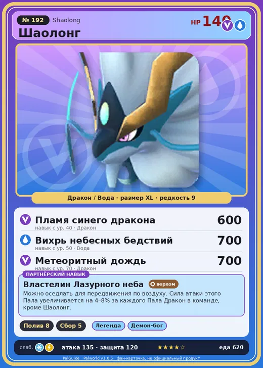

# Шаолонг

<canvas id="fx"></canvas>

№ 192

ДраконВода

Слабость: Молния <b class="mx">×1,5</b>Лёд <b class="mx">×1,5</b> <button class="hlp" data-tip="Множители перемножаются по обеим стихиям: ×1,5 за стихию, которую атака бьёт, ×0,65 за ту, что её держит. Молния: 1 × 1,5 = ×1,5; Лёд: 1,5 × 1 = ×1,5.">?</button>

Устойчив: Огонь <b class="mx">×0,65</b>Тьма <b class="mx">×0,65</b>

💧 Полив <b>8</b>🌾 Сбор <b>5</b>

<b>Властелин Лазурного неба</b> 🐾 Когда пал выпущен🐎 Верхом

❤️ 140 · ⚔️ 135 · 🛡 120

Основное

💎Редкость <button class="hlp" data-tip="Чем выше число, тем реже встречается пал. 1–4 — обычные, 5–7 — редкие, 8+ — легендарные.">?</button><b>9</b>

📏Размер<b>XL</b>

💰Цена продажи <button class="hlp" data-tip="Сколько золота даст торговец за пала.">?</button><b>4531</b>

Бой

🎯Множитель поимки <button class="hlp" data-tip="Насколько легче или труднее поймать: ×1 — обычно, меньше — сложнее.">?</button><b>×1</b>

🐎Скорость рывка верхом <button class="hlp" data-tip="Скорость, если сесть на пала и бежать рывком.">?</button><b>2800</b>

Ферма и еда

🍖Сколько ест <button class="hlp" data-tip="Сколько сытости пал тратит — чем больше, тем больше еды нужно на базе.">?</button><b>620</b>

Разведение

🧬Сила разведения <button class="hlp" data-tip="Скрытое число игры: у детёныша оно примерно среднее от родителей. Чем меньше — тем «сильнее» пал.">?</button><b>40</b>

💞Особая пара <button class="hlp" data-tip="Этого пала можно вывести только от этой пары.">?</button><b>Шаолонг + Шаолонг</b>

=== "Обзор"

    #### Работа на базе

    
💧 Полив<i style="--v:80%"></i><b>8</b>🧺 Сбор<i style="--v:50%"></i><b>5</b>

    #### Партнёрский навык: Властелин Лазурного неба
    Можно оседлать для передвижения по воздуху. Сила атаки этого Пала увеличивается на 4–8% за каждого Пала Дракон в команде, кроме Шаолонг. Технологии 77. По звёздам: 0★ 4 · 1★ 5 · 2★ 6 · 3★ 7 · 4★ 8

    #### Чем хорош / чем плох
    - ✅ Полив 8, дракон+вода; очень высокая атака (135); много здоровья (140); крепкая защита (120); отличный рабочий (пригодность 8); можно оседлать; летает (ездовой)
    - ❌ Поздний; много ест (620); разводится только особой парой

    > Встретив того, с кем им суждено пройти жизнь до конца, они снимают парящее у середины тела кольцо и обмениваются ими.

    См. также: [Стихии](../../guide/06_stihii.md) · [Разведение](../../guide/07_razvedenie.md) · [Все палы](README.md)

=== "Атаки"

    #### Атаки по уровням
    - ур. 1: Водяной выстрел (Вода, сила 50)
    - ур. 7: Кислотный дождь (Вода, сила 120)
    - ур. 15: Комета (Дракон, сила 180)
    - ур. 22: Взрывная пушка (Дракон, сила 200)
    - ур. 30: Рывок водяного дракона (Вода, сила 500)
    - ур. 40: Пламя синего дракона (Дракон, сила 600)
    - ур. 50: Вихрь небесных бедствий (Вода, сила 700)
    - ур. 70: Метеоритный дождь (Дракон, сила 700)

=== "Где живёт"

    #### Где водится

    

<button data-k="d" class="on">☀️ День</button><button data-k="n">🌙 Ночь</button>

ур. 76–76<a class="btn hm-full" href="../../../map/?pal=BlueSkyDragon">Показать на большой карте</a>

🥚 Яйцо<b>Огромное яйцо дракона</b>

=== "Дроп"

    #### Дроп
    - Рог — 1 шт., 100%
    - Кожа — 1 шт., 100%
    - Большая душа Пала — 1 шт., 100%

    **Дроп альфы:**

    - Деталь древней цивилизации — 8–9 шт., 100%
    - Ценный драконий самоцвет — 2–3 шт., 100%

=== "Разведение"

    #### Разведение
    - Ранг разведения: 40
    - **Особая пара:** [Шаолонг](../../4_spravochniki/paly/shaolong.md) + [Шаолонг](../../4_spravochniki/paly/shaolong.md)
    - Участвует в особых парах: Шаолонг → Шаолонг; Шаолонг → Шаолонг

=== "Пассивки"

    #### Лучшие пассивки по роли

    

⚔️ Боец

максимум урона и живучести в бою

<a class="psv r-4" data-psv="Легенда" href="../../../passivki/legend/">Легенда</a><a class="psv r-4" data-psv="Демон-бог" href="../../../passivki/demon_god/">Демон-бог</a><a class="psv r-3" data-psv="Божественный дракон" href="../../../passivki/divine_dragon/">Божественный дракон</a><a class="psv r-3" data-psv="Хладнокровный" href="../../../passivki/serenity/">Хладнокровный</a>

🛠 Рабочий

работает быстрее и меньше устаёт на базе

<a class="psv r-5" data-psv="Дьявольские руки" href="../../../passivki/demons_hand/">Дьявольские руки</a><a class="psv r-4" data-psv="Виртуоз" href="../../../passivki/remarkable_craftsmanship/">Виртуоз</a><a class="psv r-3" data-psv="Мастеровитый" href="../../../passivki/artisan/">Мастеровитый</a><a class="psv r-3" data-psv="Трудоголик" href="../../../passivki/workaholic/">Трудоголик</a>

🐎 Ездовой

быстрее бегает или летает с тобой верхом

<a class="psv r-4" data-psv="Божественная скорость" href="../../../passivki/swift/">Божественная скорость</a><a class="psv r-4" data-psv="Легенда" href="../../../passivki/legend/">Легенда</a><a class="psv r-4" data-psv="Вечный двигатель" href="../../../passivki/eternal_engine/">Вечный двигатель</a><a class="psv r-3" data-psv="Умелый бегун" href="../../../passivki/runner/">Умелый бегун</a>

    <small>Нажми на пассивку, чтобы узнать, что она даёт и где её взять.</small>

<a class="card-link" href="../bastigor/">← Бастигор</a><a class="card-link" href="../silvance/">Сильванс →</a>

