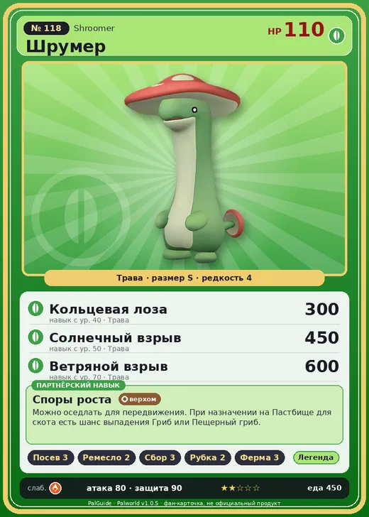

# #118 Шрумер (Shroomer)

№ 118

Трава

Слабость: Огонь

🌱 Посев семян <b>3</b>🖐️ Ручная работа <b>2</b>🌾 Сбор <b>3</b>🪓 Рубка деревьев <b>2</b>🐑 Фермерство <b>3</b>

<b>Споры роста</b> 🐎 верхом 🏠 на базе

❤️ 110 · ⚔️ 80 · 🛡 90

| Поле | Значение |
|---|---|
| Стихия | Трава |
| Слабость (кто бьёт сильнее) | Огонь |
| Редкость | 4 |
| Размер | S |
| HP / Атака / Защита (база вида) | 110 / 80 / 90 |
| Сколько ест | 450 |
| Цена продажи | 1367 |
| Множитель поимки | ×1 |
| Скорость рывка верхом | 1050 |

## Работа на базе
- Посев семян — ур. 3
- Ручная работа — ур. 2
- Сбор — ур. 3
- Рубка деревьев — ур. 2
- Фермерство — ур. 3

## Партнёрский навык: Споры роста
Можно оседлать для передвижения. При назначении на Пастбище для скота есть шанс выпадения Гриб или Пещерный гриб . Технологии 39

## Атаки по уровням
- ур. 1: Ядовитый выстрел (Тьма, сила 30)
- ур. 7: Семенной пулемёт (Трава, сила 80)
- ур. 15: Травяной торнадо (Трава, сила 200)
- ур. 22: Семенная мина (Трава, сила 120)
- ур. 30: Терновые лозы (Трава, сила 250)
- ур. 40: Кольцевая лоза (Трава, сила 300)
- ур. 50: Солнечный взрыв (Трава, сила 450)
- ур. 70: Ветряной взрыв (Трава, сила 600)

## Где водится
- В дикой природе: да; точек появления днём: 59, ночью: 59
- Яйцо: Яйцо свежей листвы

## Дроп
- Гриб — 1–2 шт., 100%
- Красная ягода — 1–2 шт., 60%

**Дроп альфы:**
- Деталь древней цивилизации — 2–3 шт., 100%
- Ценные внутренности — 2–3 шт., 100%

## Разведение
- Ранг разведения (CombiRank): 1520

## Лучшие пассивки по роли
- боец: Легенда, Демон-бог, Хладнокровный, Бессмертие, Король духов (вместо Бессмертия, если нет мутации)
- рабочий: Дьявольские руки, Виртуоз, Мастеровитый, Небожитель/Трудоголик
- ездовой: Божественная скорость, Легенда, Вечный двигатель, Небесное скольжение

## Чем хорош / чем плох
- ✅ можно оседлать
- ❌ явных минусов нет

> Вдохнув большое количество спор, он впадает в некое подобие транса. И если Шрумер вдруг замирает, то делает это не потому, что притворяется грибом — а потому что его накрыло собственными спорами.

См. также: [Стихии](../../guide/06_stihii.md) · [Разведение](../../guide/07_razvedenie.md) · [Все палы](README.md)
