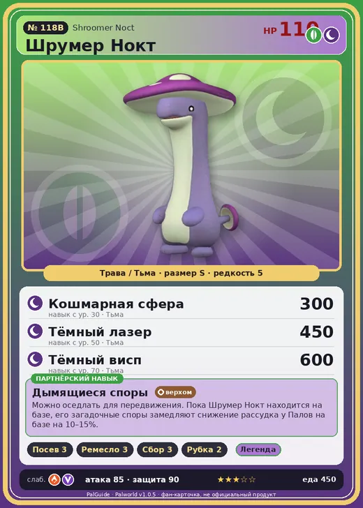

# #118B Шрумер Нокт (Shroomer Noct)

№ 118B

ТраваТьма

Слабость: ДраконОгонь

🌱 Посев семян <b>3</b>🖐️ Ручная работа <b>3</b>🌾 Сбор <b>3</b>🪓 Рубка деревьев <b>2</b>

<b>Дымящиеся споры</b> 🐎 верхом 🏠 на базе

❤️ 110 · ⚔️ 85 · 🛡 90

| Поле | Значение |
|---|---|
| Стихия | Трава, Тьма |
| Слабость (кто бьёт сильнее) | Дракон, Огонь |
| Редкость | 5 |
| Размер | S |
| HP / Атака / Защита (база вида) | 110 / 85 / 90 |
| Сколько ест | 450 |
| Цена продажи | 1399 |
| Множитель поимки | ×1 |
| Скорость рывка верхом | 1050 |

=== "Обзор"

    #### Работа на базе
    - Посев семян — ур. 3
    - Ручная работа — ур. 3
    - Сбор — ур. 3
    - Рубка деревьев — ур. 2

    #### Партнёрский навык: Дымящиеся споры
    Можно оседлать для передвижения. Пока Шрумер Нокт находится на базе, его загадочные споры замедляют снижение рассудка у Палов на базе на 10–15%. Технологии 39. По звёздам: 0★ -10 · 1★ -11.5 · 2★ -13 · 3★ -14 · 4★ -15

    #### Чем хорош / чем плох
    - ✅ можно оседлать
    - ❌ явных минусов нет

    > Облака спор легко перекрывают солнечный свет. Иногда Шрумер Нокт замирает вовсе не потому, что маскируется под гриб, а просто потому, что ничего не видит из-за собственных спор.

    См. также: [Стихии](../../guide/06_stihii.md) · [Разведение](../../guide/07_razvedenie.md) · [Все палы](README.md)

=== "Атаки"

    #### Атаки по уровням
    - ур. 1: Ядовитый выстрел (Тьма, сила 30)
    - ур. 7: Теневой взрыв (Тьма, сила 80)
    - ур. 15: Травяной торнадо (Трава, сила 200)
    - ур. 22: Семенная мина (Трава, сила 120)
    - ур. 30: Кошмарная сфера (Тьма, сила 300)
    - ур. 40: Кольцевая лоза (Трава, сила 300)
    - ур. 50: Тёмный лазер (Тьма, сила 450)
    - ур. 70: Тёмный висп (Тьма, сила 600)

=== "Где живёт"

    #### Где водится
    - В дикой природе: да; точек появления днём: 219, ночью: 219; уровни в первых точках: 47–49
    - Подземелья: Пещера Цветущей Сакуры
    - Яйцо: Большое яйцо свежей листвы

=== "Дроп"

    #### Дроп
    - Ядовитая железа — 4–8 шт., 100%
    - Загадочный гриб — 1–2 шт., 100%

    **Дроп альфы:**
    - Деталь древней цивилизации — 2–3 шт., 100%
    - Ценные внутренности — 2–3 шт., 100%

=== "Разведение"

    #### Разведение
    - Ранг разведения (CombiRank): 1450

=== "Пассивки"

    #### Лучшие пассивки по роли

    

⚔️ Боец

максимум урона и живучести в бою

<a class="psv r-4" data-psv="Легенда" href="../../../passivki/legend/">Легенда</a><a class="psv r-4" data-psv="Демон-бог" href="../../../passivki/demon_god/">Демон-бог</a><a class="psv r-3" data-psv="Король духов" href="../../../passivki/spirit_emperor/">Король духов</a><a class="psv r-3" data-psv="Хладнокровный" href="../../../passivki/serenity/">Хладнокровный</a>

🛠 Рабочий

работает быстрее и меньше устаёт на базе

<a class="psv r-5" data-psv="Дьявольские руки" href="../../../passivki/demons_hand/">Дьявольские руки</a><a class="psv r-4" data-psv="Виртуоз" href="../../../passivki/remarkable_craftsmanship/">Виртуоз</a><a class="psv r-3" data-psv="Мастеровитый" href="../../../passivki/artisan/">Мастеровитый</a><a class="psv r-3" data-psv="Трудоголик" href="../../../passivki/workaholic/">Трудоголик</a>

🐎 Ездовой

быстрее бегает или летает с тобой верхом

<a class="psv r-4" data-psv="Божественная скорость" href="../../../passivki/swift/">Божественная скорость</a><a class="psv r-4" data-psv="Легенда" href="../../../passivki/legend/">Легенда</a><a class="psv r-4" data-psv="Вечный двигатель" href="../../../passivki/eternal_engine/">Вечный двигатель</a><a class="psv r-4" data-psv="Небесное скольжение" href="../../../passivki/sky_strider/">Небесное скольжение</a>

    <small>Нажми на пассивку, чтобы узнать, что она даёт и где её взять.</small>

<a class="card-link" href="../shroomer/">← Шрумер</a><a class="card-link" href="../icelyn/">Айселин →</a>

