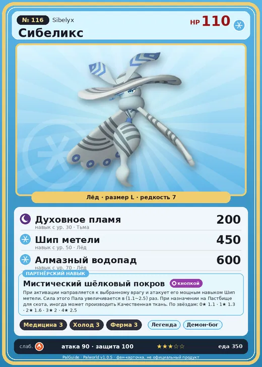

# Сибеликс

<canvas id="fx"></canvas>

№ 116

Лёд

Слабость: Огонь <b class="mx">×1,5</b> <button class="hlp" data-tip="Множители перемножаются по обеим стихиям: ×1,5 за стихию, которую атака бьёт, ×0,65 за ту, что её держит.">?</button>

Устойчив: Дракон <b class="mx">×0,65</b>

💊 Фармацевтика <b>3</b>❄️ Охлаждение <b>3</b>🐑 Фермерство <b>3</b>

<b>Мистический шёлковый покров</b> 🐾 Когда пал выпущен🔘 Включается кнопкой🏠 На базе

❤️ 110 · ⚔️ 90 · 🛡 100

Основное

💎Редкость <button class="hlp" data-tip="Чем выше число, тем реже встречается пал. 1–4 — обычные, 5–7 — редкие, 8+ — легендарные.">?</button><b>7</b>

📏Размер<b>L</b>

💰Цена продажи <button class="hlp" data-tip="Сколько золота даст торговец за пала.">?</button><b>1589</b>

Бой

🎯Множитель поимки <button class="hlp" data-tip="Насколько легче или труднее поймать: ×1 — обычно, меньше — сложнее.">?</button><b>×1</b>

🐎Скорость рывка верхом <button class="hlp" data-tip="Скорость, если сесть на пала и бежать рывком.">?</button><b>550</b>

Ферма и еда

🍖Сколько ест <button class="hlp" data-tip="Сколько сытости пал тратит — чем больше, тем больше еды нужно на базе.">?</button><b>350</b>

Разведение

🧬Сила разведения <button class="hlp" data-tip="Скрытое число игры: у детёныша оно примерно среднее от родителей. Чем меньше — тем «сильнее» пал.">?</button><b>1810</b>

=== "Обзор"

    #### Работа на базе

    
<a class="wbar" href="../../../2_mehaniki/rabota/?w=medicine&lv=3">💊 Фармацевтика<i style="--v:30%"></i><b>3</b></a><a class="wbar" href="../../../2_mehaniki/rabota/?w=cooling&lv=3">❄️ Охлаждение<i style="--v:30%"></i><b>3</b></a><a class="wbar" href="../../../2_mehaniki/rabota/?w=farming&lv=3">🐄 Фермерство<i style="--v:30%"></i><b>3</b></a><a class="wb-more" href="../../../2_mehaniki/rabota/">Что значат уровни работы →</a>

    #### Партнёрский навык: Мистический шёлковый покров
    При активации направляется к выбранному врагу и атакует его мощным навыком Шип метели. Сила этого Пала увеличивается в (1.1~2.5) раз. При назначении на Пастбище для скота, иногда может производить Качественная ткань. По звёздам: 0★ 1.1 · 1★ 1.3 · 2★ 1.6 · 3★ 2 · 4★ 2.5

    #### Чем хорош / чем плох
    - ✅ хорош в работе: Фармацевтика (ур. 3)
    - ❌ явных минусов нет

    > Любит дождь и часто просто стоит, не шевелясь, пока он не прекращается. Фокспаркс часто прибегает к нему, чтобы укрыться от дождя.

    См. также: [Стихии](../../guide/06_stihii.md) · [Разведение](../../guide/07_razvedenie.md) · [Все палы](README.md)

=== "Атаки"

    #### Атаки по уровням
    - ур. 1: Ледяная ракета (Лёд, сила 40)
    - ур. 7: Ледяной резак (Лёд, сила 80)
    - ур. 15: Айсберг (Лёд, сила 120)
    - ур. 22: Ледяное дыхание (Лёд, сила 160)
    - ур. 30: Духовное пламя (Тьма, сила 200)
    - ур. 40: Водяная бомба (Вода, сила 200)
    - ур. 50: Шип метели (Лёд, сила 450)
    - ур. 70: Алмазный водопад (Лёд, сила 600)

=== "Где живёт"

    #### Где водится

    

<button data-k="d" class="on">☀️ День</button><button data-k="n">🌙 Ночь</button>

ур. 36–43<a class="btn hm-full" href="../../../map/?pal=WhiteMoth">Показать на большой карте</a>

Астральные горыПодножие Астральных гор

🕳 Подземелье<b>Пещера Священной Горы</b>

🥚 Яйцо<b>Большое яйцо льда</b>

=== "Дроп"

    #### Дроп
    - Качественная ткань — 1 шт., 100%
    - Ледяной орган — 2–3 шт., 100%

    **Дроп альфы:**
    - Деталь древней цивилизации — 5–6 шт., 100%
    - Ценный мех — 5–6 шт., 100%

=== "Разведение"

    #### Разведение
    - Ранг разведения: 1810
    - Участвует в особых парах: Немофи → Сибеликс Примо

=== "Пассивки"

    #### Лучшие пассивки по роли

    

⚔️ Боец

максимум урона и живучести в бою

<a class="psv r-4" data-psv="Легенда" href="../../../passivki/legend/">Легенда</a><a class="psv r-4" data-psv="Демон-бог" href="../../../passivki/demon_god/">Демон-бог</a><a class="psv r-3" data-psv="Император льда" href="../../../passivki/ice_emperor/">Император льда</a><a class="psv r-3" data-psv="Хладнокровный" href="../../../passivki/serenity/">Хладнокровный</a>

🛠 Рабочий

работает быстрее и меньше устаёт на базе

<a class="psv r-5" data-psv="Дьявольские руки" href="../../../passivki/demons_hand/">Дьявольские руки</a><a class="psv r-4" data-psv="Виртуоз" href="../../../passivki/remarkable_craftsmanship/">Виртуоз</a><a class="psv r-3" data-psv="Мастеровитый" href="../../../passivki/artisan/">Мастеровитый</a><a class="psv r-3" data-psv="Трудоголик" href="../../../passivki/workaholic/">Трудоголик</a>

    <small>Нажми на пассивку, чтобы узнать, что она даёт и где её взять.</small>

<a class="card-link" href="../majex/">← Маджекс</a><a class="card-link" href="../sibelyx_primo/">Сибеликс Примо →</a>

