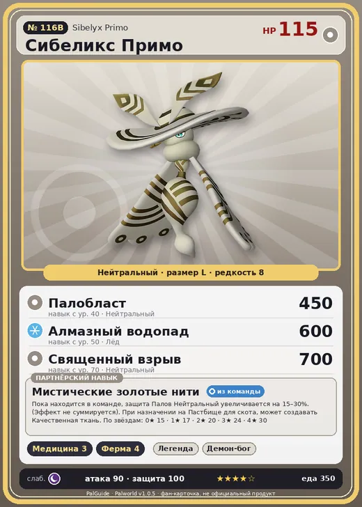

# Сибеликс Примо

<canvas id="fx"></canvas>

№ 116B

Нейтральный

Слабость: Тьма <b class="mx">×1,5</b> <button class="hlp" data-tip="Множители перемножаются по обеим стихиям: ×1,5 за стихию, которую атака бьёт, ×0,65 за ту, что её держит.">?</button>

💊 Фармацевтика <b>3</b>🐑 Фермерство <b>4</b>

<b>Мистические золотые нити</b> 🎒 Работает из команды🏠 На базе

❤️ 115 · ⚔️ 90 · 🛡 100

Основное

💎Редкость <button class="hlp" data-tip="Чем выше число, тем реже встречается пал. 1–4 — обычные, 5–7 — редкие, 8+ — легендарные.">?</button><b>8</b>

📏Размер<b>L</b>

💰Цена продажи <button class="hlp" data-tip="Сколько золота даст торговец за пала.">?</button><b>2094</b>

Бой

🎯Множитель поимки <button class="hlp" data-tip="Насколько легче или труднее поймать: ×1 — обычно, меньше — сложнее.">?</button><b>×1</b>

🐎Скорость рывка верхом <button class="hlp" data-tip="Скорость, если сесть на пала и бежать рывком.">?</button><b>550</b>

Ферма и еда

🍖Сколько ест <button class="hlp" data-tip="Сколько сытости пал тратит — чем больше, тем больше еды нужно на базе.">?</button><b>350</b>

Разведение

🧬Сила разведения <button class="hlp" data-tip="Скрытое число игры: у детёныша оно примерно среднее от родителей. Чем меньше — тем «сильнее» пал.">?</button><b>650</b>

💞Особая пара <button class="hlp" data-tip="Этого пала можно вывести только от этой пары.">?</button><b>Сибеликс + Немофи</b>

=== "Обзор"

    #### Работа на базе

    
💊 Фармацевтика<i style="--v:30%"></i><b>3</b>🐄 Фермерство<i style="--v:40%"></i><b>4</b>

    #### Партнёрский навык: Мистические золотые нити
    Пока находится в команде, защита Палов Нейтральный увеличивается на 15–30%. (Эффект не суммируется). При назначении на Пастбище для скота, может создавать Качественная ткань. По звёздам: 0★ 15 · 1★ 17 · 2★ 20 · 3★ 24 · 4★ 30

    #### Чем хорош / чем плох
    - ✅ хорош в работе: Фермерство (ур. 4)
    - ❌ разводится только особой парой

    > Любит смотреть в пустоту и часто просто неподвижно стоит, задумавшись. Нередко вокруг него собираются маленькие Палы.

    См. также: [Стихии](../../guide/06_stihii.md) · [Разведение](../../guide/07_razvedenie.md) · [Все палы](README.md)

=== "Атаки"

    #### Атаки по уровням
    - ур. 1: Воздушная пушка (Нейтральный, сила 40)
    - ур. 7: Силовой выстрел (Нейтральный, сила 80)
    - ур. 15: Силовая бомба (Нейтральный, сила 120)
    - ур. 22: Воздушные клинки (Нейтральный, сила 160)
    - ур. 30: Шип метели (Лёд, сила 450)
    - ур. 40: Палобласт (Нейтральный, сила 450)
    - ур. 50: Алмазный водопад (Лёд, сила 600)
    - ур. 70: Священный взрыв (Нейтральный, сила 700)

=== "Где живёт"

    #### Где водится

    

<button data-k="d" class="on">☀️ День</button><button data-k="n">🌙 Ночь</button>

ур. 75–76<a class="btn hm-full" href="../../../map/?pal=WhiteMoth_Neutral">Показать на большой карте</a>

🥚 Яйцо<b>Огромное обычное яйцо</b>

=== "Дроп"

    #### Дроп
    - Качественная ткань — 1 шт., 100%
    - Качественное масло Пала — 2–3 шт., 100%

    **Дроп альфы:**

    - Деталь древней цивилизации — 6–8 шт., 100%
    - Ценные внутренности — 2–3 шт., 100%

=== "Разведение"

    #### Разведение
    - Ранг разведения: 650
    - **Особая пара:** [Сибеликс](../../4_spravochniki/paly/sibelyx.md) + [Немофи](../../4_spravochniki/paly/lapure.md)

=== "Пассивки"

    #### Лучшие пассивки по роли

    

⚔️ Боец

максимум урона и живучести в бою

<a class="psv r-4" data-psv="Легенда" href="../../../passivki/legend/">Легенда</a><a class="psv r-4" data-psv="Демон-бог" href="../../../passivki/demon_god/">Демон-бог</a><a class="psv r-3" data-psv="Святое небо" href="../../../passivki/celestial_emperor/">Святое небо</a><a class="psv r-3" data-psv="Хладнокровный" href="../../../passivki/serenity/">Хладнокровный</a>

🛠 Рабочий

работает быстрее и меньше устаёт на базе

<a class="psv r-5" data-psv="Дьявольские руки" href="../../../passivki/demons_hand/">Дьявольские руки</a><a class="psv r-4" data-psv="Виртуоз" href="../../../passivki/remarkable_craftsmanship/">Виртуоз</a><a class="psv r-3" data-psv="Мастеровитый" href="../../../passivki/artisan/">Мастеровитый</a><a class="psv r-3" data-psv="Трудоголик" href="../../../passivki/workaholic/">Трудоголик</a>

    <small>Нажми на пассивку, чтобы узнать, что она даёт и где её взять.</small>

<a class="card-link" href="../sibelyx/">← Сибеликс</a><a class="card-link" href="../maraith/">Мараит →</a>

