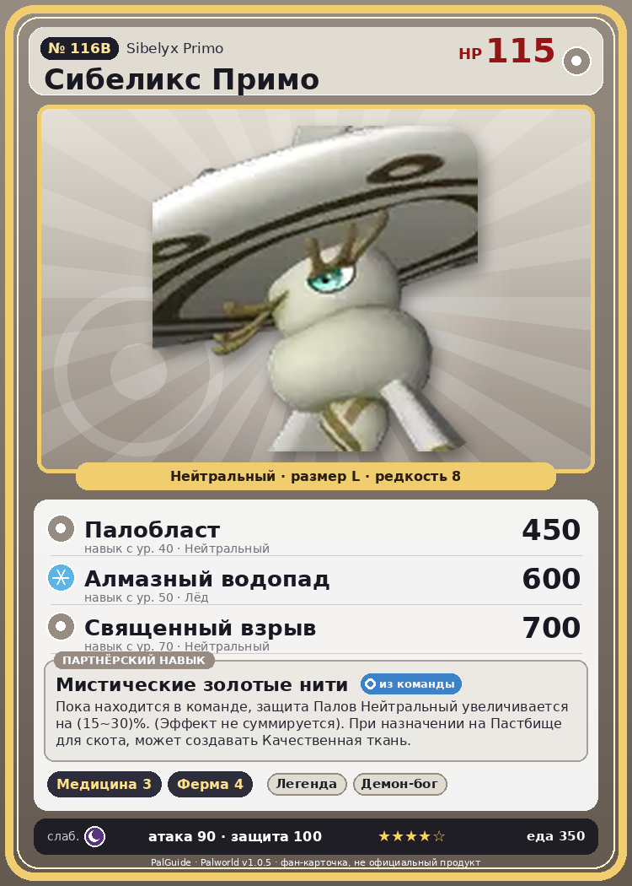

# #116B Сибеликс Примо (Sibelyx Primo)

{ width=360 }

| Поле | Значение |
|---|---|
| Стихия | Нейтральный |
| Слабость (кто бьёт сильнее) | Тьма |
| Редкость | 8 |
| Размер | L |
| HP / Атака / Защита (база вида) | 115 / 90 / 100 |
| Сколько ест | 350 |
| Цена продажи | 2094 |
| Множитель поимки | ×1 |
| Скорость рывка верхом | 550 |

## Работа на базе
- Фармацевтика — ур. 3
- Фермерство — ур. 4

## Партнёрский навык: Мистические золотые нити
Пока находится в команде, защита Палов Нейтральный увеличивается на (15~30)% . (Эффект не суммируется). При назначении на Пастбище для скота , может создавать Качественная ткань . level value 1 DefenseUp_Normal_PartnerSkill 15 2 DefenseUp_Normal_PartnerSkill 17 3 DefenseUp_Normal_PartnerSkill 20 4 DefenseUp_Normal_PartnerSkill 24 5 DefenseUp_Normal_PartnerSkill 30

## Атаки по уровням
- ур. 1: Воздушная пушка (Нейтральный, сила 40)
- ур. 7: Силовой выстрел (Нейтральный, сила 80)
- ур. 15: Силовая бомба (Нейтральный, сила 120)
- ур. 22: Воздушные клинки (Нейтральный, сила 160)
- ур. 30: Шип метели (Лёд, сила 450)
- ур. 40: Палобласт (Нейтральный, сила 450)
- ур. 50: Алмазный водопад (Лёд, сила 600)
- ур. 70: Священный взрыв (Нейтральный, сила 700)

## Где водится
- В дикой природе: нет/особый способ; точек появления днём: 0, ночью: 0
- Яйцо: Огромное обычное яйцо

## Дроп
- Качественная ткань — 1 шт., 100%
- Качественное масло Пала — 2–3 шт., 100%

**Дроп альфы:**
- Деталь древней цивилизации — 6–8 шт., 100%
- Ценные внутренности — 2–3 шт., 100%

## Разведение
- Ранг разведения (CombiRank): 650
- **Особая пара:** [Сибеликс](../../4_spravochniki/paly/sibelyx.md) + [Немофи](../../4_spravochniki/paly/lapure.md)

## Лучшие пассивки по роли
- боец: Легенда, Демон-бог, Хладнокровный, Бессмертие, Святое небо (вместо Бессмертия, если нет мутации)
- рабочий: Дьявольские руки, Виртуоз, Мастеровитый, Небожитель/Трудоголик
- ездовой: Божественная скорость, Легенда, Вечный двигатель, Небесное скольжение

## Чем хорош / чем плох
- ✅ можно оседлать
- ❌ разводится только особой парой

> Любит смотреть в пустоту и часто просто неподвижно стоит, задумавшись. Нередко вокруг него собираются маленькие Палы.

См. также: [Стихии](../../2_mehaniki/stihii.md) · [Разведение](../../2_mehaniki/razvedenie.md) · [Все палы](README.md)
_Источник: paldb.cc v1.0.5_
