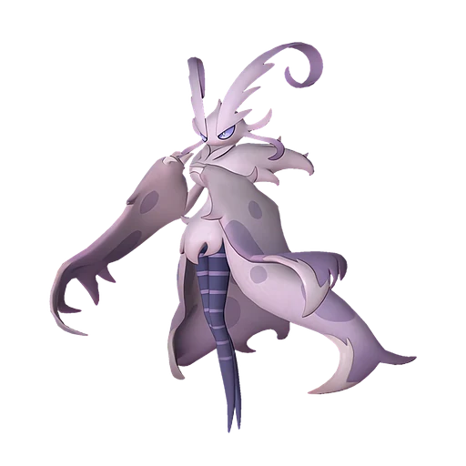

# Сильванс

<canvas id="fx"></canvas>

№ 193

Трава

Слабость: Огонь <b class="mx">×1,5</b> <button class="hlp" data-tip="Множители перемножаются по обеим стихиям: ×1,5 за стихию, которую атака бьёт, ×0,65 за ту, что её держит.">?</button>

Устойчив: Земля <b class="mx">×0,65</b>

🌱 Посев семян <b>6</b>🖐️ Ручная работа <b>6</b>🌾 Сбор <b>4</b>💊 Фармацевтика <b>8</b>📦 Транспортировка <b>2</b>

<b>Хранитель спор</b> 🎒 Работает из команды

❤️ 140 · ⚔️ 120 · 🛡 110

Основное

💎Редкость <button class="hlp" data-tip="Чем выше число, тем реже встречается пал. 1–4 — обычные, 5–7 — редкие, 8+ — легендарные.">?</button><b>8</b>

📏Размер<b>L</b>

💰Цена продажи <button class="hlp" data-tip="Сколько золота даст торговец за пала.">?</button><b>4436</b>

Бой

🎯Множитель поимки <button class="hlp" data-tip="Насколько легче или труднее поймать: ×1 — обычно, меньше — сложнее.">?</button><b>×1</b>

🐎Скорость рывка верхом <button class="hlp" data-tip="Скорость, если сесть на пала и бежать рывком.">?</button><b>750</b>

Ферма и еда

🍖Сколько ест <button class="hlp" data-tip="Сколько сытости пал тратит — чем больше, тем больше еды нужно на базе.">?</button><b>630</b>

Разведение

🧬Сила разведения <button class="hlp" data-tip="Скрытое число игры: у детёныша оно примерно среднее от родителей. Чем меньше — тем «сильнее» пал.">?</button><b>80</b>

💞Особая пара <button class="hlp" data-tip="Этого пала можно вывести только от этой пары.">?</button><b>Сильванс + Сильванс</b>

=== "Обзор"

    #### Работа на базе

    
<a class="wbar" href="../../../2_mehaniki/rabota/?w=planting&lv=6">🌱 Посев семян<i style="--v:60%"></i><b>6</b></a><a class="wbar" href="../../../2_mehaniki/rabota/?w=handiwork&lv=6">✋ Ручная работа<i style="--v:60%"></i><b>6</b></a><a class="wbar" href="../../../2_mehaniki/rabota/?w=gathering&lv=4">🧺 Сбор<i style="--v:40%"></i><b>4</b></a><a class="wbar" href="../../../2_mehaniki/rabota/?w=medicine&lv=8">💊 Фармацевтика<i style="--v:80%"></i><b>8</b></a><a class="wbar" href="../../../2_mehaniki/rabota/?w=transporting&lv=2">📦 Транспортировка<i style="--v:20%"></i><b>2</b></a><a class="wb-more" href="../../../2_mehaniki/rabota/">Что значат уровни работы →</a>

    #### Партнёрский навык: Хранитель спор
    Пока находится в команде, если игрок атакует врага в состоянии Путы, враг взрывается, дополнительно нанося 40–60% урона от атаки игрока. (Эффект не суммируется) Кроме того, игрок и Палы нейтрализуют взрывоопасные споры Мирового Древа.

    #### Чем хорош / чем плох
    - ✅ Фармацевтика 8, посев 6; мини-босс Древа; очень высокая атака (120); много здоровья (140); отличный рабочий (пригодность 8)
    - ❌ Поздний; много ест (630); разводится только особой парой

    > С незапамятных времён он стоит у Древа и продолжает что-то охранять. Что именно он защищает сейчас и почему делает это — сам Сильванс не знает. Потому что так велит Древо. Потому что споры, которыми он управляет, должны знать, кто является врагом.

    См. также: [Стихии](../../guide/06_stihii.md) · [Разведение](../../guide/07_razvedenie.md) · [Все палы](README.md)

=== "Атаки"

    #### Атаки по уровням
    - ур. 1: Воздушные клинки (Нейтральный, сила 160)
    - ур. 7: Отражающий лист (Трава, сила 400)
    - ур. 15: Шип метели (Лёд, сила 450)
    - ур. 22: Перекрестие ветра (Трава, сила 500)
    - ур. 30: Ветряной взрыв (Трава, сила 600)
    - ур. 40: Священный взрыв (Нейтральный, сила 700)
    - ур. 50: Гигантские споры (Трава, сила 700)
    - ур. 70: Споровый взрыв (Трава, сила 800)

=== "Где живёт"

    #### Где водится

    

<b>В дикой природе не встречается</b>Точек появления на открытой карте в данных игры нет — ищи в подземельях, яйцах или выводи разведением.

🥚 Яйцо<b>Огромное яйцо свежей листвы</b>

=== "Дроп"

    #### Дроп
    - Абсолютная душа Пала — 1 шт., 100%
    - Ядро древней цивилизации — 1 шт., 100%

    **Дроп альфы:**
    - Деталь древней цивилизации — 6–8 шт., 100%
    - Ценные внутренности — 2–3 шт., 100%

=== "Разведение"

    #### Разведение
    - Ранг разведения: 80
    - **Особая пара:** [Сильванс](../../4_spravochniki/paly/silvance.md) + [Сильванс](../../4_spravochniki/paly/silvance.md)
    - Участвует в особых парах: Сильванс → Сильванс; Сильванс → Сильванс

=== "Пассивки"

    #### Лучшие пассивки по роли

    

⚔️ Боец

максимум урона и живучести в бою

<a class="psv r-4" data-psv="Легенда" href="../../../passivki/legend/">Легенда</a><a class="psv r-4" data-psv="Демон-бог" href="../../../passivki/demon_god/">Демон-бог</a><a class="psv r-3" data-psv="Король духов" href="../../../passivki/spirit_emperor/">Король духов</a><a class="psv r-3" data-psv="Хладнокровный" href="../../../passivki/serenity/">Хладнокровный</a>

🛠 Рабочий

работает быстрее и меньше устаёт на базе

<a class="psv r-5" data-psv="Дьявольские руки" href="../../../passivki/demons_hand/">Дьявольские руки</a><a class="psv r-4" data-psv="Виртуоз" href="../../../passivki/remarkable_craftsmanship/">Виртуоз</a><a class="psv r-3" data-psv="Мастеровитый" href="../../../passivki/artisan/">Мастеровитый</a><a class="psv r-3" data-psv="Трудоголик" href="../../../passivki/workaholic/">Трудоголик</a>

    <small>Нажми на пассивку, чтобы узнать, что она даёт и где её взять.</small>

<a class="card-link" href="../shaolong/">← Шаолонг</a><a class="card-link" href="../dandilord/">Дандилорд →</a>

