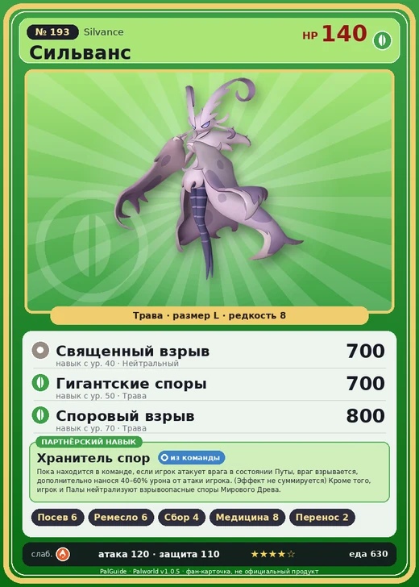

# #193 Сильванс (Silvance)

№ 193

Трава

Слабость: Огонь

🌱 Посев семян <b>6</b>🖐️ Ручная работа <b>6</b>🌾 Сбор <b>4</b>💊 Фармацевтика <b>8</b>📦 Транспортировка <b>2</b>

<b>Хранитель спор</b> 🎒 из команды

❤️ 140 · ⚔️ 120 · 🛡 110

| Поле | Значение |
|---|---|
| Стихия | Трава |
| Слабость (кто бьёт сильнее) | Огонь |
| Редкость | 8 |
| Размер | L |
| HP / Атака / Защита (база вида) | 140 / 120 / 110 |
| Сколько ест | 630 |
| Цена продажи | 4436 |
| Множитель поимки | ×1 |
| Скорость рывка верхом | 750 |

=== "Обзор"

    #### Работа на базе
    - Посев семян — ур. 6
    - Ручная работа — ур. 6
    - Сбор — ур. 4
    - Фармацевтика — ур. 8
    - Транспортировка — ур. 2

    #### Партнёрский навык: Хранитель спор
    Пока находится в команде, если игрок атакует врага в состоянии Путы, враг взрывается, дополнительно нанося 40–60% урона от атаки игрока. (Эффект не суммируется) Кроме того, игрок и Палы нейтрализуют взрывоопасные споры Мирового Древа.

    #### Чем хорош / чем плох
    - ✅ Фармацевтика 8, посев 6; мини-босс Древа; очень высокая атака (120); много здоровья (140); отличный рабочий (пригодность 8)
    - ❌ Поздний; много ест (630); разводится только особой парой

    > С незапамятных времён он стоит у Древа и продолжает что-то охранять. Что именно он защищает сейчас и почему делает это — сам Сильванс не знает. Потому что так велит Древо. Потому что споры, которыми он управляет, должны знать, кто является врагом.

    См. также: [Стихии](../../guide/06_stihii.md) · [Разведение](../../guide/07_razvedenie.md) · [Все палы](README.md)

=== "Атаки"

    #### Атаки по уровням
    - ур. 1: Воздушные клинки (Нейтральный, сила 160)
    - ур. 7: Отражающий лист (Трава, сила 400)
    - ур. 15: Шип метели (Лёд, сила 450)
    - ур. 22: Перекрестие ветра (Трава, сила 500)
    - ур. 30: Ветряной взрыв (Трава, сила 600)
    - ур. 40: Священный взрыв (Нейтральный, сила 700)
    - ур. 50: Гигантские споры (Трава, сила 700)
    - ур. 70: Споровый взрыв (Трава, сила 800)

=== "Где живёт"

    #### Где водится
    - В дикой природе: нет/особый способ; точек появления днём: 0, ночью: 0
    - Яйцо: Огромное яйцо свежей листвы

=== "Дроп"

    #### Дроп
    - Абсолютная душа Пала — 1 шт., 100%
    - Ядро древней цивилизации — 1 шт., 100%

    **Дроп альфы:**
    - Деталь древней цивилизации — 6–8 шт., 100%
    - Ценные внутренности — 2–3 шт., 100%

=== "Разведение"

    #### Разведение
    - Ранг разведения (CombiRank): 80
    - **Особая пара:** [Сильванс](../../4_spravochniki/paly/silvance.md) + [Сильванс](../../4_spravochniki/paly/silvance.md)
    - Участвует в особых парах: Сильванс → Сильванс; Сильванс → Сильванс

=== "Пассивки"

    #### Лучшие пассивки по роли

    

⚔️ Боец

максимум урона и живучести в бою

<a class="psv r-4" data-psv="Легенда" href="../../../passivki/legend/">Легенда</a><a class="psv r-4" data-psv="Демон-бог" href="../../../passivki/demon_god/">Демон-бог</a><a class="psv r-3" data-psv="Король духов" href="../../../passivki/spirit_emperor/">Король духов</a><a class="psv r-3" data-psv="Хладнокровный" href="../../../passivki/serenity/">Хладнокровный</a>

🛠 Рабочий

работает быстрее и меньше устаёт на базе

<a class="psv r-5" data-psv="Дьявольские руки" href="../../../passivki/demons_hand/">Дьявольские руки</a><a class="psv r-4" data-psv="Виртуоз" href="../../../passivki/remarkable_craftsmanship/">Виртуоз</a><a class="psv r-3" data-psv="Мастеровитый" href="../../../passivki/artisan/">Мастеровитый</a><a class="psv r-3" data-psv="Трудоголик" href="../../../passivki/workaholic/">Трудоголик</a>

    <small>Нажми на пассивку, чтобы узнать, что она даёт и где её взять.</small>

<a class="card-link" href="../shaolong/">← Шаолонг</a><a class="card-link" href="../dandilord/">Дандилорд →</a>

