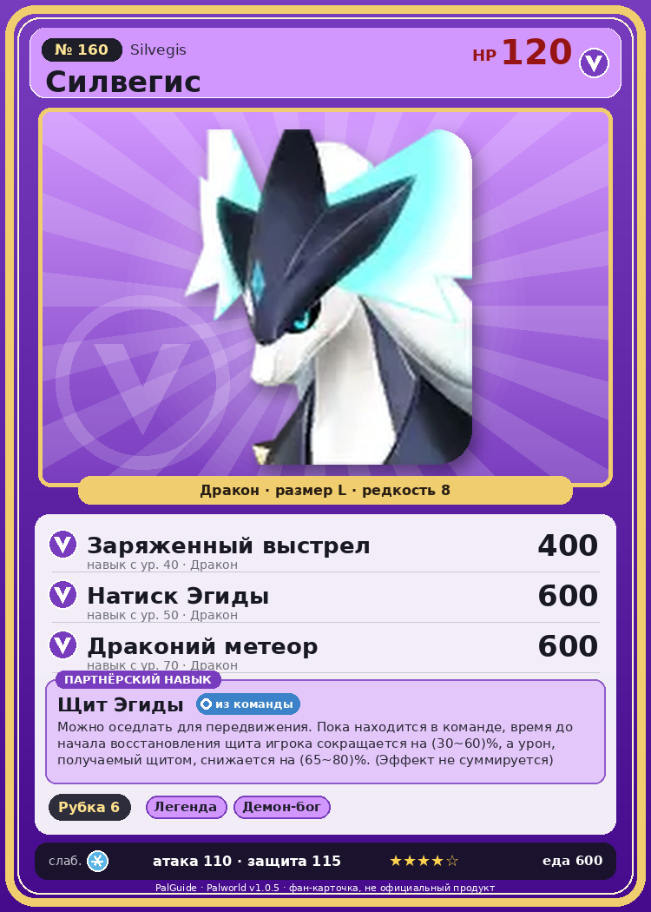

# #160 Силвегис (Silvegis)

{ width=360 }

| Поле | Значение |
|---|---|
| Стихия | Дракон |
| Слабость (кто бьёт сильнее) | Лёд |
| Редкость | 8 |
| Размер | L |
| HP / Атака / Защита (база вида) | 120 / 110 / 115 |
| Сколько ест | 600 |
| Цена продажи | 3710 |
| Множитель поимки | ×1 |
| Скорость рывка верхом | 1050 |

## Работа на базе
- Рубка деревьев — ур. 6

## Партнёрский навык: Щит Эгиды
Можно оседлать для передвижения. Пока находится в команде, время до начала восстановления щита игрока сокращается на (30~60)% , а урон, получаемый щитом, снижается на (65~80)% . (Эффект не суммируется) Технологии 60 level value 1 ReduceCoolTime_RecoveryPlayerShield_PartnerSkill 30 ShieldDamageCutRate_PartnerSkill 65 2 ReduceCoolTime_RecoveryPlayerShield_PartnerSkill 34 ShieldDamageCutRate_PartnerSkill 68 3 ReduceCoolTime_RecoveryPlayerShield_PartnerSkill 40 ShieldDamageCutRate_PartnerSkill 71 4 ReduceCoolTime_RecoveryPlayerShield_PartnerSkill 48 ShieldDamageCutRate_PartnerSkill 75 5 ReduceCoolTime_RecoveryPlayerShield_PartnerSkill 60 ShieldDamageCutRate_PartnerSkill 80

## Атаки по уровням
- ур. 1: Драконья пушка (Дракон, сила 40)
- ур. 7: Ледяной резак (Лёд, сила 80)
- ур. 15: Айсберг (Лёд, сила 120)
- ур. 22: Дыхание дракона (Дракон, сила 160)
- ур. 30: Взрывная пушка (Дракон, сила 200)
- ур. 40: Заряженный выстрел (Дракон, сила 400)
- ур. 50: Натиск Эгиды (Дракон, сила 600)
- ур. 70: Драконий метеор (Дракон, сила 600)

## Где водится
- В дикой природе: да; точек появления днём: 1, ночью: 1
- Яйцо: Огромное яйцо дракона

## Дроп
- Хромаит — 2–3 шт., 100%

**Дроп альфы:**
- Деталь древней цивилизации — 7–8 шт., 100%
- Ценный драконий самоцвет — 2–3 шт., 100%

## Разведение
- Ранг разведения (CombiRank): 560

## Лучшие пассивки по роли
- по обзору: Алмазное тело, Особая конституция, Легенда, Живая стена святилища
- боец: Легенда, Демон-бог, Хладнокровный, Бессмертие, Божественный дракон (вместо Бессмертия, если нет мутации)
- рабочий: Дьявольские руки, Виртуоз, Мастеровитый, Небожитель/Трудоголик
- ездовой: Божественная скорость, Легенда, Вечный двигатель, Небесное скольжение

## Чем хорош / чем плох
- ✅ Щит игрока: быстрее восстанавливается и меньше урона — главный саппорт рейдов; хорошая атака (110); много здоровья (120); отличный рабочий (пригодность 6); можно оседлать
- ❌ Сам наносит мало урона; много ест (600)

> Металлический обод на его шее обладает магнитными свойствами. Стоит поднести к нему лапу — и он тут же притягивается сам к себе. Когда на шее скапливается металлический мусор, он нехотя берётся за уборку, но ничего не отлипает — и его охватывает приступ бешенства.

См. также: [Стихии](../../2_mehaniki/stihii.md) · [Разведение](../../2_mehaniki/razvedenie.md) · [Все палы](README.md)
_Источник: paldb.cc v1.0.5_
