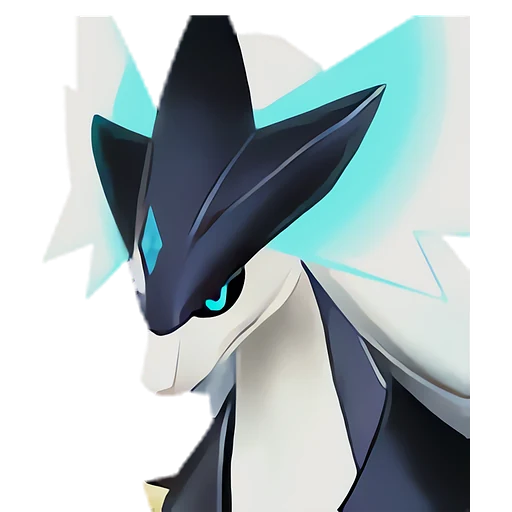

# Силвегис

<canvas id="fx"></canvas>

№ 160 · Silvegis

Дракон

Слабость: Лёд <b class="mx">×1,5</b> <button class="hlp" data-tip="Множители перемножаются по обеим стихиям пала: ×1,5 за каждую стихию, которую атака бьёт, ×0,65 за каждую, которая её держит. Если одна стихия слаба, а другая устойчива (×1,5 × 0,65 ≈ ×0,98), слабости нет.">?</button>

Устойчив: Тьма <b class="mx">×0,65</b>

🪓 Рубка деревьев <b>6</b>

<b>Щит Эгиды</b> 🎒 из команды 🐎 верхом

❤️ 120 · ⚔️ 110 · 🛡 115

Основное

💎Редкость <button class="hlp" data-tip="Чем выше число, тем реже встречается пал. 1–4 — обычные, 5–7 — редкие, 8+ — легендарные.">?</button><b>8</b>

📏Размер<b>L</b>

💰Цена продажи <button class="hlp" data-tip="Сколько золота даст торговец за пала.">?</button><b>3710</b>

Бой

🎯Множитель поимки <button class="hlp" data-tip="Насколько легче или труднее поймать: ×1 — обычно, меньше — сложнее.">?</button><b>×1</b>

🐎Скорость рывка верхом <button class="hlp" data-tip="Скорость, если сесть на пала и бежать рывком.">?</button><b>1050</b>

Ферма и еда

🍖Сколько ест <button class="hlp" data-tip="Сколько сытости пал тратит — чем больше, тем больше еды нужно на базе.">?</button><b>600</b>

Разведение

🧬Сила разведения <button class="hlp" data-tip="Скрытое число игры: у детёныша оно примерно среднее от родителей. Чем меньше — тем «сильнее» пал.">?</button><b>560</b>

=== "Обзор"

    #### Работа на базе
    - Рубка деревьев — ур. 6

    #### Партнёрский навык: Щит Эгиды
    Можно оседлать для передвижения. Пока находится в команде, время до начала восстановления щита игрока сокращается на 30–60%, а урон, получаемый щитом, снижается на 65–80%. (Эффект не суммируется) Технологии 60. По звёздам: 0★ 30 · 1★ 34 · 2★ 40 · 3★ 48 · 4★ 60

    #### Чем хорош / чем плох
    - ✅ Щит игрока: быстрее восстанавливается и меньше урона — главный саппорт рейдов; хорошая атака (110); много здоровья (120); отличный рабочий (пригодность 6); можно оседлать
    - ❌ Сам наносит мало урона; много ест (600)

    > Металлический обод на его шее обладает магнитными свойствами. Стоит поднести к нему лапу — и он тут же притягивается сам к себе. Когда на шее скапливается металлический мусор, он нехотя берётся за уборку, но ничего не отлипает — и его охватывает приступ бешенства.

    См. также: [Стихии](../../guide/06_stihii.md) · [Разведение](../../guide/07_razvedenie.md) · [Все палы](README.md)

=== "Атаки"

    #### Атаки по уровням
    - ур. 1: Драконья пушка (Дракон, сила 40)
    - ур. 7: Ледяной резак (Лёд, сила 80)
    - ур. 15: Айсберг (Лёд, сила 120)
    - ур. 22: Дыхание дракона (Дракон, сила 160)
    - ур. 30: Взрывная пушка (Дракон, сила 200)
    - ур. 40: Заряженный выстрел (Дракон, сила 400)
    - ур. 50: Натиск Эгиды (Дракон, сила 600)
    - ур. 70: Драконий метеор (Дракон, сила 600)

=== "Где живёт"

    #### Где водится

    

<button data-k="d" class="on">☀️ День</button><button data-k="n">🌙 Ночь</button>

ур. 80–80<a class="btn hm-full" href="../../../map/?pal=WhiteShieldDragon">Показать на большой карте</a>

🥚 Яйцо<b>Огромное яйцо дракона</b>

=== "Дроп"

    #### Дроп
    - Хромаит — 2–3 шт., 100%

    **Дроп альфы:**
    - Деталь древней цивилизации — 7–8 шт., 100%
    - Ценный драконий самоцвет — 2–3 шт., 100%

=== "Разведение"

    #### Разведение
    - Ранг разведения (CombiRank): 560

=== "Пассивки"

    #### Лучшие пассивки по роли

    

⚔️ Боец

максимум урона и живучести в бою

<a class="psv r-4" data-psv="Легенда" href="../../../passivki/legend/">Легенда</a><a class="psv r-4" data-psv="Демон-бог" href="../../../passivki/demon_god/">Демон-бог</a><a class="psv r-3" data-psv="Божественный дракон" href="../../../passivki/divine_dragon/">Божественный дракон</a><a class="psv r-3" data-psv="Хладнокровный" href="../../../passivki/serenity/">Хладнокровный</a>

🛠 Рабочий

работает быстрее и меньше устаёт на базе

<a class="psv r-5" data-psv="Дьявольские руки" href="../../../passivki/demons_hand/">Дьявольские руки</a><a class="psv r-4" data-psv="Виртуоз" href="../../../passivki/remarkable_craftsmanship/">Виртуоз</a><a class="psv r-3" data-psv="Мастеровитый" href="../../../passivki/artisan/">Мастеровитый</a><a class="psv r-3" data-psv="Трудоголик" href="../../../passivki/workaholic/">Трудоголик</a>

🐎 Ездовой

быстрее бегает или летает с тобой верхом

<a class="psv r-4" data-psv="Божественная скорость" href="../../../passivki/swift/">Божественная скорость</a><a class="psv r-4" data-psv="Легенда" href="../../../passivki/legend/">Легенда</a><a class="psv r-4" data-psv="Вечный двигатель" href="../../../passivki/eternal_engine/">Вечный двигатель</a><a class="psv r-4" data-psv="Небесное скольжение" href="../../../passivki/sky_strider/">Небесное скольжение</a>

    <small>Нажми на пассивку, чтобы узнать, что она даёт и где её взять.</small>

<a class="card-link" href="../knocklem_ignis/">← Теранайт Игнис</a><a class="card-link" href="../azurmane/">Азурмейн →</a>

