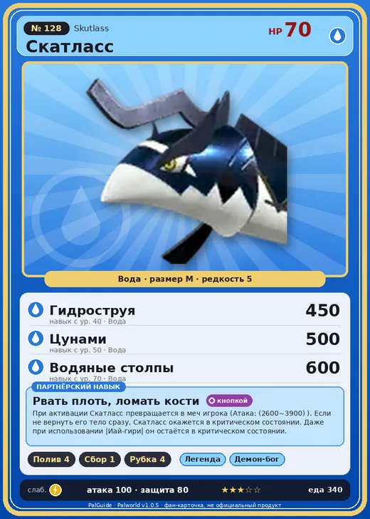

# #128 Скатласс (Skutlass)

#128 · Skutlass

Вода

Слабость: Молния

💧 Полив <b>4</b>🌾 Сбор <b>1</b>🪓 Рубка деревьев <b>4</b>

<b>Рвать плоть, ломать кости</b> 🔘 кнопкой

❤️ 70 · ⚔️ 100 · 🛡 80

| Поле | Значение |
|---|---|
| Стихия | Вода |
| Слабость (кто бьёт сильнее) | Молния |
| Редкость | 5 |
| Размер | M |
| HP / Атака / Защита (база вида) | 70 / 100 / 80 |
| Сколько ест | 340 |
| Цена продажи | 1342 |
| Множитель поимки | ×1 |
| Скорость рывка верхом | 800 |

## Работа на базе
- Полив — ур. 4
- Сбор — ур. 1
- Рубка деревьев — ур. 4

## Партнёрский навык: Рвать плоть, ломать кости
При активации Скатласс превращается в меч игрока (Атака: (2600~3900) ). Если не вернуть его тело сразу, Скатласс окажется в критическом состоянии. Даже при использовании |Иай-гири| он остаётся в критическом состоянии. level value 1 MainValue 2600 2 MainValue 2700 3 MainValue 3000 4 MainValue 3400 5 MainValue 3900

## Атаки по уровням
- ур. 1: Акваджет (Вода, сила 40)
- ур. 7: Пузырьковый выстрел (Вода, сила 80)
- ур. 15: Полоса брызг (Вода, сила 160)
- ур. 22: Гидроатака под давлением (Вода, сила 250)
- ур. 30: Гидрорезак (Вода, сила 350)
- ур. 40: Гидроструя (Вода, сила 450)
- ур. 50: Цунами (Вода, сила 500)
- ур. 70: Водяные столпы (Вода, сила 600)

## Где водится
- В дикой природе: да; точек появления днём: 129, ночью: 129; уровни в первых точках: 30–34
- Яйцо: Большое яйцо воды

## Дроп
- Филе Скатласса — 1–2 шт., 100%
- Жидкость водного Пала — 1–2 шт., 100%

**Дроп альфы:**
- Деталь древней цивилизации — 2–3 шт., 100%
- Ценные внутренности — 2–3 шт., 100%

## Разведение
- Ранг разведения (CombiRank): 1420
- Участвует в особых парах: Гобфин Игнис → Скатласс Игнис

## Лучшие пассивки по роли
- боец: Легенда, Демон-бог, Хладнокровный, Бессмертие, Владыка морей (вместо Бессмертия, если нет мутации)
- рабочий: Дьявольские руки, Виртуоз, Мастеровитый, Небожитель/Трудоголик
- ездовой: Божественная скорость, Легенда, Вечный двигатель, Небесное скольжение

## Чем хорош / чем плох
- ✅ хорошая атака (100); можно оседлать
- ❌ явных минусов нет

> Способность временно отделять тело и рассекать врагов костями. Если тело не вернуть сразу, силы быстро истощаются. Говорят, среди молодых особей популярна опасная игра — соревнуются, кто дольше продержится разделённым.

См. также: [Стихии](../../2_mehaniki/stihii.md) · [Разведение](../../2_mehaniki/razvedenie.md) · [Все палы](README.md)
_Источник: paldb.cc v1.0.5_
