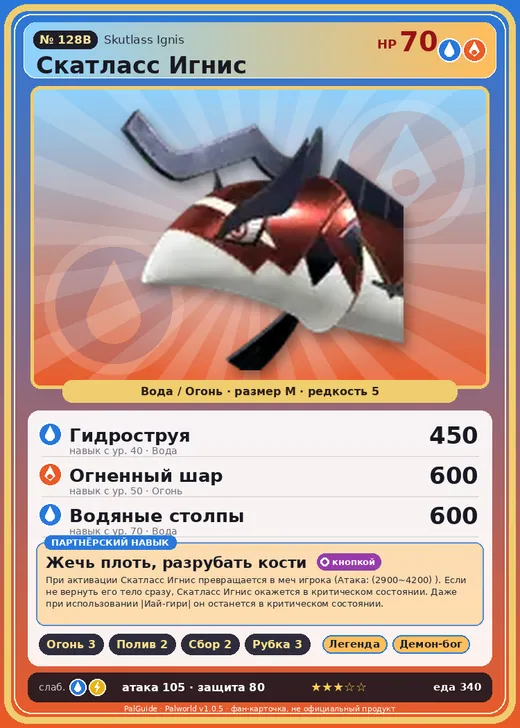

# Скатласс Игнис

<canvas id="fx"></canvas>

№ 128B

ВодаОгонь

Слабость: Вода <b class="mx">×1,5</b>Молния <b class="mx">×1,5</b> <button class="hlp" data-tip="Множители перемножаются по обеим стихиям: ×1,5 за стихию, которую атака бьёт, ×0,65 за ту, что её держит. Вода: 1 × 1,5 = ×1,5; Молния: 1,5 × 1 = ×1,5.">?</button>

Устойчив: Огонь <b class="mx">×0,65</b>Трава <b class="mx">×0,65</b>Лёд <b class="mx">×0,65</b>

🔥 Разжигание огня <b>3</b>💧 Полив <b>2</b>🌾 Сбор <b>2</b>🪓 Рубка деревьев <b>3</b>

<b>Жечь плоть, разрубать кости</b> 🔘 Включается кнопкой

❤️ 70 · ⚔️ 105 · 🛡 80

Основное

💎Редкость <button class="hlp" data-tip="Чем выше число, тем реже встречается пал. 1–4 — обычные, 5–7 — редкие, 8+ — легендарные.">?</button><b>5</b>

📏Размер<b>M</b>

💰Цена продажи <button class="hlp" data-tip="Сколько золота даст торговец за пала.">?</button><b>1442</b>

Бой

🎯Множитель поимки <button class="hlp" data-tip="Насколько легче или труднее поймать: ×1 — обычно, меньше — сложнее.">?</button><b>×1</b>

🐎Скорость рывка верхом <button class="hlp" data-tip="Скорость, если сесть на пала и бежать рывком.">?</button><b>800</b>

Ферма и еда

🍖Сколько ест <button class="hlp" data-tip="Сколько сытости пал тратит — чем больше, тем больше еды нужно на базе.">?</button><b>340</b>

Разведение

🧬Сила разведения <button class="hlp" data-tip="Скрытое число игры: у детёныша оно примерно среднее от родителей. Чем меньше — тем «сильнее» пал.">?</button><b>1590</b>

💞Особая пара <button class="hlp" data-tip="Этого пала можно вывести только от этой пары.">?</button><b>Скатласс + Гобфин Игнис</b>

=== "Обзор"

    #### Работа на базе

    
<a class="wbar" href="../../../2_mehaniki/rabota/?w=kindling&lv=3">🔥 Разжигание огня<i style="--v:30%"></i><b>3</b></a><a class="wbar" href="../../../2_mehaniki/rabota/?w=watering&lv=2">💧 Полив<i style="--v:20%"></i><b>2</b></a><a class="wbar" href="../../../2_mehaniki/rabota/?w=gathering&lv=2">🧺 Сбор<i style="--v:20%"></i><b>2</b></a><a class="wbar" href="../../../2_mehaniki/rabota/?w=lumbering&lv=3">🪓 Рубка деревьев<i style="--v:30%"></i><b>3</b></a><a class="wb-more" href="../../../2_mehaniki/rabota/">Что значат уровни работы →</a>

    #### Партнёрский навык: Жечь плоть, разрубать кости
    При активации Скатласс Игнис превращается в меч игрока (Атака: 2900–4200). Если не вернуть его тело сразу, Скатласс Игнис окажется в критическом состоянии. Даже при использовании |Иай-гири| он останется в критическом состоянии. По звёздам: 0★ 2900 · 1★ 3000 · 2★ 3300 · 3★ 3700 · 4★ 4200

    #### Чем хорош / чем плох
    - ✅ хорошая атака (105)
    - ❌ разводится только особой парой

    > Отделяя тело, рассекать врагов костями. Если тело не вернуть сразу, силы быстро истощаются. Говорят, старые особи сознательно держат тело отделённым надолго, чтобы активизировать инстинкт выживания и продлить жизнь… или нет.

    См. также: [Стихии](../../guide/06_stihii.md) · [Разведение](../../guide/07_razvedenie.md) · [Все палы](README.md)

=== "Атаки"

    #### Атаки по уровням
    - ур. 1: Акваджет (Вода, сила 40)
    - ур. 7: Огненная стрела (Огонь, сила 120)
    - ур. 15: Огненный шторм (Огонь, сила 200)
    - ур. 22: Гидроатака под давлением (Вода, сила 250)
    - ур. 30: Гидрорезак (Вода, сила 350)
    - ур. 40: Гидроструя (Вода, сила 450)
    - ур. 50: Огненный шар (Огонь, сила 600)
    - ур. 70: Водяные столпы (Вода, сила 600)

=== "Где живёт"

    #### Где водится

    

<button data-k="d" class="on">☀️ День</button><button data-k="n">🌙 Ночь</button>

<button data-w=p class=on>Палпагос</button><button data-w=t>Мировое древо</button>

ур. 40–40<a class="btn hm-full" href="../../../map/?pal=SwordCutlassfish_Fire">Показать на большой карте</a>

Остров Огненных жилДвурогий остров

🥚 Яйцо<b>Большое яйцо воды</b>

=== "Дроп"

    #### Дроп
    - Филе Скатласса — 1–2 шт., 100%
    - Огненный орган — 1–2 шт., 100%

    **Дроп альфы:**

    - Деталь древней цивилизации — 2–3 шт., 100%
    - Ценные внутренности — 2–3 шт., 100%

=== "Разведение"

    #### Разведение
    - Ранг разведения: 1590
    - **Особая пара:** [Скатласс](../../4_spravochniki/paly/skutlass.md) + [Гобфин Игнис](../../4_spravochniki/paly/gobfin_ignis.md)

=== "Пассивки"

    #### Лучшие пассивки по роли

    

⚔️ Боец

максимум урона и живучести в бою

<a class="psv r-4" data-psv="Легенда" href="../../../passivki/legend/">Легенда</a><a class="psv r-4" data-psv="Демон-бог" href="../../../passivki/demon_god/">Демон-бог</a><a class="psv r-3" data-psv="Владыка морей" href="../../../passivki/lord_of_the_sea/">Владыка морей</a><a class="psv r-3" data-psv="Хладнокровный" href="../../../passivki/serenity/">Хладнокровный</a>

🛠 Рабочий

работает быстрее и меньше устаёт на базе

<a class="psv r-5" data-psv="Дьявольские руки" href="../../../passivki/demons_hand/">Дьявольские руки</a><a class="psv r-4" data-psv="Виртуоз" href="../../../passivki/remarkable_craftsmanship/">Виртуоз</a><a class="psv r-3" data-psv="Мастеровитый" href="../../../passivki/artisan/">Мастеровитый</a><a class="psv r-3" data-psv="Трудоголик" href="../../../passivki/workaholic/">Трудоголик</a>

    <small>Нажми на пассивку, чтобы узнать, что она даёт и где её взять.</small>

<a class="card-link" href="../skutlass/">← Скатласс</a><a class="card-link" href="../reptyro/">Рептиро →</a>

