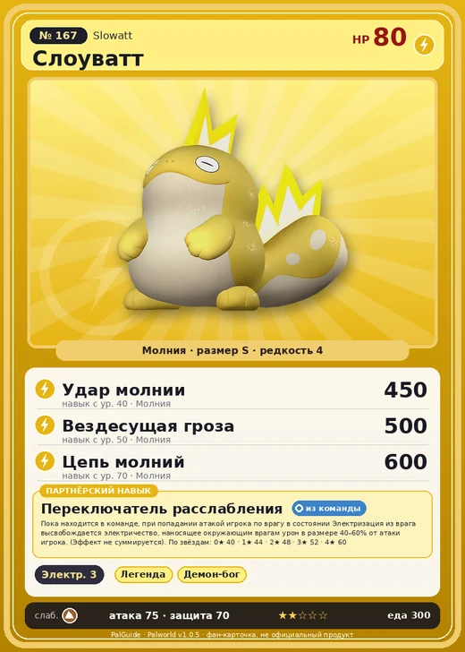

# #167 Слоуватт (Slowatt)

№ 167

Молния

Слабость: Земля

⚡ Генерация энергии <b>3</b>

<b>Переключатель расслабления</b> 🎒 из команды

❤️ 80 · ⚔️ 75 · 🛡 70

| Поле | Значение |
|---|---|
| Стихия | Молния |
| Слабость (кто бьёт сильнее) | Земля |
| Редкость | 4 |
| Размер | S |
| HP / Атака / Защита (база вида) | 80 / 75 / 70 |
| Сколько ест | 300 |
| Цена продажи | 1611 |
| Множитель поимки | ×1 |
| Скорость рывка верхом | 390 |

=== "Обзор"

    #### Работа на базе
    - Генерация энергии — ур. 3

    #### Партнёрский навык: Переключатель расслабления
    Пока находится в команде, при попадании атакой игрока по врагу в состоянии Электризация из врага высвобождается электричество, наносящее окружающим врагам урон в размере 40–60% от атаки игрока. (Эффект не суммируется). По звёздам: 0★ 40 · 1★ 44 · 2★ 48 · 3★ 52 · 4★ 60

    #### Чем хорош / чем плох
    - ✅
    - ❌ слабая атака (75)

    > Делает что хочет, спит когда захочется, ест что вздумается. Чтобы поддерживать такой образ жизни, Слоуватт , должно быть, прилагают незаметные усилия. …Говорят, прежние островитяне не выдержали бы, если бы не думали так.

    См. также: [Стихии](../../guide/06_stihii.md) · [Разведение](../../guide/07_razvedenie.md) · [Все палы](README.md)

=== "Атаки"

    #### Атаки по уровням
    - ур. 1: Грозовое копьё (Молния, сила 40)
    - ур. 7: Шоковая волна (Молния, сила 80)
    - ур. 15: Плазмомёт (Молния, сила 120)
    - ур. 22: Грозовая линия (Молния, сила 160)
    - ур. 30: Тройной разряд (Молния, сила 250)
    - ур. 40: Удар молнии (Молния, сила 450)
    - ур. 50: Вездесущая гроза (Молния, сила 500)
    - ур. 70: Цепь молний (Молния, сила 600)

=== "Где живёт"

    #### Где водится
    - В дикой природе: да; точек появления днём: 45, ночью: 45
    - Яйцо: Яйцо молнии

=== "Дроп"

    #### Дроп
    - Жидкость водного Пала — 1 шт., 100%
    - Электрический орган — 1–2 шт., 100%

    **Дроп альфы:**
    - Деталь древней цивилизации — 7–8 шт., 100%
    - Ценные внутренности — 2–3 шт., 100%

=== "Разведение"

    #### Разведение
    - Ранг разведения (CombiRank): 1750
    - Участвует в особых парах: Солмора → Солмора Лакс

=== "Пассивки"

    #### Лучшие пассивки по роли

    

⚔️ Боец

максимум урона и живучести в бою

<a class="psv r-4" data-psv="Легенда" href="../../../passivki/legend/">Легенда</a><a class="psv r-4" data-psv="Демон-бог" href="../../../passivki/demon_god/">Демон-бог</a><a class="psv r-3" data-psv="Император молнии" href="../../../passivki/lord_of_lightning/">Император молнии</a><a class="psv r-3" data-psv="Хладнокровный" href="../../../passivki/serenity/">Хладнокровный</a>

🛠 Рабочий

работает быстрее и меньше устаёт на базе

<a class="psv r-5" data-psv="Дьявольские руки" href="../../../passivki/demons_hand/">Дьявольские руки</a><a class="psv r-4" data-psv="Виртуоз" href="../../../passivki/remarkable_craftsmanship/">Виртуоз</a><a class="psv r-3" data-psv="Мастеровитый" href="../../../passivki/artisan/">Мастеровитый</a><a class="psv r-3" data-psv="Трудоголик" href="../../../passivki/workaholic/">Трудоголик</a>

    <small>Нажми на пассивку, чтобы узнать, что она даёт и где её взять.</small>

<a class="card-link" href="../hoodle/">← Худл</a><a class="card-link" href="../bakemi/">Бакеми →</a>

