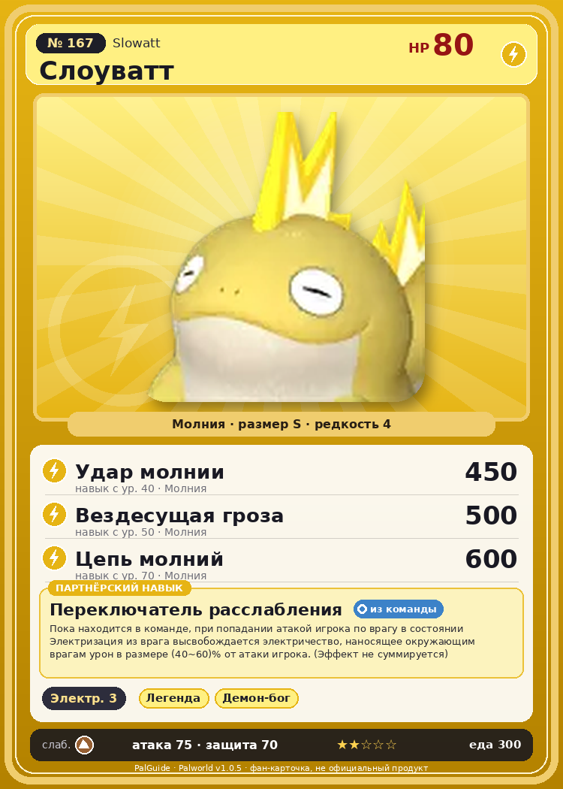

# #167 Слоуватт (Slowatt)

{ width=360 }

| Поле | Значение |
|---|---|
| Стихия | Молния |
| Слабость (кто бьёт сильнее) | Земля |
| Редкость | 4 |
| Размер | S |
| HP / Атака / Защита (база вида) | 80 / 75 / 70 |
| Сколько ест | 300 |
| Цена продажи | 1611 |
| Множитель поимки | ×1 |
| Скорость рывка верхом | 390 |

## Работа на базе
- Генерация энергии — ур. 3

## Партнёрский навык: Переключатель расслабления
Пока находится в команде, при попадании атакой игрока по врагу в состоянии Электризация из врага высвобождается электричество , наносящее окружающим врагам урон в размере (40~60)% от атаки игрока. (Эффект не суммируется) level value 1 ElecLizard_PlayerInflictEffect_PartnerSkill 40 2 ElecLizard_PlayerInflictEffect_PartnerSkill 44 3 ElecLizard_PlayerInflictEffect_PartnerSkill 48 4 ElecLizard_PlayerInflictEffect_PartnerSkill 52 5 ElecLizard_PlayerInflictEffect_PartnerSkill 60

## Атаки по уровням
- ур. 1: Грозовое копьё (Молния, сила 40)
- ур. 7: Шоковая волна (Молния, сила 80)
- ур. 15: Плазмомёт (Молния, сила 120)
- ур. 22: Грозовая линия (Молния, сила 160)
- ур. 30: Тройной разряд (Молния, сила 250)
- ур. 40: Удар молнии (Молния, сила 450)
- ур. 50: Вездесущая гроза (Молния, сила 500)
- ур. 70: Цепь молний (Молния, сила 600)

## Где водится
- В дикой природе: да; точек появления днём: 45, ночью: 45
- Яйцо: Яйцо молнии

## Дроп
- Жидкость водного Пала — 1 шт., 100%
- Электрический орган — 1–2 шт., 100%

**Дроп альфы:**
- Деталь древней цивилизации — 7–8 шт., 100%
- Ценные внутренности — 2–3 шт., 100%

## Разведение
- Ранг разведения (CombiRank): 1750
- Участвует в особых парах: Солмора → Солмора Лакс

## Лучшие пассивки по роли
- боец: Легенда, Демон-бог, Хладнокровный, Бессмертие, Император молнии (вместо Бессмертия, если нет мутации)
- рабочий: Дьявольские руки, Виртуоз, Мастеровитый, Небожитель/Трудоголик
- ездовой: Божественная скорость, Легенда, Вечный двигатель, Небесное скольжение

## Чем хорош / чем плох
- ✅ можно оседлать
- ❌ слабая атака (75)

> Делает что хочет, спит когда захочется, ест что вздумается. Чтобы поддерживать такой образ жизни, Слоуватт , должно быть, прилагают незаметные усилия. …Говорят, прежние островитяне не выдержали бы, если бы не думали так.

См. также: [Стихии](../../2_mehaniki/stihii.md) · [Разведение](../../2_mehaniki/razvedenie.md) · [Все палы](README.md)
_Источник: paldb.cc v1.0.5_
