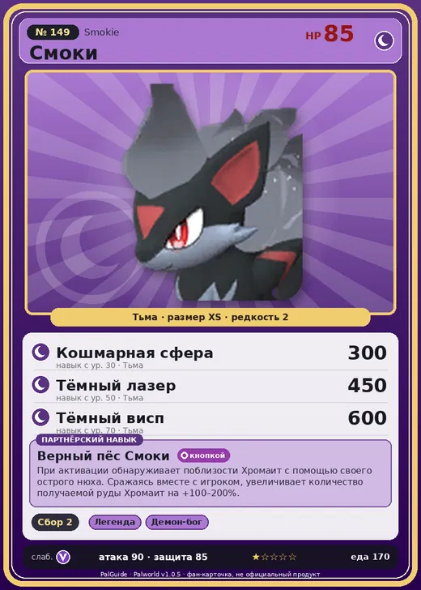

# Смоки

<canvas id="fx"></canvas>

№ 149

Тьма

Слабость: Дракон <b class="mx">×1,5</b> <button class="hlp" data-tip="Множители перемножаются по обеим стихиям: ×1,5 за стихию, которую атака бьёт, ×0,65 за ту, что её держит.">?</button>

Устойчив: Нейтральный <b class="mx">×0,65</b>

🌾 Сбор <b>2</b>

<b>Верный пёс Смоки</b> 🔘 Включается кнопкой

❤️ 85 · ⚔️ 90 · 🛡 85

Основное

💎Редкость <button class="hlp" data-tip="Чем выше число, тем реже встречается пал. 1–4 — обычные, 5–7 — редкие, 8+ — легендарные.">?</button><b>2</b>

📏Размер<b>XS</b>

💰Цена продажи <button class="hlp" data-tip="Сколько золота даст торговец за пала.">?</button><b>1842</b>

Бой

🎯Множитель поимки <button class="hlp" data-tip="Насколько легче или труднее поймать: ×1 — обычно, меньше — сложнее.">?</button><b>×1</b>

🐎Скорость рывка верхом <button class="hlp" data-tip="Скорость, если сесть на пала и бежать рывком.">?</button><b>700</b>

Ферма и еда

🍖Сколько ест <button class="hlp" data-tip="Сколько сытости пал тратит — чем больше, тем больше еды нужно на базе.">?</button><b>170</b>

Разведение

🧬Сила разведения <button class="hlp" data-tip="Скрытое число игры: у детёныша оно примерно среднее от родителей. Чем меньше — тем «сильнее» пал.">?</button><b>1760</b>

=== "Обзор"

    #### Работа на базе

    
🧺 Сбор<i style="--v:20%"></i><b>2</b>

    #### Партнёрский навык: Верный пёс Смоки
    При активации обнаруживает поблизости Хромаит с помощью своего острого нюха. Сражаясь вместе с игроком, увеличивает количество получаемой руды Хромаит на +100–200%. Технологии 58. По звёздам: 0★ 100 · 1★ 110 · 2★ 130 · 3★ 160 · 4★ 200

    #### Чем хорош / чем плох
    - ✅ хорошая атака (90)
    - ❌ явных минусов нет

    > Чёрное пламя на ощупь лишь слегка тёплое, но всё, что касается его слишком долго, медленно плавится изнутри. Стоит лишь поднести кусок сыра — получается настоящий деликатес.

    См. также: [Стихии](../../guide/06_stihii.md) · [Разведение](../../guide/07_razvedenie.md) · [Все палы](README.md)

=== "Атаки"

    #### Атаки по уровням
    - ур. 1: Двойные клыки (тьма) (Тьма, сила 40)
    - ур. 2: Дикие клыки (тьма) (Тьма, сила 50)
    - ур. 3: Грязевой выстрел (Земля, сила 40)
    - ур. 7: Распространение тьмы (Тьма, сила 60)
    - ур. 15: Тёмная пушка (Тьма, сила 70)
    - ур. 22: Теневой взрыв (Тьма, сила 80)
    - ур. 30: Кошмарная сфера (Тьма, сила 300)
    - ур. 40: Комета (Дракон, сила 180)
    - ур. 50: Тёмный лазер (Тьма, сила 450)
    - ур. 70: Тёмный висп (Тьма, сила 600)

=== "Где живёт"

    #### Где водится

    

<button data-k="d" class="on">☀️ День</button><button data-k="n">🌙 Ночь</button>

ур. 50–64<a class="btn hm-full" href="../../../map/?pal=BlackPuppy">Показать на большой карте</a>

Выжженный холмЛедяной коралловый холмЖёлтоземная равнинаПустынное пепельное плато

🕳 Подземелье<b>Пещера Тэнраку</b>

🥚 Яйцо<b>Яйцо тьмы</b>

=== "Дроп"

    #### Дроп
    - Хромаит — 1–2 шт., 100%

    **Дроп альфы:**

    - Деталь древней цивилизации — 6–7 шт., 100%
    - Ценный мех — 2–3 шт., 100%

=== "Разведение"

    #### Разведение
    - Ранг разведения: 1760
    - Участвует в особых парах: [Манчилл](munchill.md) → [Смоки Крист](smokie_cryst.md)

=== "Пассивки"

    #### Лучшие пассивки по роли

    

⚔️ Боец

максимум урона и живучести в бою

<a class="psv r-4" data-psv="Легенда" href="../../../passivki/legend/">Легенда</a><a class="psv r-4" data-psv="Демон-бог" href="../../../passivki/demon_god/">Демон-бог</a><a class="psv r-3" data-psv="Король тьмы" href="../../../passivki/lord_of_the_underworld/">Король тьмы</a><a class="psv r-3" data-psv="Хладнокровный" href="../../../passivki/serenity/">Хладнокровный</a>

    <small>Нажми на пассивку, чтобы узнать, что она даёт и где её взять.</small>

<a class="card-link" href="../nitemary_botan/">← Найтмери Ботан</a><a class="card-link" href="../smokie_cryst/">Смоки Крист →</a>

