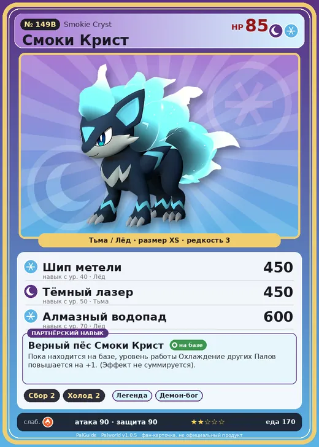

# #149B Смоки Крист (Smokie Cryst)

№ 149B

ТьмаЛёд

Слабость: ДраконОгонь

🌾 Сбор <b>2</b>❄️ Охлаждение <b>2</b>

<b>Верный пёс Смоки Крист</b> 🏠 на базе

❤️ 85 · ⚔️ 90 · 🛡 90

| Поле | Значение |
|---|---|
| Стихия | Тьма, Лёд |
| Слабость (кто бьёт сильнее) | Дракон, Огонь |
| Редкость | 3 |
| Размер | XS |
| HP / Атака / Защита (база вида) | 85 / 90 / 90 |
| Сколько ест | 170 |
| Цена продажи | 1628 |
| Множитель поимки | ×1 |
| Скорость рывка верхом | 700 |

=== "Обзор"

    #### Работа на базе
    - Сбор — ур. 2
    - Охлаждение — ур. 2

    #### Партнёрский навык: Верный пёс Смоки Крист
    Пока находится на базе, уровень работы Охлаждение других Палов повышается на +1. (Эффект не суммируется).

    #### Чем хорош / чем плох
    - ✅
    - ❌ разводится только особой парой

    > Бледно-голубое пламя на ощупь лишь немного холодное, но всё, что касается его слишком долго, медленно замерзает. Стоит лишь поднести бутылку молока — получается замороженное молоко!

    См. также: [Стихии](../../guide/06_stihii.md) · [Разведение](../../guide/07_razvedenie.md) · [Все палы](README.md)

=== "Атаки"

    #### Атаки по уровням
    - ур. 1: Двойные клыки (тьма) (Тьма, сила 40)
    - ур. 2: Дикие клыки (тьма) (Тьма, сила 50)
    - ур. 7: Ледяной резак (Лёд, сила 80)
    - ур. 15: Ледяное дыхание (Лёд, сила 160)
    - ур. 22: Ледяные пули (Лёд, сила 250)
    - ур. 30: Ледяной след (Лёд, сила 300)
    - ур. 40: Шип метели (Лёд, сила 450)
    - ур. 50: Тёмный лазер (Тьма, сила 450)
    - ур. 70: Алмазный водопад (Лёд, сила 600)

=== "Где живёт"

    #### Где водится
    - В дикой природе: да; точек появления днём: 8, ночью: 8
    - Яйцо: Яйцо тьмы

=== "Дроп"

    #### Дроп
    - Ледяной орган — 1–2 шт., 100%
    - Средняя душа Пала — 1 шт., 100%

    **Дроп альфы:**
    - Деталь древней цивилизации — 4–6 шт., 100%
    - Ценный мех — 2–3 шт., 100%

=== "Разведение"

    #### Разведение
    - Ранг разведения (CombiRank): 1610
    - **Особая пара:** [Смоки](../../4_spravochniki/paly/smokie.md) + [Манчилл](../../4_spravochniki/paly/munchill.md)

=== "Пассивки"

    #### Лучшие пассивки по роли

    

⚔️ Боец

максимум урона и живучести в бою

<a class="psv r-4" data-psv="Легенда" href="../../../passivki/legend/">Легенда</a><a class="psv r-4" data-psv="Демон-бог" href="../../../passivki/demon_god/">Демон-бог</a><a class="psv r-3" data-psv="Король тьмы" href="../../../passivki/lord_of_the_underworld/">Король тьмы</a><a class="psv r-3" data-psv="Хладнокровный" href="../../../passivki/serenity/">Хладнокровный</a>

    <small>Нажми на пассивку, чтобы узнать, что она даёт и где её взять.</small>

<a class="card-link" href="../smokie/">← Смоки</a><a class="card-link" href="../omascul/">Омаскул →</a>

