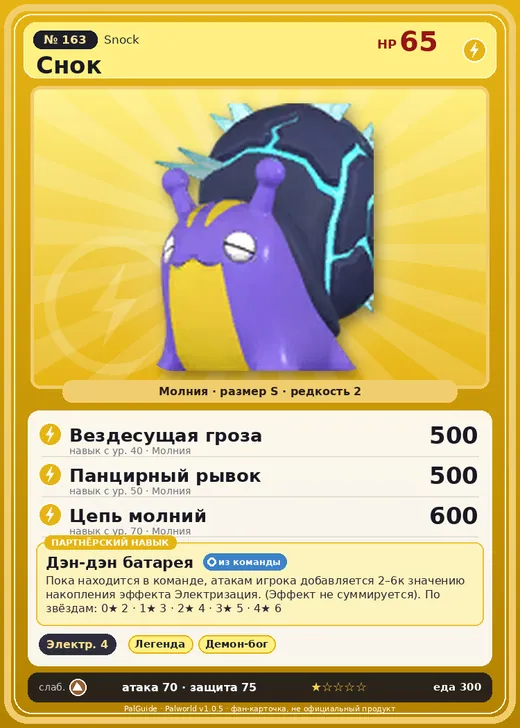

# #163 Снок (Snock)

#163 · Snock

Молния

Слабость: Земля

⚡ Генерация энергии <b>4</b>

<b>Дэн-дэн батарея</b> 🎒 из команды

❤️ 65 · ⚔️ 70 · 🛡 75

| Поле | Значение |
|---|---|
| Стихия | Молния |
| Слабость (кто бьёт сильнее) | Земля |
| Редкость | 2 |
| Размер | S |
| HP / Атака / Защита (база вида) | 65 / 70 / 75 |
| Сколько ест | 300 |
| Цена продажи | 1523 |
| Множитель поимки | ×1 |
| Скорость рывка верхом | 945 |

## Работа на базе
- Генерация энергии — ур. 4

## Партнёрский навык: Дэн-дэн батарея
Пока находится в команде, атакам игрока добавляется (2~6) к значению накопления эффекта Электризация . (Эффект не суммируется) level value 1 AdditionalEffect_Electrical_PartnerSkill_ElecSnail 2 2 AdditionalEffect_Electrical_PartnerSkill_ElecSnail 3 3 AdditionalEffect_Electrical_PartnerSkill_ElecSnail 4 4 AdditionalEffect_Electrical_PartnerSkill_ElecSnail 5 5 AdditionalEffect_Electrical_PartnerSkill_ElecSnail 6

## Атаки по уровням
- ур. 1: Шоковая волна (Молния, сила 80)
- ур. 7: Грозовая линия (Молния, сила 160)
- ур. 15: Тройной разряд (Молния, сила 250)
- ур. 22: Грозовой удар (Молния, сила 300)
- ур. 30: Удар молнии (Молния, сила 450)
- ур. 40: Вездесущая гроза (Молния, сила 500)
- ур. 50: Панцирный рывок (Молния, сила 500)
- ур. 70: Цепь молний (Молния, сила 600)

## Где водится
- В дикой природе: да; точек появления днём: 34, ночью: 34
- Яйцо: Яйцо молнии

## Дроп
- Электрический орган — 1–2 шт., 100%
- Жидкость водного Пала — 1–2 шт., 100%

**Дроп альфы:**
- Деталь древней цивилизации — 7–8 шт., 100%
- Ценные внутренности — 2–3 шт., 100%

## Разведение
- Ранг разведения (CombiRank): 1780
- Участвует в особых парах: Туртакл Терра → Снок Терра

## Лучшие пассивки по роли
- боец: Легенда, Демон-бог, Хладнокровный, Бессмертие, Император молнии (вместо Бессмертия, если нет мутации)
- рабочий: Дьявольские руки, Виртуоз, Мастеровитый, Небожитель/Трудоголик
- ездовой: Божественная скорость, Легенда, Вечный двигатель, Небесное скольжение

## Чем хорош / чем плох
- ✅ можно оседлать
- ❌ слабая атака (70); мало здоровья (65)

> Бросить Снок в воду и наслаждаться электрической ванной считается традиционным способом укрепления здоровья. Иначе говоря, опасная активность.

См. также: [Стихии](../../2_mehaniki/stihii.md) · [Разведение](../../2_mehaniki/razvedenie.md) · [Все палы](README.md)
