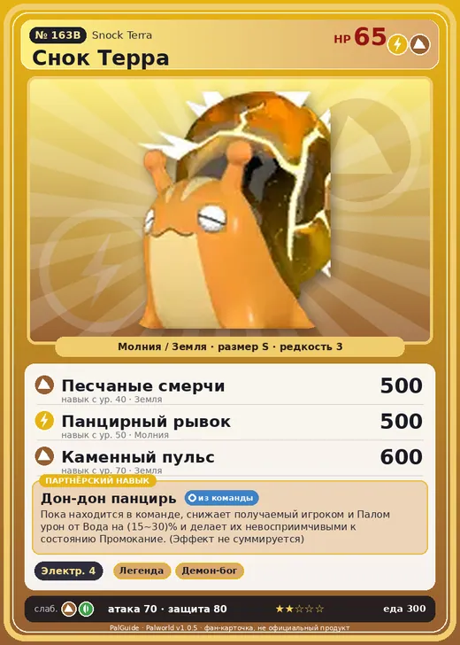

# #163B Снок Терра (Snock Terra)

№ 163B

МолнияЗемля

Слабость: ЗемляТрава

⚡ Генерация энергии <b>4</b>

<b>Дон-дон панцирь</b> 🎒 из команды

❤️ 65 · ⚔️ 70 · 🛡 80

| Поле | Значение |
|---|---|
| Стихия | Молния, Земля |
| Слабость (кто бьёт сильнее) | Земля, Трава |
| Редкость | 3 |
| Размер | S |
| HP / Атака / Защита (база вида) | 65 / 70 / 80 |
| Сколько ест | 300 |
| Цена продажи | 1623 |
| Множитель поимки | ×1 |
| Скорость рывка верхом | 945 |

=== "Обзор"

    #### Работа на базе
    - Генерация энергии — ур. 4

    #### Партнёрский навык: Дон-дон панцирь
    Пока находится в команде, снижает получаемый игроком и Палом урон от Вода на (15~30)% и делает их невосприимчивыми к состоянию Промокание . (Эффект не суммируется) level value 1 ElecSnail_Ground_PartnerSkill 15, 100 2 ElecSnail_Ground_PartnerSkill 17, 100 3 ElecSnail_Ground_PartnerSkill 20, 100 4 ElecSnail_Ground_PartnerSkill 24, 100 5 ElecSnail_Ground_PartnerSkill 30, 100

    #### Чем хорош / чем плох
    - ✅ можно оседлать
    - ❌ слабая атака (70); мало здоровья (65); разводится только особой парой

    > Бросать раскалённого Снок Терра в ванну и наслаждаться обжигающей водой когда-то было модой. Сегодня, благодаря ретро-буму, это снова горячий тренд.

    См. также: [Стихии](../../guide/06_stihii.md) · [Разведение](../../guide/07_razvedenie.md) · [Все палы](README.md)

=== "Атаки"

    #### Атаки по уровням
    - ур. 1: Шоковая волна (Молния, сила 80)
    - ур. 7: Камнемёт (Земля, сила 120)
    - ур. 15: Камнепад (Земля, сила 300)
    - ур. 22: Тройной разряд (Молния, сила 250)
    - ур. 30: Каменные копья (Земля, сила 400)
    - ур. 40: Песчаные смерчи (Земля, сила 500)
    - ур. 50: Панцирный рывок (Молния, сила 500)
    - ур. 70: Каменный пульс (Земля, сила 600)

=== "Где живёт"

    #### Где водится
    - В дикой природе: нет/особый способ; точек появления днём: 0, ночью: 0
    - Яйцо: Яйцо молнии

=== "Дроп"

    #### Дроп
    - Электрический орган — 1–2 шт., 100%
    - Качественное масло Пала — 1–2 шт., 100%

    **Дроп альфы:**
    - Деталь древней цивилизации — 7–8 шт., 100%
    - Ценные внутренности — 2–3 шт., 100%

=== "Разведение"

    #### Разведение
    - Ранг разведения (CombiRank): 1500
    - **Особая пара:** [Снок](../../4_spravochniki/paly/snock.md) + [Туртакл Терра](../../4_spravochniki/paly/turtacle_terra.md)

=== "Пассивки"

    #### Лучшие пассивки по роли
    - боец: Легенда, Демон-бог, Хладнокровный, Бессмертие, Император молнии (вместо Бессмертия, если нет мутации)
    - рабочий: Дьявольские руки, Виртуоз, Мастеровитый, Небожитель/Трудоголик
    - ездовой: Божественная скорость, Легенда, Вечный двигатель, Небесное скольжение

<a class="card-link" href="../snock/">← Снок</a><a class="card-link" href="../souffline/">Суффлин →</a>

