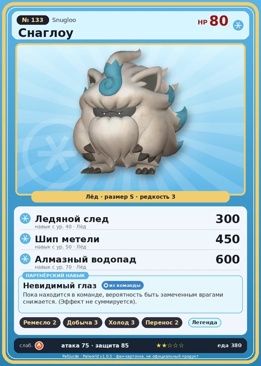

# #133 Снаглоу (Snugloo)

#133 · Snugloo

Лёд

Слабость: Огонь

🖐️ Ручная работа <b>2</b>⛏️ Добыча <b>3</b>❄️ Охлаждение <b>3</b>📦 Транспортировка <b>2</b>

<b>Невидимый глаз</b> 🎒 из команды

❤️ 80 · ⚔️ 75 · 🛡 85

| Поле | Значение |
|---|---|
| Стихия | Лёд |
| Слабость (кто бьёт сильнее) | Огонь |
| Редкость | 3 |
| Размер | S |
| HP / Атака / Защита (база вида) | 80 / 75 / 85 |
| Сколько ест | 380 |
| Цена продажи | 927 |
| Множитель поимки | ×1 |
| Скорость рывка верхом | 600 |

## Работа на базе
- Ручная работа — ур. 2
- Добыча — ур. 3
- Охлаждение — ур. 3
- Транспортировка — ур. 2

## Партнёрский навык: Невидимый глаз
Пока находится в команде, вероятность быть замеченным врагами снижается. (Эффект не суммируется) level value 1 EnemySightDetectionRate_PartnerSkill_SmallYeti 50 Пробуждение : 2 EnemySightDetectionRate_PartnerSkill_SmallYeti 55 Пробуждение : (Скрытность повышена: Небольшое ) 3 EnemySightDetectionRate_PartnerSkill_SmallYeti 60 Пробуждение : (Скрытность повышена: Среднее ) 4 EnemySightDetectionRate_PartnerSkill_SmallYeti 65 Пробуждение : (Скрытность повышена: Большое ) 5 EnemySightDetectionRate_PartnerSkill_SmallYeti 75 Пробуждение : (Скрытность повышена: Очень большое )

## Атаки по уровням
- ур. 1: Ледяная ракета (Лёд, сила 40)
- ур. 7: Ледяной резак (Лёд, сила 80)
- ур. 15: Айсберг (Лёд, сила 120)
- ур. 22: Ледяное дыхание (Лёд, сила 160)
- ур. 30: Ледяные пули (Лёд, сила 250)
- ур. 40: Ледяной след (Лёд, сила 300)
- ур. 50: Шип метели (Лёд, сила 450)
- ур. 70: Алмазный водопад (Лёд, сила 600)

## Где водится
- В дикой природе: да; точек появления днём: 21, ночью: 21; уровни в первых точках: 32–34
- Яйцо: Яйцо льда

## Дроп
- Кожа — 1–2 шт., 100%
- Шерсть — 2 шт., 100%

**Дроп альфы:**
- Деталь древней цивилизации — 1–2 шт., 100%
- Ценный мех — 2–3 шт., 100%

## Разведение
- Ранг разведения (CombiRank): 2390

## Лучшие пассивки по роли
- боец: Легенда, Демон-бог, Хладнокровный, Бессмертие, Император льда (вместо Бессмертия, если нет мутации)
- рабочий: Дьявольские руки, Виртуоз, Мастеровитый, Небожитель/Трудоголик
- ездовой: Божественная скорость, Легенда, Вечный двигатель, Небесное скольжение

## Чем хорош / чем плох
- ✅ можно оседлать
- ❌ слабая атака (75)

> «Увидеть глаза Снаглоу ». Так говорят о попытке постичь невидимую суть вещей. Однако почему-то не нашлось ни одного исследователя, который бы проверил, есть ли у Пала глаза вообще.

См. также: [Стихии](../../2_mehaniki/stihii.md) · [Разведение](../../2_mehaniki/razvedenie.md) · [Все палы](README.md)
_Источник: paldb.cc v1.0.5_
