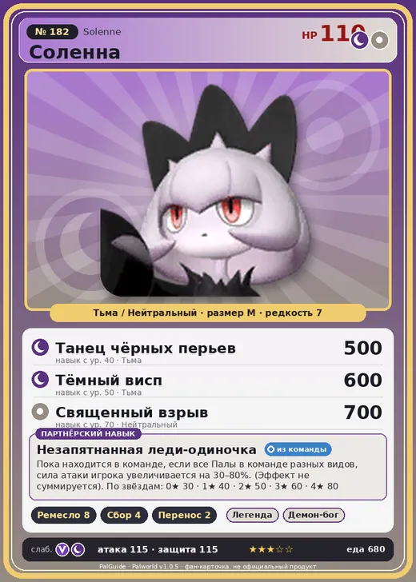

# #182 Соленна (Solenne)

#182 · Solenne

ТьмаНейтральный

Слабость: ДраконТьма

🖐️ Ручная работа <b>8</b>🌾 Сбор <b>4</b>📦 Транспортировка <b>2</b>

<b>Незапятнанная леди-одиночка</b> 🎒 из команды

❤️ 110 · ⚔️ 115 · 🛡 115

| Поле | Значение |
|---|---|
| Стихия | Тьма, Нейтральный |
| Слабость (кто бьёт сильнее) | Дракон, Тьма |
| Редкость | 7 |
| Размер | M |
| HP / Атака / Защита (база вида) | 110 / 115 / 115 |
| Сколько ест | 680 |
| Цена продажи | 3867 |
| Множитель поимки | ×1 |
| Скорость рывка верхом | 600 |

## Работа на базе
- Ручная работа — ур. 8
- Сбор — ур. 4
- Транспортировка — ур. 2

## Партнёрский навык: Незапятнанная леди-одиночка
Пока находится в команде, если все Палы в команде разных видов, сила атаки игрока увеличивается на (30~80)% . (Эффект не суммируется) level value 1 AttackUp_IfAllOtomoTribeDifferent_PartnerSkill 30 2 AttackUp_IfAllOtomoTribeDifferent_PartnerSkill 40 3 AttackUp_IfAllOtomoTribeDifferent_PartnerSkill 50 4 AttackUp_IfAllOtomoTribeDifferent_PartnerSkill 60 5 AttackUp_IfAllOtomoTribeDifferent_PartnerSkill 80

## Атаки по уровням
- ур. 1: Тёмный выстрел (Тьма, сила 40)
- ур. 7: Тёмная пушка (Тьма, сила 70)
- ур. 15: Воздушные клинки (Нейтральный, сила 160)
- ур. 22: Кошмарная сфера (Тьма, сила 300)
- ур. 30: Тёмный лазер (Тьма, сила 450)
- ур. 40: Танец чёрных перьев (Тьма, сила 500)
- ур. 50: Тёмный висп (Тьма, сила 600)
- ур. 70: Священный взрыв (Нейтральный, сила 700)

## Где водится
- В дикой природе: нет/особый способ; точек появления днём: 0, ночью: 0
- Яйцо: Большое яйцо тьмы

## Дроп
- Осколок тьмы — 2–3 шт., 100%
- Качественное снадобье восстановления — 2 шт., 50%

**Дроп альфы:**
- Деталь древней цивилизации — 4–6 шт., 100%
- Ценные внутренности — 2–3 шт., 100%

## Разведение
- Ранг разведения (CombiRank): 280

## Лучшие пассивки по роли
- по обзору: Мастеровитый, Виртуоз, Дьявольские руки, Трудоголик
- боец: Легенда, Демон-бог, Хладнокровный, Бессмертие, Король тьмы (вместо Бессмертия, если нет мутации)
- рабочий: Дьявольские руки, Виртуоз, Мастеровитый, Небожитель/Трудоголик
- ездовой: Божественная скорость, Легенда, Вечный двигатель, Небесное скольжение

## Чем хорош / чем плох
- ✅ Ручная работа 8 — лучший крафтер; хорошая атака (115); отличный рабочий (пригодность 8); можно оседлать
- ❌ⓘ; много ест (680)

> После хорошего опыта Соленна не успокоится, пока не получит столь же плохой. Если берёшь на себя заботу о Соленна , нужна соответствующая решимость.

См. также: [Стихии](../../guide/06_stihii.md) · [Разведение](../../guide/07_razvedenie.md) · [Все палы](README.md)
