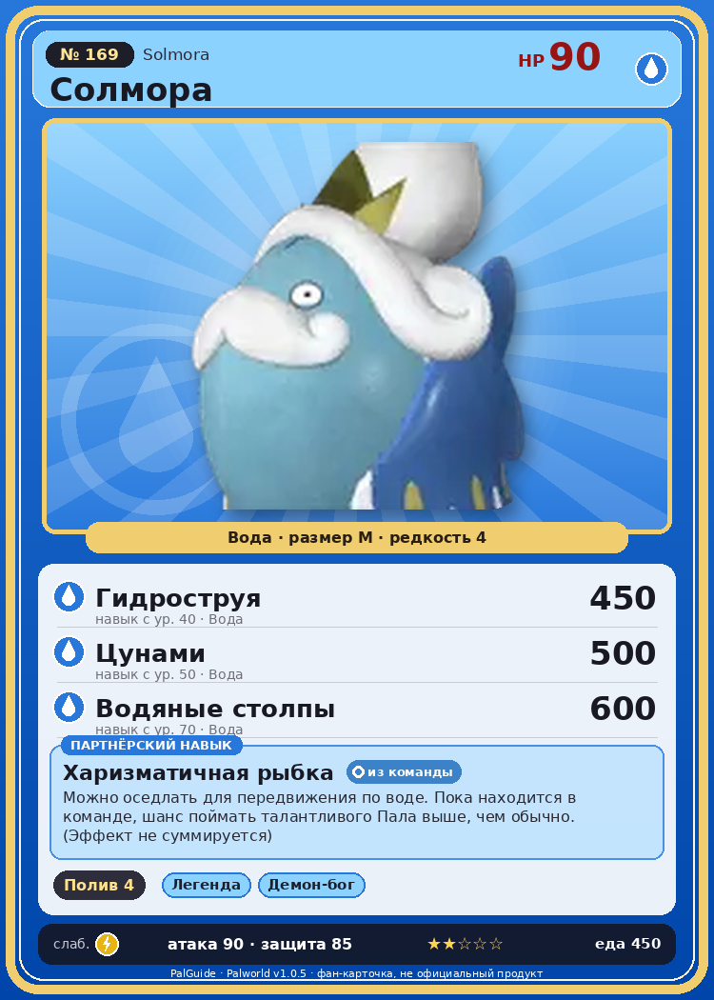

# #169 Солмора (Solmora)

{ width=360 }

| Поле | Значение |
|---|---|
| Стихия | Вода |
| Слабость (кто бьёт сильнее) | Молния |
| Редкость | 4 |
| Размер | M |
| HP / Атака / Защита (база вида) | 90 / 90 / 85 |
| Сколько ест | 450 |
| Цена продажи | 1636 |
| Множитель поимки | ×1 |
| Скорость рывка верхом | 900 |

## Работа на базе
- Полив — ур. 4

## Партнёрский навык: Харизматичная рыбка
Можно оседлать для передвижения по воде. Пока находится в команде, шанс поймать талантливого Пала выше, чем обычно. (Эффект не суммируется) Технологии 65 level value 1 KingSunfish_PartnerSkill 70 Пробуждение : 2 KingSunfish_PartnerSkill 72 SwimSpeed_up_PartnerSkill_1 10 Пробуждение : (Скорость передвижения по воде: +10% ) 3 KingSunfish_PartnerSkill 74 SwimSpeed_up_PartnerSkill_2 14 Пробуждение : (Скорость передвижения по воде: +14% ) 4 KingSunfish_PartnerSkill 76 SwimSpeed_up_PartnerSkill_3 18 Пробуждение : (Скорость передвижения по воде: +18% ) 5 KingSunfish_PartnerSkill 80 SwimSpeed_up_PartnerSkill_4 25 Пробуждение : (Скорость передвижения по воде: +25% )

## Атаки по уровням
- ур. 1: Пузырьковый выстрел (Вода, сила 80)
- ур. 7: Полоса брызг (Вода, сила 160)
- ур. 15: Гидроатака под давлением (Вода, сила 250)
- ур. 22: Водяная стена (Вода, сила 300)
- ур. 30: Гидрорезак (Вода, сила 350)
- ур. 40: Гидроструя (Вода, сила 450)
- ур. 50: Цунами (Вода, сила 500)
- ур. 70: Водяные столпы (Вода, сила 600)

## Где водится
- В дикой природе: да; точек появления днём: 109, ночью: 109
- Яйцо: Яйцо воды

## Дроп
- Качественное масло Пала — 2–3 шт., 100%
- Жидкость водного Пала — 2 шт., 100%

**Дроп альфы:**
- Деталь древней цивилизации — 3–4 шт., 100%
- Ценные внутренности — 2–3 шт., 100%

## Разведение
- Ранг разведения (CombiRank): 1370
- Участвует в особых парах: Слоуватт → Солмора Лакс

## Лучшие пассивки по роли
- боец: Легенда, Демон-бог, Хладнокровный, Бессмертие, Владыка морей (вместо Бессмертия, если нет мутации)
- рабочий: Дьявольские руки, Виртуоз, Мастеровитый, Небожитель/Трудоголик
- ездовой: Божественная скорость, Легенда, Вечный двигатель, Небесное скольжение

## Чем хорош / чем плох
- ✅ можно оседлать
- ❌ явных минусов нет

> Вращая винтообразный хвост, создаёт мощную движущую силу. По данным прошлых исследований, если не учитывать разрушение тела, теоретически может плавать со скоростью более 88 миль в час.

См. также: [Стихии](../../2_mehaniki/stihii.md) · [Разведение](../../2_mehaniki/razvedenie.md) · [Все палы](README.md)
_Источник: paldb.cc v1.0.5_
