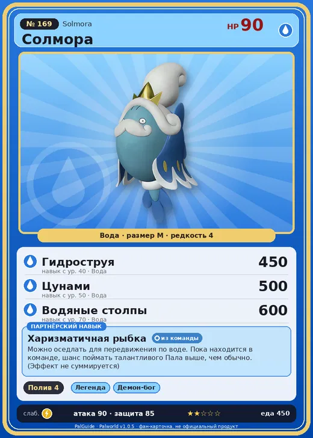

# Солмора

<canvas id="fx"></canvas>

№ 169 · Solmora

Вода

Слабость: Молния

💧 Полив <b>4</b>

<b>Харизматичная рыбка</b> 🎒 из команды 🐎 верхом

❤️ 90 · ⚔️ 90 · 🛡 85

| Поле | Значение |
|---|---|
| Стихия | Вода |
| Слабость (кто бьёт сильнее) | Молния |
| Редкость | 4 |
| Размер | M |
| HP / Атака / Защита (база вида) | 90 / 90 / 85 |
| Сколько ест | 450 |
| Цена продажи | 1636 |
| Множитель поимки | ×1 |
| Скорость рывка верхом | 900 |

=== "Обзор"

    #### Работа на базе
    - Полив — ур. 4

    #### Партнёрский навык: Харизматичная рыбка
    Можно оседлать для передвижения по воде. Пока находится в команде, шанс поймать талантливого Пала выше, чем обычно. (Эффект не суммируется) Технологии 65.

    #### Чем хорош / чем плох
    - ✅ можно оседлать
    - ❌ явных минусов нет

    > Вращая винтообразный хвост, создаёт мощную движущую силу. По данным прошлых исследований, если не учитывать разрушение тела, теоретически может плавать со скоростью более 88 миль в час.

    См. также: [Стихии](../../guide/06_stihii.md) · [Разведение](../../guide/07_razvedenie.md) · [Все палы](README.md)

=== "Атаки"

    #### Атаки по уровням
    - ур. 1: Пузырьковый выстрел (Вода, сила 80)
    - ур. 7: Полоса брызг (Вода, сила 160)
    - ур. 15: Гидроатака под давлением (Вода, сила 250)
    - ур. 22: Водяная стена (Вода, сила 300)
    - ур. 30: Гидрорезак (Вода, сила 350)
    - ур. 40: Гидроструя (Вода, сила 450)
    - ур. 50: Цунами (Вода, сила 500)
    - ур. 70: Водяные столпы (Вода, сила 600)

=== "Где живёт"

    #### Где водится
    - В дикой природе: да; точек появления днём: 109, ночью: 109
    - Яйцо: Яйцо воды

=== "Дроп"

    #### Дроп
    - Качественное масло Пала — 2–3 шт., 100%
    - Жидкость водного Пала — 2 шт., 100%

    **Дроп альфы:**
    - Деталь древней цивилизации — 3–4 шт., 100%
    - Ценные внутренности — 2–3 шт., 100%

=== "Разведение"

    #### Разведение
    - Ранг разведения (CombiRank): 1370
    - Участвует в особых парах: Слоуватт → Солмора Лакс

=== "Пассивки"

    #### Лучшие пассивки по роли

    

⚔️ Боец

максимум урона и живучести в бою

<a class="psv r-4" data-psv="Легенда" href="../../../passivki/legend/">Легенда</a><a class="psv r-4" data-psv="Демон-бог" href="../../../passivki/demon_god/">Демон-бог</a><a class="psv r-3" data-psv="Владыка морей" href="../../../passivki/lord_of_the_sea/">Владыка морей</a><a class="psv r-3" data-psv="Хладнокровный" href="../../../passivki/serenity/">Хладнокровный</a>

🛠 Рабочий

работает быстрее и меньше устаёт на базе

<a class="psv r-5" data-psv="Дьявольские руки" href="../../../passivki/demons_hand/">Дьявольские руки</a><a class="psv r-4" data-psv="Виртуоз" href="../../../passivki/remarkable_craftsmanship/">Виртуоз</a><a class="psv r-3" data-psv="Мастеровитый" href="../../../passivki/artisan/">Мастеровитый</a><a class="psv r-3" data-psv="Трудоголик" href="../../../passivki/workaholic/">Трудоголик</a>

🐎 Ездовой

быстрее бегает или летает с тобой верхом

<a class="psv r-4" data-psv="Божественная скорость" href="../../../passivki/swift/">Божественная скорость</a><a class="psv r-4" data-psv="Легенда" href="../../../passivki/legend/">Легенда</a><a class="psv r-4" data-psv="Вечный двигатель" href="../../../passivki/eternal_engine/">Вечный двигатель</a><a class="psv r-4" data-psv="Небесное скольжение" href="../../../passivki/sky_strider/">Небесное скольжение</a>

    <small>Нажми на пассивку, чтобы узнать, что она даёт и где её взять.</small>

<a class="card-link" href="../bakemi/">← Бакеми</a><a class="card-link" href="../solmora_lux/">Солмора Лакс →</a>

