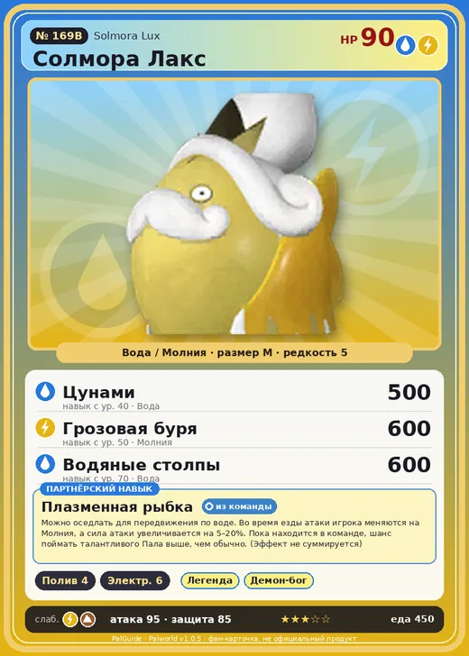

# #169B Солмора Лакс (Solmora Lux)

#169B · Solmora Lux

ВодаМолния

Слабость: ЗемляМолния

💧 Полив <b>4</b>⚡ Генерация энергии <b>6</b>

<b>Плазменная рыбка</b> 🎒 из команды 🐎 верхом

❤️ 90 · ⚔️ 95 · 🛡 85

| Поле | Значение |
|---|---|
| Стихия | Вода, Молния |
| Слабость (кто бьёт сильнее) | Земля, Молния |
| Редкость | 5 |
| Размер | M |
| HP / Атака / Защита (база вида) | 90 / 95 / 85 |
| Сколько ест | 450 |
| Цена продажи | 1843 |
| Множитель поимки | ×1 |
| Скорость рывка верхом | 900 |

## Работа на базе
- Полив — ур. 4
- Генерация энергии — ур. 6

## Партнёрский навык: Плазменная рыбка
Можно оседлать для передвижения по воде. Во время езды атаки игрока меняются на Молния , а сила атаки увеличивается на (5~20)% . Пока находится в команде, шанс поймать талантливого Пала выше, чем обычно. (Эффект не суммируется) Технологии 66 level value 1 GiveAElectricity_Ride 1 GiveElement_TrainerATK_UP_PartnerSkill_Ride 5 KingSunfish_Thunder_PartnerSkill 74 Пробуждение : 2 GiveAElectricity_Ride 1 GiveElement_TrainerATK_UP_PartnerSkill_Ride 7 KingSunfish_Thunder_PartnerSkill 76 SwimSpeed_up_PartnerSkill_1 10 Пробуждение : (Скорость передвижения по воде: +10% ) 3 GiveAElectricity_Ride 1 GiveElement_TrainerATK_UP_PartnerSkill_Ride 10 KingSunfish_Thunder_PartnerSkill 78 SwimSpeed_up_PartnerSkill_2 14 Пробуждение : (Скорость передвижения по воде: +14% ) 4 GiveAElectricity_Ride 1 GiveElement_TrainerATK_UP_PartnerSkill_Ride 14 KingSunfish_Thunder_PartnerSkill 80 SwimSpeed_up_PartnerSkill_3 18 Пробуждение : (Скорость передвижения по воде: +18% ) 5 GiveAElectricity_Ride 1 GiveElement_TrainerATK_UP_PartnerSkill_Ride 20 KingSunfish_Thunder_PartnerSkill 82 SwimSpeed_up_PartnerSkill_4 25 Пробуждение : (Скорость передвижения по воде: +25% )

## Атаки по уровням
- ур. 1: Водяной выстрел (Вода, сила 50)
- ур. 7: Шоковая волна (Молния, сила 80)
- ур. 15: Гидроатака под давлением (Вода, сила 250)
- ур. 22: Тройной разряд (Молния, сила 250)
- ур. 30: Грозовой дождь (Молния, сила 400)
- ур. 40: Цунами (Вода, сила 500)
- ур. 50: Грозовая буря (Молния, сила 600)
- ур. 70: Водяные столпы (Вода, сила 600)

## Где водится
- В дикой природе: да; точек появления днём: 91, ночью: 91
- Яйцо: Большое яйцо воды

## Дроп
- Качественное масло Пала — 2–3 шт., 100%
- Электрический орган — 2 шт., 100%

**Дроп альфы:**
- Деталь древней цивилизации — 3–4 шт., 100%
- Ценные внутренности — 2–3 шт., 100%

## Разведение
- Ранг разведения (CombiRank): 1000
- **Особая пара:** [Солмора](../../4_spravochniki/paly/solmora.md) + [Слоуватт](../../4_spravochniki/paly/slowatt.md)

## Лучшие пассивки по роли
- боец: Легенда, Демон-бог, Хладнокровный, Бессмертие, Владыка морей (вместо Бессмертия, если нет мутации)
- рабочий: Дьявольские руки, Виртуоз, Мастеровитый, Небожитель/Трудоголик
- ездовой: Божественная скорость, Легенда, Вечный двигатель, Небесное скольжение

## Чем хорош / чем плох
- ✅ отличный рабочий (пригодность 6); можно оседлать
- ❌ разводится только особой парой

> Вращение винтообразного хвоста позволяет ему вырабатывать электричество. Теоретически способен производить до 1,21 гигаватта энергии, однако мгновенное разрушение тела делает это свойство непрактичным.

См. также: [Стихии](../../2_mehaniki/stihii.md) · [Разведение](../../2_mehaniki/razvedenie.md) · [Все палы](README.md)
_Источник: paldb.cc v1.0.5_
