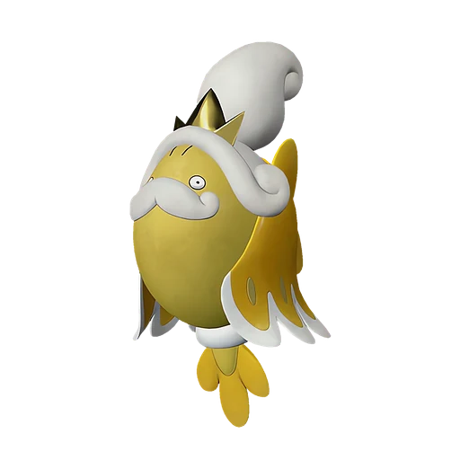

# Солмора Лакс

<canvas id="fx"></canvas>

№ 169B

ВодаМолния

Слабость: Молния <b class="mx">×1,5</b>Земля <b class="mx">×1,5</b> <button class="hlp" data-tip="Множители перемножаются по обеим стихиям: ×1,5 за стихию, которую атака бьёт, ×0,65 за ту, что её держит. Молния: 1,5 × 1 = ×1,5; Земля: 1 × 1,5 = ×1,5.">?</button>

Устойчив: Огонь <b class="mx">×0,65</b>Вода <b class="mx">×0,65</b>

💧 Полив <b>4</b>⚡ Генерация энергии <b>6</b>

<b>Плазменная рыбка</b> 🎒 Работает из команды🐎 Верхом

❤️ 90 · ⚔️ 95 · 🛡 85

Основное

💎Редкость <button class="hlp" data-tip="Чем выше число, тем реже встречается пал. 1–4 — обычные, 5–7 — редкие, 8+ — легендарные.">?</button><b>5</b>

📏Размер<b>M</b>

💰Цена продажи <button class="hlp" data-tip="Сколько золота даст торговец за пала.">?</button><b>1843</b>

Бой

🎯Множитель поимки <button class="hlp" data-tip="Насколько легче или труднее поймать: ×1 — обычно, меньше — сложнее.">?</button><b>×1</b>

🐎Скорость рывка верхом <button class="hlp" data-tip="Скорость, если сесть на пала и бежать рывком.">?</button><b>900</b>

Ферма и еда

🍖Сколько ест <button class="hlp" data-tip="Сколько сытости пал тратит — чем больше, тем больше еды нужно на базе.">?</button><b>450</b>

Разведение

🧬Сила разведения <button class="hlp" data-tip="Скрытое число игры: у детёныша оно примерно среднее от родителей. Чем меньше — тем «сильнее» пал.">?</button><b>1000</b>

💞Особая пара <button class="hlp" data-tip="Этого пала можно вывести только от этой пары.">?</button><b>Солмора + Слоуватт</b>

=== "Обзор"

    #### Работа на базе

    
<a class="wbar" href="../../../2_mehaniki/rabota/?w=watering&lv=4">💧 Полив<i style="--v:40%"></i><b>4</b></a><a class="wbar" href="../../../2_mehaniki/rabota/?w=electricity&lv=6">⚡ Генерация энергии<i style="--v:60%"></i><b>6</b></a><a class="wb-more" href="../../../2_mehaniki/rabota/">Что значат уровни работы →</a>

    #### Партнёрский навык: Плазменная рыбка
    Можно оседлать для передвижения по воде. Во время езды атаки игрока меняются на Молния, а сила атаки увеличивается на 5–20%. Пока находится в команде, шанс поймать талантливого Пала выше, чем обычно. (Эффект не суммируется) Технологии 66.

    #### Чем хорош / чем плох
    - ✅ отличный рабочий (пригодность 6); можно оседлать
    - ❌ разводится только особой парой

    > Вращение винтообразного хвоста позволяет ему вырабатывать электричество. Теоретически способен производить до 1,21 гигаватта энергии, однако мгновенное разрушение тела делает это свойство непрактичным.

    См. также: [Стихии](../../guide/06_stihii.md) · [Разведение](../../guide/07_razvedenie.md) · [Все палы](README.md)

=== "Атаки"

    #### Атаки по уровням
    - ур. 1: Водяной выстрел (Вода, сила 50)
    - ур. 7: Шоковая волна (Молния, сила 80)
    - ур. 15: Гидроатака под давлением (Вода, сила 250)
    - ур. 22: Тройной разряд (Молния, сила 250)
    - ур. 30: Грозовой дождь (Молния, сила 400)
    - ур. 40: Цунами (Вода, сила 500)
    - ур. 50: Грозовая буря (Молния, сила 600)
    - ур. 70: Водяные столпы (Вода, сила 600)

=== "Где живёт"

    #### Где водится

    

<button data-k="d" class="on">☀️ День</button><button data-k="n">🌙 Ночь</button>

<button data-w=p class=on>Палпагос</button><button data-w=t>Мировое древо</button>

ур. 76–76<a class="btn hm-full" href="../../../map/?pal=">Показать на большой карте</a>

Солнечный предел

🥚 Яйцо<b>Большое яйцо воды</b>

=== "Дроп"

    #### Дроп
    - Качественное масло Пала — 2–3 шт., 100%
    - Электрический орган — 2 шт., 100%

    **Дроп альфы:**
    - Деталь древней цивилизации — 3–4 шт., 100%
    - Ценные внутренности — 2–3 шт., 100%

=== "Разведение"

    #### Разведение
    - Ранг разведения: 1000
    - **Особая пара:** [Солмора](../../4_spravochniki/paly/solmora.md) + [Слоуватт](../../4_spravochniki/paly/slowatt.md)

=== "Пассивки"

    #### Лучшие пассивки по роли

    

⚔️ Боец

максимум урона и живучести в бою

<a class="psv r-4" data-psv="Легенда" href="../../../passivki/legend/">Легенда</a><a class="psv r-4" data-psv="Демон-бог" href="../../../passivki/demon_god/">Демон-бог</a><a class="psv r-3" data-psv="Владыка морей" href="../../../passivki/lord_of_the_sea/">Владыка морей</a><a class="psv r-3" data-psv="Хладнокровный" href="../../../passivki/serenity/">Хладнокровный</a>

🛠 Рабочий

работает быстрее и меньше устаёт на базе

<a class="psv r-5" data-psv="Дьявольские руки" href="../../../passivki/demons_hand/">Дьявольские руки</a><a class="psv r-4" data-psv="Виртуоз" href="../../../passivki/remarkable_craftsmanship/">Виртуоз</a><a class="psv r-3" data-psv="Мастеровитый" href="../../../passivki/artisan/">Мастеровитый</a><a class="psv r-3" data-psv="Трудоголик" href="../../../passivki/workaholic/">Трудоголик</a>

🐎 Ездовой

быстрее бегает или летает с тобой верхом

<a class="psv r-4" data-psv="Божественная скорость" href="../../../passivki/swift/">Божественная скорость</a><a class="psv r-4" data-psv="Легенда" href="../../../passivki/legend/">Легенда</a><a class="psv r-4" data-psv="Вечный двигатель" href="../../../passivki/eternal_engine/">Вечный двигатель</a><a class="psv r-4" data-psv="Небесное скольжение" href="../../../passivki/sky_strider/">Небесное скольжение</a>

    <small>Нажми на пассивку, чтобы узнать, что она даёт и где её взять.</small>

<a class="card-link" href="../solmora/">← Солмора</a><a class="card-link" href="../lapure/">Немофи →</a>

