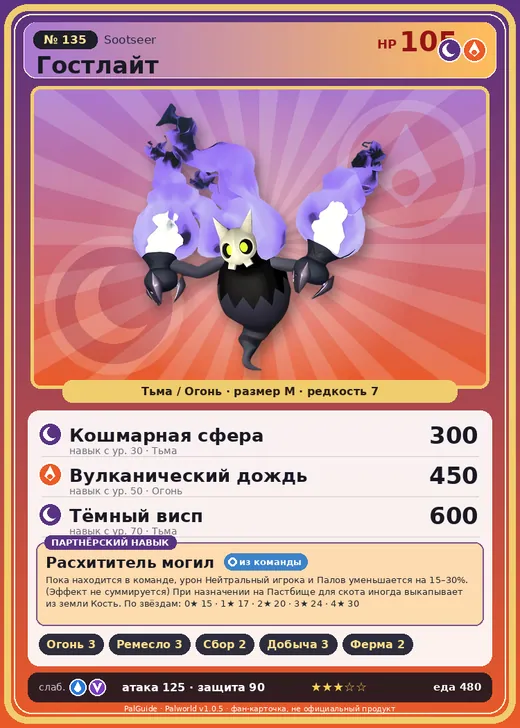

# Гостлайт

<canvas id="fx"></canvas>

№ 135 · Sootseer

ТьмаОгонь

Слабость: ВодаДракон

🔥 Разжигание огня <b>3</b>🖐️ Ручная работа <b>3</b>🌾 Сбор <b>2</b>⛏️ Добыча <b>3</b>🐑 Фермерство <b>2</b>

<b>Расхититель могил</b> 🎒 из команды 🏠 на базе

❤️ 105 · ⚔️ 125 · 🛡 90

Основное

💎Редкость <button class="hlp" data-tip="Чем выше число, тем реже встречается пал. 1–4 — обычные, 5–7 — редкие, 8+ — легендарные.">?</button><b>7</b>

📏Размер<b>M</b>

💰Цена продажи <button class="hlp" data-tip="Сколько золота даст торговец за пала.">?</button><b>2041</b>

Бой

🎯Множитель поимки <button class="hlp" data-tip="Насколько легче или труднее поймать: ×1 — обычно, меньше — сложнее.">?</button><b>×1</b>

🐎Скорость рывка верхом <button class="hlp" data-tip="Скорость, если сесть на пала и бежать рывком.">?</button><b>1000</b>

Ферма и еда

🍖Сколько ест <button class="hlp" data-tip="Сколько сытости пал тратит — чем больше, тем больше еды нужно на базе.">?</button><b>480</b>

Разведение

🧬Сила разведения <button class="hlp" data-tip="Скрытое число игры: у детёныша оно примерно среднее от родителей. Чем меньше — тем «сильнее» пал.">?</button><b>980</b>

=== "Обзор"

    #### Работа на базе
    - Разжигание огня — ур. 3
    - Ручная работа — ур. 3
    - Сбор — ур. 2
    - Добыча — ур. 3
    - Фермерство — ур. 2

    #### Партнёрский навык: Расхититель могил
    Пока находится в команде, урон Нейтральный игрока и Палов уменьшается на 15–30%. (Эффект не суммируется) При назначении на Пастбище для скота иногда выкапывает из земли Кость. По звёздам: 0★ 15 · 1★ 17 · 2★ 20 · 3★ 24 · 4★ 30

    #### Чем хорош / чем плох
    - ✅ очень высокая атака (125)
    - ❌ явных минусов нет

    > Раньше верили, что по мере приближения конца света пламя слабеет. Каждый раз, когда оно заметно угасало, сторонники апокалипсиса поднимали панику. Но в конце концов оказалось, что это всего лишь выходки Гостлайт . По крайней мере, пока что.

    См. также: [Стихии](../../guide/06_stihii.md) · [Разведение](../../guide/07_razvedenie.md) · [Все палы](README.md)

=== "Атаки"

    #### Атаки по уровням
    - ур. 1: Огненный выстрел (Огонь, сила 40)
    - ур. 7: Тёмный шар (Тьма, сила 50)
    - ур. 15: Расщеплённый огонь (Огонь, сила 80)
    - ур. 22: Духовное пламя (Тьма, сила 200)
    - ур. 30: Кошмарная сфера (Тьма, сила 300)
    - ур. 40: Огненная воронка (Огонь, сила 300)
    - ур. 50: Вулканический дождь (Огонь, сила 450)
    - ур. 70: Тёмный висп (Тьма, сила 600)

=== "Где живёт"

    #### Где водится
    - В дикой природе: да; точек появления днём: 10, ночью: 680; уровни в первых точках: 45–48
    - Подземелья: Пещера Цветущей Сакуры
    - Яйцо: Большое яйцо тьмы

=== "Дроп"

    #### Дроп
    - Средняя душа Пала — 1–2 шт., 100%
    - Кость — 1–2 шт., 100%
    - Сырая нефть — 1 шт., 50%

    **Дроп альфы:**
    - Деталь древней цивилизации — 2–3 шт., 100%
    - Ценные внутренности — 2–3 шт., 100%

=== "Разведение"

    #### Разведение
    - Ранг разведения (CombiRank): 980
    - Участвует в особых парах: Буси → Буси Нокт; Ганглер → Ганглер Игнис; Дуалит → Дуалит Нокт

=== "Пассивки"

    #### Лучшие пассивки по роли

    

⚔️ Боец

максимум урона и живучести в бою

<a class="psv r-4" data-psv="Легенда" href="../../../passivki/legend/">Легенда</a><a class="psv r-4" data-psv="Демон-бог" href="../../../passivki/demon_god/">Демон-бог</a><a class="psv r-3" data-psv="Король тьмы" href="../../../passivki/lord_of_the_underworld/">Король тьмы</a><a class="psv r-3" data-psv="Хладнокровный" href="../../../passivki/serenity/">Хладнокровный</a>

🛠 Рабочий

работает быстрее и меньше устаёт на базе

<a class="psv r-5" data-psv="Дьявольские руки" href="../../../passivki/demons_hand/">Дьявольские руки</a><a class="psv r-4" data-psv="Виртуоз" href="../../../passivki/remarkable_craftsmanship/">Виртуоз</a><a class="psv r-3" data-psv="Мастеровитый" href="../../../passivki/artisan/">Мастеровитый</a><a class="psv r-3" data-psv="Трудоголик" href="../../../passivki/workaholic/">Трудоголик</a>

    <small>Нажми на пассивку, чтобы узнать, что она даёт и где её взять.</small>

<a class="card-link" href="../wumpo_botan/">← Вумпо Ботан</a><a class="card-link" href="../carnibora/">Карнибора →</a>

