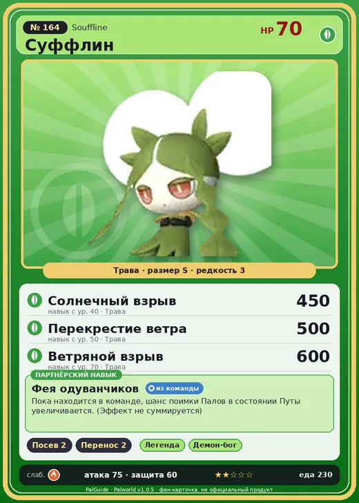

# #164 Суффлин (Souffline)

№ 164

Трава

Слабость: Огонь

🌱 Посев семян <b>2</b>📦 Транспортировка <b>2</b>

<b>Фея одуванчиков</b> 🎒 из команды

❤️ 70 · ⚔️ 75 · 🛡 60

| Поле | Значение |
|---|---|
| Стихия | Трава |
| Слабость (кто бьёт сильнее) | Огонь |
| Редкость | 3 |
| Размер | S |
| HP / Атака / Защита (база вида) | 70 / 75 / 60 |
| Сколько ест | 230 |
| Цена продажи | 1610 |
| Множитель поимки | ×1 |
| Скорость рывка верхом | 450 |

=== "Обзор"

    #### Работа на базе
    - Посев семян — ур. 2
    - Транспортировка — ур. 2

    #### Партнёрский навык: Фея одуванчиков
    Пока находится в команде, шанс поимки Палов в состоянии Путы увеличивается. (Эффект не суммируется) level value 1 CaptureLevelUpIfTarget_IvyCling_PartnerSkill_DandelionGirl 1 Пробуждение : 2 CaptureLevelUpIfTarget_IvyCling_PartnerSkill_DandelionGirl 2 Пробуждение : (Повышение шанса поимки: Небольшое ) 3 CaptureLevelUpIfTarget_IvyCling_PartnerSkill_DandelionGirl 3 Пробуждение : (Повышение шанса поимки: Среднее ) 4 CaptureLevelUpIfTarget_IvyCling_PartnerSkill_DandelionGirl 4 Пробуждение : (Повышение шанса поимки: Большое ) 5 CaptureLevelUpIfTarget_IvyCling_PartnerSkill_DandelionGirl 5 Пробуждение : (Повышение шанса поимки: Очень большое )

    #### Чем хорош / чем плох
    - ✅ можно оседлать
    - ❌ слабая атака (75)

    > Внутрь пуха можно набить неприятные воспоминания. Стоит ветру унести его прочь, и тёмному настроению можно сказать прощай.

    См. также: [Стихии](../../guide/06_stihii.md) · [Разведение](../../guide/07_razvedenie.md) · [Все палы](README.md)

=== "Атаки"

    #### Атаки по уровням
    - ур. 1: Ветряной клинок (Трава, сила 40)
    - ур. 7: Семенной пулемёт (Трава, сила 80)
    - ур. 15: Семенная мина (Трава, сила 120)
    - ур. 22: Травяной торнадо (Трава, сила 200)
    - ур. 30: Отражающий лист (Трава, сила 400)
    - ур. 40: Солнечный взрыв (Трава, сила 450)
    - ур. 50: Перекрестие ветра (Трава, сила 500)
    - ур. 70: Ветряной взрыв (Трава, сила 600)

=== "Где живёт"

    #### Где водится
    - В дикой природе: да; точек появления днём: 53, ночью: 53
    - Яйцо: Яйцо свежей листвы

=== "Дроп"

    #### Дроп
    - Семена пшеницы — 1–2 шт., 100%

    **Дроп альфы:**
    - Деталь древней цивилизации — 1–2 шт., 100%
    - Ценные внутренности — 2–3 шт., 100%

=== "Разведение"

    #### Разведение
    - Ранг разведения (CombiRank): 2000

=== "Пассивки"

    #### Лучшие пассивки по роли
    - боец: Легенда, Демон-бог, Хладнокровный, Бессмертие, Король духов (вместо Бессмертия, если нет мутации)
    - ездовой: Божественная скорость, Легенда, Вечный двигатель, Небесное скольжение

<a class="card-link" href="../snock_terra/">← Снок Терра</a><a class="card-link" href="../lapiron/">Лапирон →</a>

