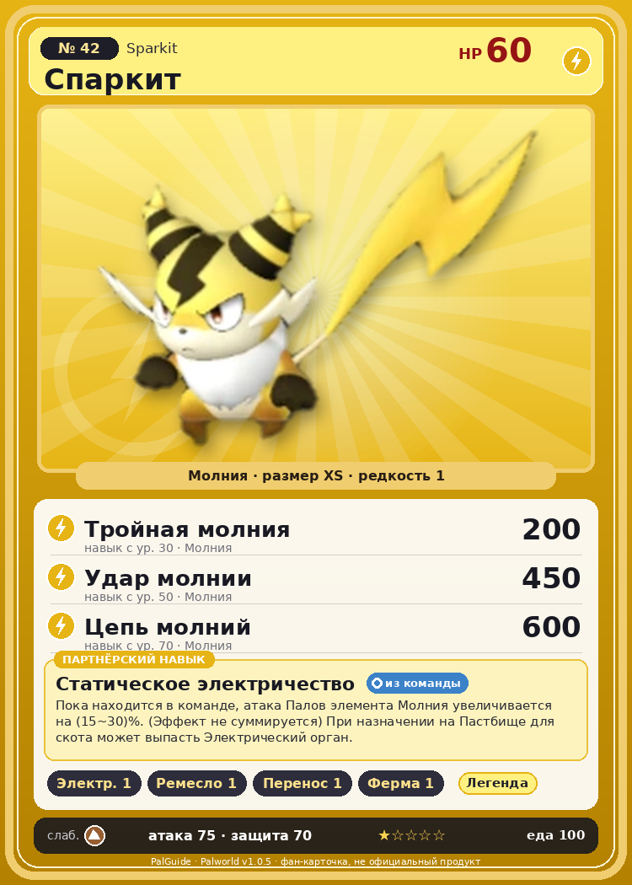

# #42 Спаркит (Sparkit)

{ width=360 }

| Поле | Значение |
|---|---|
| Стихия | Молния |
| Слабость (кто бьёт сильнее) | Земля |
| Редкость | 1 |
| Размер | XS |
| HP / Атака / Защита (база вида) | 60 / 75 / 70 |
| Сколько ест | 100 |
| Цена продажи | 410 |
| Множитель поимки | ×1.1 |
| Скорость рывка верхом | 500 |

## Работа на базе
- Генерация энергии — ур. 1
- Ручная работа — ур. 1
- Транспортировка — ур. 1
- Фермерство — ур. 1

## Партнёрский навык: Статическое электричество
Пока находится в команде, атака Палов элемента Молния увеличивается на (15~30)% . (Эффект не суммируется) При назначении на Пастбище для скота может выпасть Электрический орган . level value 1 AttackUp_Electricity_PartnerSkill 15 2 AttackUp_Electricity_PartnerSkill 17 3 AttackUp_Electricity_PartnerSkill 20 4 AttackUp_Electricity_PartnerSkill 24 5 AttackUp_Electricity_PartnerSkill 30

## Атаки по уровням
- ур. 1: Искровой выстрел (Молния, сила 50)
- ур. 7: Грязевой выстрел (Земля, сила 40)
- ур. 15: Шоковая волна (Молния, сила 80)
- ур. 22: Шаровая молния (Молния, сила 100)
- ур. 30: Тройная молния (Молния, сила 200)
- ур. 40: Грозовая линия (Молния, сила 160)
- ур. 50: Удар молнии (Молния, сила 450)
- ур. 70: Цепь молний (Молния, сила 600)

## Где водится
- В дикой природе: да; точек появления днём: 47, ночью: 47
- Яйцо: Яйцо молнии

## Дроп
- Электрический орган — 1–2 шт., 100%

**Дроп альфы:**
- Деталь древней цивилизации — 1–2 шт., 100%
- Ценный коготь — 1–2 шт., 100%

## Разведение
- Ранг разведения (CombiRank): 3010
- Участвует в особых парах: Пенгуллет → Пенгуллет Лакс; Релаксаурус → Релаксаурус Лакс

## Лучшие пассивки по роли
- боец: Легенда, Демон-бог, Хладнокровный, Бессмертие, Император молнии (вместо Бессмертия, если нет мутации)
- ездовой: Божественная скорость, Легенда, Вечный двигатель, Небесное скольжение

## Чем хорош / чем плох
- ✅ можно оседлать
- ❌ слабая атака (75); мало здоровья (60)

> В сезон засухи он становится раздражительным и всё время на взводе. Даже малейшее провоцирование может привести к большой драке, даже среди сородичей.

См. также: [Стихии](../../2_mehaniki/stihii.md) · [Разведение](../../2_mehaniki/razvedenie.md) · [Все палы](README.md)
_Источник: paldb.cc v1.0.5_
