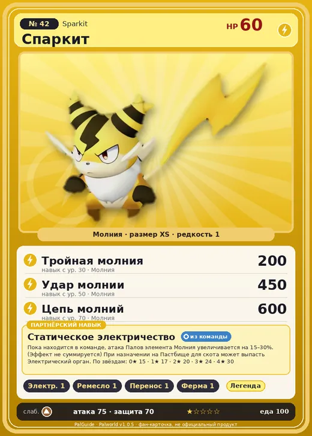

# Спаркит

<canvas id="fx"></canvas>

№ 42 · Sparkit

Молния

Слабость: Земля

⚡ Генерация энергии <b>1</b>🖐️ Ручная работа <b>1</b>📦 Транспортировка <b>1</b>🐑 Фермерство <b>1</b>

<b>Статическое электричество</b> 🎒 из команды 🏠 на базе

❤️ 60 · ⚔️ 75 · 🛡 70

| Поле | Значение |
|---|---|
| Стихия | Молния |
| Слабость (кто бьёт сильнее) | Земля |
| Редкость | 1 |
| Размер | XS |
| HP / Атака / Защита (база вида) | 60 / 75 / 70 |
| Сколько ест | 100 |
| Цена продажи | 410 |
| Множитель поимки | ×1.1 |
| Скорость рывка верхом | 500 |

=== "Обзор"

    #### Работа на базе
    - Генерация энергии — ур. 1
    - Ручная работа — ур. 1
    - Транспортировка — ур. 1
    - Фермерство — ур. 1

    #### Партнёрский навык: Статическое электричество
    Пока находится в команде, атака Палов элемента Молния увеличивается на 15–30%. (Эффект не суммируется) При назначении на Пастбище для скота может выпасть Электрический орган. По звёздам: 0★ 15 · 1★ 17 · 2★ 20 · 3★ 24 · 4★ 30

    #### Чем хорош / чем плох
    - ✅
    - ❌ слабая атака (75); мало здоровья (60)

    > В сезон засухи он становится раздражительным и всё время на взводе. Даже малейшее провоцирование может привести к большой драке, даже среди сородичей.

    См. также: [Стихии](../../guide/06_stihii.md) · [Разведение](../../guide/07_razvedenie.md) · [Все палы](README.md)

=== "Атаки"

    #### Атаки по уровням
    - ур. 1: Искровой выстрел (Молния, сила 50)
    - ур. 7: Грязевой выстрел (Земля, сила 40)
    - ур. 15: Шоковая волна (Молния, сила 80)
    - ур. 22: Шаровая молния (Молния, сила 100)
    - ур. 30: Тройная молния (Молния, сила 200)
    - ур. 40: Грозовая линия (Молния, сила 160)
    - ур. 50: Удар молнии (Молния, сила 450)
    - ур. 70: Цепь молний (Молния, сила 600)

=== "Где живёт"

    #### Где водится
    - В дикой природе: да; точек появления днём: 47, ночью: 47
    - Яйцо: Яйцо молнии

=== "Дроп"

    #### Дроп
    - Электрический орган — 1–2 шт., 100%

    **Дроп альфы:**
    - Деталь древней цивилизации — 1–2 шт., 100%
    - Ценный коготь — 1–2 шт., 100%

=== "Разведение"

    #### Разведение
    - Ранг разведения (CombiRank): 3010
    - Участвует в особых парах: Пенгуллет → Пенгуллет Лакс; Релаксаурус → Релаксаурус Лакс

=== "Пассивки"

    #### Лучшие пассивки по роли

    

⚔️ Боец

максимум урона и живучести в бою

<a class="psv r-4" data-psv="Легенда" href="../../../passivki/legend/">Легенда</a><a class="psv r-4" data-psv="Демон-бог" href="../../../passivki/demon_god/">Демон-бог</a><a class="psv r-3" data-psv="Император молнии" href="../../../passivki/lord_of_lightning/">Император молнии</a><a class="psv r-3" data-psv="Хладнокровный" href="../../../passivki/serenity/">Хладнокровный</a>

    <small>Нажми на пассивку, чтобы узнать, что она даёт и где её взять.</small>

<a class="card-link" href="../azurobe_cryst/">← Азуроб Крист</a><a class="card-link" href="../kelpsea/">Келпси →</a>

