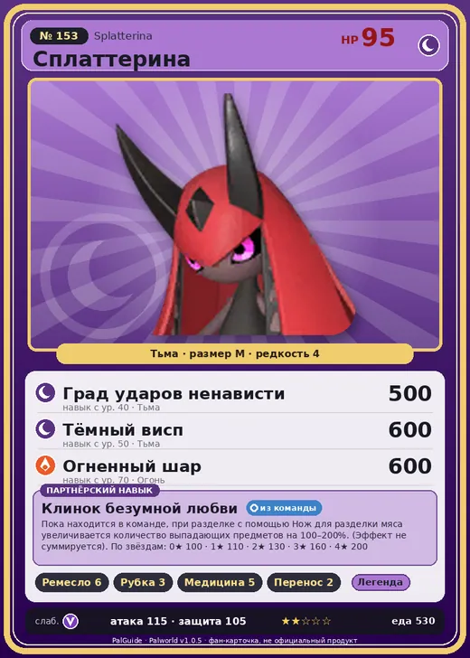

# #153 Сплаттерина (Splatterina)

#153 · Splatterina

Тьма

Слабость: Дракон

🖐️ Ручная работа <b>6</b>🪓 Рубка деревьев <b>3</b>💊 Фармацевтика <b>5</b>📦 Транспортировка <b>2</b>

<b>Клинок безумной любви</b> 🎒 из команды

❤️ 95 · ⚔️ 115 · 🛡 105

| Поле | Значение |
|---|---|
| Стихия | Тьма |
| Слабость (кто бьёт сильнее) | Дракон |
| Редкость | 4 |
| Размер | M |
| HP / Атака / Защита (база вида) | 95 / 115 / 105 |
| Сколько ест | 530 |
| Цена продажи | 2484 |
| Множитель поимки | ×1 |
| Скорость рывка верхом | 660 |

## Работа на базе
- Ручная работа — ур. 6
- Рубка деревьев — ур. 3
- Фармацевтика — ур. 5
- Транспортировка — ур. 2

## Партнёрский навык: Клинок безумной любви
Пока находится в команде, при разделке с помощью Нож для разделки мяса увеличивается количество выпадающих предметов на (100~200)% . (Эффект не суммируется) level value 1 MeatCut_01 100 2 MeatCut_02 110 3 MeatCut_03 130 4 MeatCut_04 160 5 MeatCut_05 200

## Атаки по уровням
- ур. 1: Тёмный шар (Тьма, сила 50)
- ур. 7: Распространение тьмы (Тьма, сила 60)
- ур. 15: Тёмная пушка (Тьма, сила 70)
- ур. 22: Теневой взрыв (Тьма, сила 80)
- ур. 30: Кошмарная сфера (Тьма, сила 300)
- ур. 40: Град ударов ненависти (Тьма, сила 500)
- ур. 50: Тёмный висп (Тьма, сила 600)
- ур. 70: Огненный шар (Огонь, сила 600)

## Где водится
- В дикой природе: да; точек появления днём: 1, ночью: 793; уровни в первых точках: 56–59
- Подземелья: Пещера Тэнраку
- Яйцо: Яйцо тьмы

## Дроп
- Осколок тьмы — 2–3 шт., 100%

**Дроп альфы:**
- Деталь древней цивилизации — 7–8 шт., 100%
- Ценные внутренности — 2–3 шт., 100%

## Разведение
- Ранг разведения (CombiRank): 780

## Лучшие пассивки по роли
- боец: Легенда, Демон-бог, Хладнокровный, Бессмертие, Король тьмы (вместо Бессмертия, если нет мутации)
- рабочий: Дьявольские руки, Виртуоз, Мастеровитый, Небожитель/Трудоголик
- ездовой: Божественная скорость, Легенда, Вечный двигатель, Небесное скольжение

## Чем хорош / чем плох
- ✅ хорошая атака (115); отличный рабочий (пригодность 6); можно оседлать
- ❌ много ест (530)

> Инстинкты заставляют этого Пала рвать своих жертв на части. Каждая особь предпочитает свой порядок расчленения жертвы. Если тебя поймает Сплаттерина , остаётся только надеяться, что начнёт с головы.

См. также: [Стихии](../../2_mehaniki/stihii.md) · [Разведение](../../2_mehaniki/razvedenie.md) · [Все палы](README.md)
