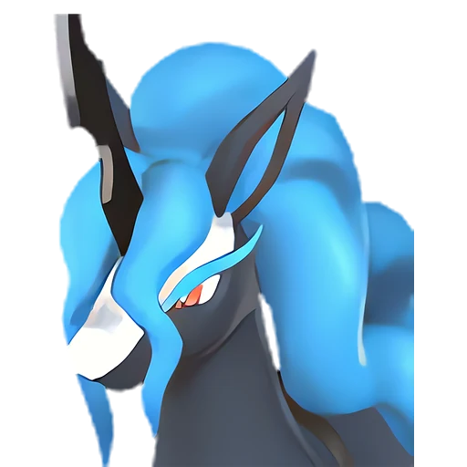

# Старрион

<canvas id="fx"></canvas>

№ 130 · Starryon

Тьма

Слабость: Дракон <b class="mx">×1,5</b> <button class="hlp" data-tip="Множители перемножаются по обеим стихиям пала: ×1,5 за каждую стихию, которую атака бьёт, ×0,65 за каждую, которая её держит. Если одна стихия слаба, а другая устойчива (×1,5 × 0,65 ≈ ×0,98), слабости нет.">?</button>

Устойчив: Нейтральный <b class="mx">×0,65</b>

🌾 Сбор <b>5</b>

<b>Ночной танцор</b> 🐾 выпущен 🐎 верхом

❤️ 110 · ⚔️ 100 · 🛡 100

Основное

💎Редкость <button class="hlp" data-tip="Чем выше число, тем реже встречается пал. 1–4 — обычные, 5–7 — редкие, 8+ — легендарные.">?</button><b>7</b>

📏Размер<b>M</b>

💰Цена продажи <button class="hlp" data-tip="Сколько золота даст торговец за пала.">?</button><b>2014</b>

Бой

🎯Множитель поимки <button class="hlp" data-tip="Насколько легче или труднее поймать: ×1 — обычно, меньше — сложнее.">?</button><b>×1</b>

🐎Скорость рывка верхом <button class="hlp" data-tip="Скорость, если сесть на пала и бежать рывком.">?</button><b>1250</b>

Ферма и еда

🍖Сколько ест <button class="hlp" data-tip="Сколько сытости пал тратит — чем больше, тем больше еды нужно на базе.">?</button><b>440</b>

Разведение

🧬Сила разведения <button class="hlp" data-tip="Скрытое число игры: у детёныша оно примерно среднее от родителей. Чем меньше — тем «сильнее» пал.">?</button><b>1150</b>

=== "Обзор"

    #### Работа на базе
    - Сбор — ур. 5

    #### Партнёрский навык: Ночной танцор
    Можно оседлать для передвижения. Во время езды увеличивает силу прыжка. Ночью скорость передвижения этого Пала увеличивается на +50–100%. Технологии 57. По звёздам: 0★ 50 · 1★ 62 · 2★ 74 · 3★ 86 · 4★ 100

    #### Чем хорош / чем плох
    - ✅ хорошая атака (100); отличный рабочий (пригодность 5); можно оседлать
    - ❌ явных минусов нет

    > Безмерно гордится своей красивой, струящейся гривой. Стоит заметить секущийся волос — от стыда не может сосредоточиться на беге. От статического электричества шерсть портится, поэтому к Азурмейн лучше не приближаться.

    См. также: [Стихии](../../guide/06_stihii.md) · [Разведение](../../guide/07_razvedenie.md) · [Все палы](README.md)

=== "Атаки"

    #### Атаки по уровням
    - ур. 1: Грязевой выстрел (Земля, сила 40)
    - ур. 7: Тёмный шар (Тьма, сила 50)
    - ур. 15: Духовное пламя (Тьма, сила 200)
    - ур. 22: Кошмарная сфера (Тьма, сила 300)
    - ур. 30: Инферно (Огонь, сила 500)
    - ур. 40: Апокалипсис (Тьма, сила 400)
    - ур. 45: Рывок призрачного скакуна (Тьма, сила 450)
    - ур. 50: Летальный шаг (Тьма, сила 550)
    - ур. 70: Тёмный висп (Тьма, сила 600)

=== "Где живёт"

    #### Где водится

    

<button data-k="d" class="on">☀️ День</button><button data-k="n">🌙 Ночь</button>

<button data-w=p class=on>Палпагос</button><button data-w=t>Мировое древо</button>

ур. 50–80<a class="btn hm-full" href="../../../map/?pal=NightBlueHorse">Показать на большой карте</a>

Жёлтоземная равнинаВыжженный холмКристаллизованное древнее деревоТлеющее лавовое плато

🕳 Подземелье<b>Пещера Тэнраку</b>

🥚 Яйцо<b>Большое яйцо тьмы</b>

=== "Дроп"

    #### Дроп
    - Кожа — 2–3 шт., 100%
    - Осколок тьмы — 1–2 шт., 100%

    **Дроп альфы:**
    - Деталь древней цивилизации — 6–8 шт., 100%
    - Ценный мех — 2–3 шт., 100%

=== "Разведение"

    #### Разведение
    - Ранг разведения (CombiRank): 1150
    - Участвует в особых парах: Селесдир → Старрион Примо

=== "Пассивки"

    #### Лучшие пассивки по роли

    

⚔️ Боец

максимум урона и живучести в бою

<a class="psv r-4" data-psv="Легенда" href="../../../passivki/legend/">Легенда</a><a class="psv r-4" data-psv="Демон-бог" href="../../../passivki/demon_god/">Демон-бог</a><a class="psv r-3" data-psv="Король тьмы" href="../../../passivki/lord_of_the_underworld/">Король тьмы</a><a class="psv r-3" data-psv="Хладнокровный" href="../../../passivki/serenity/">Хладнокровный</a>

🛠 Рабочий

работает быстрее и меньше устаёт на базе

<a class="psv r-5" data-psv="Дьявольские руки" href="../../../passivki/demons_hand/">Дьявольские руки</a><a class="psv r-4" data-psv="Виртуоз" href="../../../passivki/remarkable_craftsmanship/">Виртуоз</a><a class="psv r-3" data-psv="Мастеровитый" href="../../../passivki/artisan/">Мастеровитый</a><a class="psv r-3" data-psv="Трудоголик" href="../../../passivki/workaholic/">Трудоголик</a>

🐎 Ездовой

быстрее бегает или летает с тобой верхом

<a class="psv r-4" data-psv="Божественная скорость" href="../../../passivki/swift/">Божественная скорость</a><a class="psv r-4" data-psv="Легенда" href="../../../passivki/legend/">Легенда</a><a class="psv r-4" data-psv="Вечный двигатель" href="../../../passivki/eternal_engine/">Вечный двигатель</a><a class="psv r-4" data-psv="Небесное скольжение" href="../../../passivki/sky_strider/">Небесное скольжение</a>

    <small>Нажми на пассивку, чтобы узнать, что она даёт и где её взять.</small>

<a class="card-link" href="../reptyro_cryst/">← Рептиро Крист</a><a class="card-link" href="../starryon_primo/">Старрион Примо →</a>

